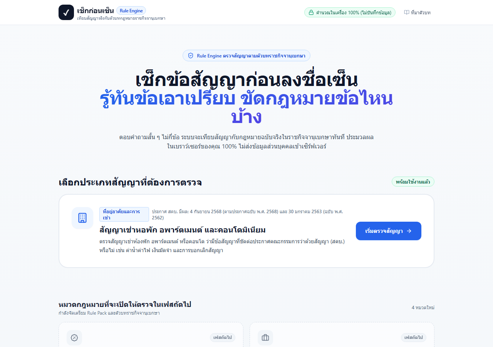
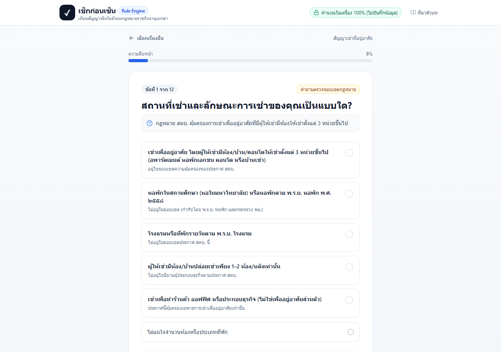
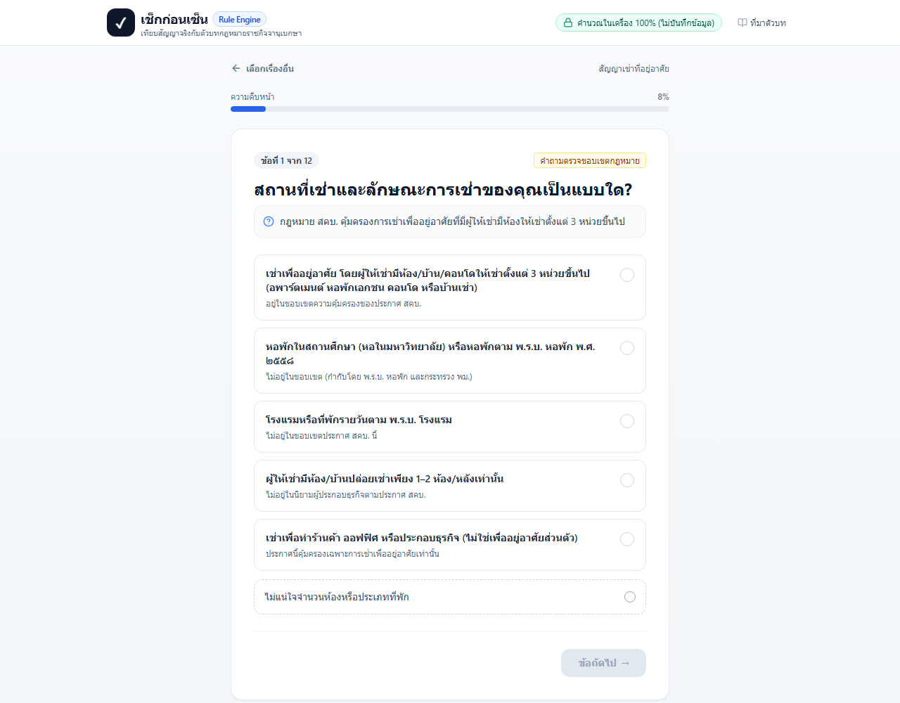
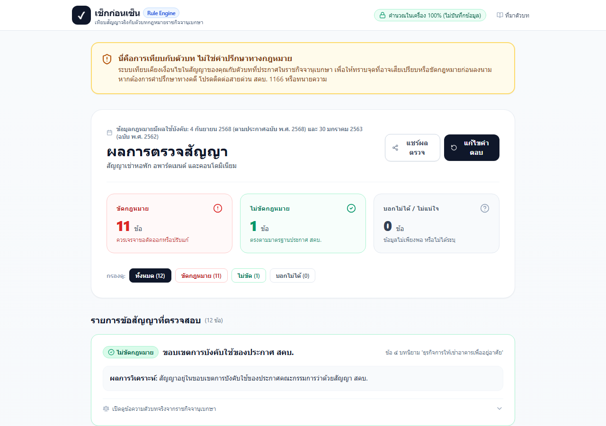
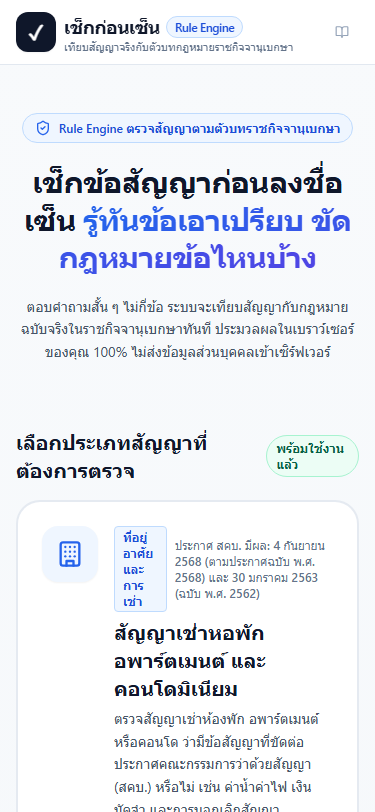
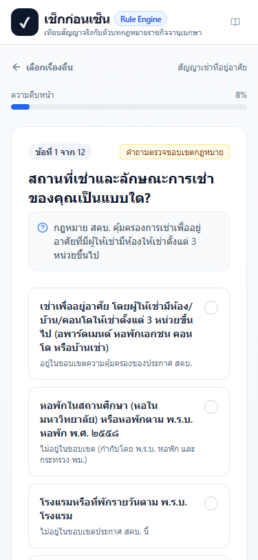
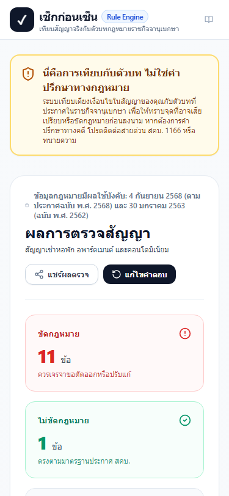

# เช็กก่อนเซ็น (Check Before Sign)

> **Civic Legal Rule Engine** สำหรับตรวจสอบข้อสัญญาและข้อตกลงตามตัวบทกฎหมายจริงจากราชกิจจานุเบกษา
> ตัดสินด้วยโค้ด TypeScript ที่พิสูจน์ได้ ไม่ใช้ AI ตัดสินความถูกผิด ประมวลผลในเบราว์เซอร์ 100% ไม่ส่งข้อมูลส่วนบุคคลเข้าเซิร์ฟเวอร์

---

## 1. ปัญหาที่โครงการนี้แก้ไข (The Problem We Solve)

ในชีวิตประจำวัน ผู้บริโภค ประชาชน และคนทำงานมักต้องลงนามในสัญญาต่าง ๆ เช่น **สัญญาเช่าหอพัก/อพาร์ตเมนต์, สัญญากู้ยืมเงิน, สัญญาจ้างแรงงาน, หรือสัญญาจะซื้อจะขายคอนโด** โดยไม่มีความรู้ทางกฎหมายเพียงพอ
บ่อยครั้งที่ผู้ประกอบธุรกิจหรือผู้ให้เช่าใส่ **"ข้อสัญญาที่ไม่เป็นธรรมหรือขัดต่อกฎหมาย"** ลงในสัญญา เช่น:
- บวกกำไรค่าไฟหน่วยละ 8–10 บาท ค่าน้ำหน่วยละ 20 บาท (เกินกว่าอัตราที่การไฟฟ้าและการประปาเรียกเก็บจริง)
- เรียกเก็บเงินประกันและค่าเช่าล่วงหน้ารวมกันเกินเพดานที่กฎหมายกำหนด
- ตั้งเงื่อนไขริบเงินประกันทั้งหมดตามอำเภอใจ แม้ไม่มีความเสียหายจริง
- ระบุให้สิทธิผู้ให้เช่าไขกุญแจเข้าห้องได้ตลอดเวลา หรือล็อกห้องตัดน้ำตัดไฟขับไล่ผู้เช่า

แม้ตามกฎหมาย (พระราชบัญญัติคุ้มครองผู้บริโภค พ.ศ. ๒๕๒๒) ข้อสัญญาที่ขัดต่อประกาศควบคุมสัญญาจะ **ตกเป็นโมฆะและไม่มีผลบังคับ** แต่ผู้เช่าส่วนใหญ่ไม่ทราบสิทธิ ทำให้ยอมจ่ายเงินเกินจริงหรือถูกเอารัดเอาเปรียบมาโดยตลอด

**"เช็กก่อนเซ็น"** ถูกสร้างขึ้นเพื่อเป็นเครื่องมือภาคพลเมืองที่ช่วยให้ทุกคนสามารถตรวจสัญญาได้เองใน 2 นาที โดย:
1. บอกชัดเจนว่าข้อไหน **"ขัดกฎหมาย"**, **"ไม่ขัดกฎหมาย"**, หรือ **"บอกไม่ได้"** (ข้อมูลไม่พอห้ามเดา)
2. อ้างอิงเลขข้อและตัวบทจริงจากราชกิจจานุเบกษาทุกครั้ง
3. ให้ **"ข้อความสุภาพสำหรับเจรจา"** ที่คัดลอกไปส่งให้คู่สัญญาปรับแก้ได้ทันที
4. ชี้เป้าช่องทางขอความช่วยเหลือและร้องเรียนของหน่วยงานภาครัฐที่ถูกต้อง

---

## 2. ภาพหน้าจอระบบ (Screenshots)

### 2.1 หน้าจอ Desktop (เดสก์ท็อป)
| หน้าแรก (Home & Pack Selection) | หน้าตรวจสัญญา (Questionnaire Form) |
| :---: | :---: |
|  |  |

| หน้าผลการตรวจสัญญา (Result View) | หน้าระงับการตรวจเมื่ออยู่นอกขอบเขต (Out of Scope) |
| :---: | :---: |
|  |  |

### 2.2 หน้าจอมือถือ Responsive (Mobile 375px)
| หน้าแรกมือถือ | ฟอร์มตอบคำถาม | หน้าผลตรวจบนมือถือ |
| :---: | :---: | :---: |
|  |  |  |

---

## 3. วิธีการติดตั้งและรันระบบ (How to Run)

### ความต้องการของระบบ (Prerequisites)
- Node.js version 18 หรือสูงกว่า (ทดสอบกับ Node.js v24.16.0)
- npm หรือ pnpm

### คำสั่งเริ่มต้นทำงาน
```bash
# 1. ติดตั้ง Dependencies
npm install

# 2. ตรวจสอบความถูกต้องของ Schema ทุก Pack
npm run validate-packs

# 3. รัน Unit Test ทั้งหมด (Vitest)
npm test

# 4. ตรวจสอบ Type ด้วย TypeScript Compiler
npm run typecheck

# 5. รันเซิร์ฟเวอร์สำหรับทดสอบในโหมดพัฒนา (Port 3020)
npm run dev

# 6. สร้าง Production Build
npm run build
```

เปิดเบราว์เซอร์ไปที่: `http://localhost:3020`

---

## 4. แหล่งที่มาของกฎหมายและหลักการพื้นฐาน (Legal Ground Truth)

ทุกกฎในระบบต้องมาจากตัวบทจริงจากแหล่งทางการของรัฐเท่านั้น ห้ามเชื่อโมเดล AI หรือความจำ:
- **ราชกิจจานุเบกษา (ratchakitcha.soc.go.th):**
  - *ประกาศคณะกรรมการว่าด้วยสัญญา เรื่อง ให้ธุรกิจการให้เช่าอาคารเพื่ออยู่อาศัยเป็นธุรกิจที่ควบคุมสัญญา พ.ศ. ๒๕๖๒* (เล่ม ๑๓๖ ตอนพิเศษ ๒๗๐ ง วันที่ ๓๑ ตุลาคม ๒๕๖๒)
  - *ประกาศคณะกรรมการว่าด้วยสัญญา เรื่อง ให้ธุรกิจการให้เช่าอาคารเพื่ออยู่อาศัยเป็นธุรกิจที่ควบคุมสัญญา พ.ศ. ๒๕๖๘* (เล่ม ๑๔๒ ตอนพิเศษ ๒๑๑ ง วันที่ ๖ มิถุนายน ๒๕๖๘)
- **สำนักงานคณะกรรมการคุ้มครองผู้บริโภค (สคบ.):** [www.ocpb.go.th](https://www.ocpb.go.th) / สายด่วน 1166

> **ข้อสงวนสิทธิ์:** นี่คือการเทียบกับตัวบท ไม่ใช่คำปรึกษาทางกฎหมาย

---

## 5. รายการ Rule Packs

| รหัส Pack | ชื่อหมวดสัญญา | สถานะ | ขอบเขต & กฎหมายที่ใช้ |
| :--- | :--- | :---: | :--- |
| `rental` | สัญญาเช่าหอพัก อพาร์ตเมนต์ และคอนโด | **พร้อมใช้งาน** | ประกาศ สคบ. ควบคุมสัญญาเช่าที่อยู่อาศัย (พ.ศ. ๒๕๖๒ และ ๒๕๖๘) |
| `loan-interest` | ดอกเบี้ยเงินกู้และสัญญากู้ยืม | *เฟสถัดไป* | พ.ร.บ. ห้ามเรียกดอกเบี้ยเกินอัตรา พ.ศ. ๒๕๖๐ (เพดาน 15% ต่อปี) และประกาศ ธปท. |
| `labor-rights` | สิทธิแรงงานและสัญญาจ้างงาน | *เฟสถัดไป* | พ.ร.บ. คุ้มครองแรงงาน พ.ศ. ๒๕๔๑ (ค่าชดเชย, OT, วันลา) |
| `flight-rights` | สิทธิผู้โดยสารสายการบิน | *เฟสถัดไป* | ประกาศกระทรวงคมนาคม เรื่องการคุ้มครองสิทธิผู้โดยสารกรณีเที่ยวบินล่าช้า/ยกเลิก |
| `condo-purchase` | สัญญาจะซื้อจะขายคอนโด | *เฟสถัดไป* | ประกาศ สคบ. สัญญามาตรฐานจะซื้อจะขายอาคารชุด |

---

## 6. แผนพัฒนาระยะถัดไป: เฟส AI ผู้ช่วยกรอกฟอร์ม (AI Assistance Phase)

ในเฟสถัดไป จะมีการเพิ่มระบบอำนวยความสะดวกด้วย AI ภายใต้ **สถาปัตยกรรมที่ปลอดภัยและควบคุมได้ (Human-in-the-Loop)**:

```
[ผู้ใช้อัปโหลด PDF หรือรูปถ่ายสัญญา]
             │
             ▼
[Claude / Multimodal AI Service]
(ทำหน้าที่ OCR & ดึงค่าตัวเลข/เงื่อนไขลงในฟอร์มเท่านั้น — ห้าม AI ตัดสินความถูกผิด)
             │
             ▼
[หน้าจอตรวจสอบ: ผู้ใช้ตรวจทานและแก้ไขตัวเลขได้ทุกช่อง]
             │
             ▼ (เมื่อผู้ใช้กดยืนยัน)
[Deterministic TypeScript Rule Engine]
(ตรวจเทียบกับตัวบทจริง และแสดงผล ขัด / ไม่ขัด / บอกไม่ได้)
```

### หลักการของเฟส AI:
1. **AI ทำหน้าที่เพียง Data Extraction ผู้ช่วยพิมพ์:** สแกนข้อความ ค้นหาตัวเลขค่าน้ำ ค่าไฟ เงินมัดจำ และเติมลงในช่องฟอร์มล่วงหน้า
2. **ผู้ใช้ต้องตรวจสอบและแก้ไขก่อนเสมอ:** หน้าจอจะแสดงข้อความต้นฉบับคู่กับช่องฟอร์มเพื่อให้ผู้ใช้ตรวจสอบความถูกต้องก่อนกดยืนยัน
3. **AI ไม่มีสิทธิตัดสินผลทางกฎหมาย:** การตัดสินความถูกผิดต้องผ่าน Deterministic TypeScript Engine ที่ผ่านการทดสอบ 100% เท่านั้น
4. **ความปลอดภัยของข้อมูล:** รูปภาพหรือไฟล์สัญญาต้องไม่ถูกนำไปใช้เทรนโมเดล และลบทิ้งทันทีหลังจากการดึงข้อมูลเสร็จสิ้น

