# รายงานที่ 2: engine จบการถามได้, อัปเกรด Next 16 / React 19 / zod 4, ตรวจหน้าเว็บจริง

- สาขา: `fix-rental-law` (ต่อจากรายงานที่ 1 commit `bbb3f15`) — **commit แล้ว ไม่ได้ push**
- วันที่ตรวจ: 9 พฤศจิกายน 2569 (2026-11-09) บน Windows 11, Node.js v24.16.0, npm 11.13.0, Chrome (headless ผ่าน puppeteer-core)
- output ดิบทั้งหมดอยู่ใน [หัวข้อ 8](#8-output-ดิบ)

## 1. สรุปผลรายข้อ

| ข้อ | งาน | ผล | commit |
| :-- | :-- | :-- | :-- |
| 1 | engine: คำตอบที่ "จบการถาม" กำหนดผ่าน pack.json | ✅ เสร็จ — rental ไปหน้าผลทันทีหลังข้อ 2 เมื่อสัญญาก่อน 4 ก.ย. 68, วันที่ 4 ก.ย. พอดี หรือไม่แน่ใจ | `538b4a0` |
| 2 | Next 16.4.5 + React 19.3.1 ด้วย codemod ทางการ, แก้ breaking | ✅ build ผ่าน, `params` เป็น Promise, pack ที่ไม่มีอยู่จริงได้ HTTP 404 | `50f0223` |
| 3 | zod 4.6.7 | ✅ test ของ schema เดิมผ่านทั้งหมดโดยไม่แก้ test, เพิ่ม test ตรึงพฤติกรรม | `682a354` |
| 4 | npm audit ทั้งหมด และ `--omit=dev` | ✅ **production: 0 รายการ** (เดิม 3: critical 1, high 2) / ทั้งหมด: เหลือ 6 รายการ ทุกตัวอยู่ใน devDependency `vitest@2.1.9` อธิบายรายข้อในหัวข้อ 5 | — |
| 5 | ตรวจหน้าเว็บจริง `npm run build && npm start` พร้อมภาพ 375px และเดสก์ท็อป | ✅ ทุกเส้นทางที่ขอผ่าน — มี 1 รายการที่ไม่ผ่านซึ่งไม่ได้ขอ: `/favicon.ico` 404 (มีมาก่อน ดูหัวข้อ 6) | commit รายงาน |
| 6 | รายงานนี้ | ✅ | commit รายงาน |

ตัวเลขยืนยัน: `validate-packs` ผ่าน (21 คำถาม, 18 กฎ, 26 เคส) · vitest **135/135** (รายงานที่ 1: 109) · `tsc --noEmit` exit 0 · `next build` exit 0

## 2. ข้อ 1 — คำตอบที่จบการถาม (`endsQuestionnaire`)

### การออกแบบ
ใช้กลไกแบบเดียวกับคำถามขอบเขต คือ **ธงบนตัวเลือกใน pack.json** (คำถามขอบเขตใช้ `isOutOfScope`; ความสามารถใหม่ใช้ `endsQuestionnaire`)

```json
"options": [{ "value": "before_effective", "endsQuestionnaire": { "reason": "ข้อความเต็ม (กรอบบนหน้าผล)", "ruleReason": "ข้อความสั้นในแต่ละกฎ" } }]
```
และ `unsureEndsQuestionnaire` ระดับคำถาม สำหรับคำตอบ "ไม่แน่ใจ" (`__unsure__`)

- **engine ไม่มีชื่อ pack หรือชื่อคำถามใด ๆ** — `getQuestionnaireEnd(question, answer)` / `findQuestionnaireEnd(pack, answers)` ใน `lib/engine/evaluator.ts` อ่านจากธงใน pack.json เท่านั้น
- `evaluatePack`: นอกขอบเขตมาก่อนเสมอ → ถ้ามีคำตอบจบการถาม ทุกกฎเป็น `undetermined` **โดยไม่เรียก evaluator ของกฎเลย** (มี test นับจำนวนครั้งที่ถูกเรียก = 0) → ผลมี `endedEarly { questionId, questionText, answerLabel, reason }`
- หน้าเว็บ: เมื่อเลือกคำตอบนั้น ปุ่มเปลี่ยนเป็น "ดูผลการตรวจสัญญา" กดแล้วไปหน้าผลทันที หน้าผลมีกรอบ "ระบบหยุดถามเพราะตรวจตามเกณฑ์นี้ไม่ได้" พร้อมคำถาม คำตอบ และเหตุผล
- schema: `reason` ห้ามว่าง, ตัวเลือกเดียวห้ามเป็นทั้ง `isOutOfScope` และ `endsQuestionnaire`, `unsureEndsQuestionnaire` ใช้ได้เฉพาะคำถามที่ `allowUnsure: true`

### rental pack
- `q_contract_date` (คำถามข้อ 2): `before_effective`, `boundary_day` และ "ไม่แน่ใจ" จบการถาม; `on_or_after_effective` ถามต่อ
- ข้อความ gate **ย้ายไปอยู่ใน pack.json ที่เดียว** — `applicabilityGate` ใน `rules.ts` อ่านจาก pack.json (ใช้ป้องกันซ้ำเมื่อเรียก evaluator โดยตรง) จึงไม่มีข้อความสองชุดที่อาจไม่ตรงกัน
- ข้อความสั้นต่อกฎตัดคำว่า "(ดูคำอธิบายที่ข้อแรก)" ออก เพราะตอนนี้คำอธิบายเต็มอยู่ในกรอบด้านบนแล้ว

### test ที่เพิ่ม
- `tests/engine.test.ts` (dummy pack เพิ่มคำถาม `q_dummy_version`): จบด้วยตัวเลือก, จบด้วย "ไม่แน่ใจ", `ruleReason` default เป็น `reason`, ไม่เรียก evaluator, ตัวเลือกปกติไม่จบ, นอกขอบเขตมาก่อน, ยังไม่ตอบ ≠ ไม่แน่ใจ, schema ปฏิเสธ 3 แบบ, เพดาน 25/26 คำถาม
- `tests/rental-rules.test.ts`: ข้อ 2 อยู่ถัดจากคำถามขอบเขต; ตอบแค่ 2 ข้อ (3 ค่า) → 18 บอกไม่ได้; ข้อความกรอบ/ต่อกฎตรงกับ gate; คำตอบข้อหลัง ๆ ที่ "ขัด" ถูกละเลย; นอกขอบเขตชนะ; ค่าแปลกปลอม → ข้อความ "ไม่ทราบวันที่"
- `packs/rental/cases.json`: เพิ่ม `case-26` ตอบแค่ 2 ข้อ → 0/0/18

### เอกสาร
`docs/adding-a-pack.md` มีตาราง "ข้อยกเว้นที่เจ้าของโครงการอนุมัติแล้ว" (เพดาน 25 คำถาม, `endsQuestionnaire`, หน้า `/check/[packId]`) และหัวข้อ 2.1 อธิบายวิธีใช้ `endsQuestionnaire`; `docs/packs/rental.md` อัปเดตตาม

## 3. ข้อ 2 — Next.js 16.4.5 / React 19.3.1

**codemod ทางการ:** `npx @next/codemod@latest upgrade latest --yes --skip-adoption --skip-eslint-upgrade`
- codemod ยกเวอร์ชัน `next 14.2.35 → 16.4.5`, `react/react-dom 18.3.1 → 19.3.1`, `@types/react(-dom) → 19.3.0` (+ `overrides`) และรัน transform ของ Next 15/16 และ React 19 ทั้งหมด — ไฟล์ที่ถูกแก้มีไฟล์เดียวคือ `app/check/[packId]/page.tsx` (ห่อ `params` ด้วย `use()`)
- ข้ามสองส่วนโดยตั้งใจ: *adoption* (ฟีเจอร์เสริม ไม่ใช่ breaking) และ *eslint* (`next-lint-to-eslint-cli` จะเพิ่ม ESLint เข้ามาใหม่ แต่ repo ไม่มี ESLint config อยู่แล้ว)

**แก้เพิ่มจาก codemod**
| ไฟล์ | สิ่งที่แก้ | เหตุผล |
| :-- | :-- | :-- |
| `app/check/[packId]/page.tsx` | เป็น Server Component: `await params`, `generateStaticParams()` จาก `PACK_REGISTRY`, `dynamicParams = false`, `notFound()` | หน้าเดิมแสดงข้อความ "ไม่พบ" แต่ตอบ **HTTP 200** ข้อ 5 ต้องได้ 404 จริง; ได้ผลพลอยได้ว่า `/check/rental` เป็น SSG (HTML สร้างตอน build) |
| `app/check/[packId]/CheckPackClient.tsx` (ใหม่) | client boundary ที่หา pack จาก id แล้ว render `EngineContainer` | evaluator ของกฎเป็นฟังก์ชัน ส่งจาก Server Component เป็น props ไม่ได้; คำตอบยังอยู่ในเบราว์เซอร์ทั้งหมด |
| `app/not-found.tsx` (ใหม่) | หน้า 404 ภาษาไทย | ใช้ดีไซน์เดิมของข้อความ "ไม่พบหมวดสัญญา" |
| `package.json` | ลบสคริปต์ `lint` | `next lint` ถูกถอดใน Next 16 และไม่มี ESLint config อยู่แล้ว |
| `package.json` | `engines.node >= 20.9.0`; README แก้จาก "Node 18" | Next 16 กำหนด (Vercel ใช้ค่านี้เลือก Node) |
| `tsconfig.json`, `next-env.d.ts` | Next เขียนให้เองตอน build (`jsx: react-jsx`, include `.next/dev/types`) | ค่าบังคับของ Next 16 |
| `components/engine/ResultView.tsx` | ปุ่ม "แชร์ผลตรวจ / แก้ไขคำตอบ" ไม่ให้หดจนตัดคำ (`shrink-0`, `whitespace-nowrap`) | เห็นจากภาพหน้าจอเดสก์ท็อปในข้อ 5 (ปัญหาเดิม ไม่ได้เกิดจากการอัปเกรด) |

Route หลัง build: `/` static, `/_not-found` static, `/check/rental` SSG — **ไม่มี route แบบ dynamic (ƒ) เหลืออยู่**

## 4. ข้อ 3 — zod 4.6.7

| เดิม (zod 3) | ใหม่ (zod 4) |
| :-- | :-- |
| `z.literal(true, { errorMap: () => ({ message }) })` | `z.literal(true, { error: message })` |
| `z.record(z.any())` / `z.record(z.enum(...))` | `z.record(z.string(), ...)` (zod 4 บังคับ key schema) |
| `z.string().url(msg)` (deprecated ใน v4) | `z.url(msg)` |
| validate-packs พิมพ์ `err.message` (ใน v4 เป็น JSON ยาว) | `z.prettifyError(err)` → `✖ ข้อความ → at path` |

test ของ schema เดิมทุกข้อผ่านโดยไม่ต้องแก้ test และเพิ่ม 6 test ตรึงพฤติกรรม (ข้อความภาษาไทย + path ของ URL ผิด, `scopeQuestionId` ไม่ตรง, `isHypothetical`, `ruleStatuses`, ค่า default ของ `allowUnsure`) — **ข้อจำกัด:** 6 test ใหม่นี้เขียนหลังอัปเกรด จึงรันบน zod 4 เท่านั้น ไม่ได้ย้อนรันบน zod 3

## 5. ข้อ 4 — npm audit

| | ก่อน (14.2.35 / zod 3) | หลัง |
| :-- | :-- | :-- |
| `npm audit --omit=dev` (สิ่งที่ขึ้น production) | 3 — critical 1 (`next`), high 2 (`postcss` ใน next, `zod`) | **0** |
| `npm audit` (รวม dev) | 9 — critical 3, high 3, moderate 3 | 6 — critical 2, high 1, moderate 3 |

**ทั้ง 6 รายการที่เหลือมาจาก devDependency เดียวคือ `vitest@2.1.9`** (`vitest → @vitest/mocker, tinypool, vite-node, vite → esbuild@0.21.5`) แก้ได้ด้วย `vitest@5.1.0` ซึ่งเป็น breaking change และ **ไม่อยู่ในขอบเขตงานนี้ ผมจึงไม่ได้อัปเกรด**

| แพ็กเกจ | ระดับ | advisory | กระทบเว็บนี้ไหม | เพราะอะไร |
| :-- | :-- | :-- | :-- | :-- |
| `vitest` | critical | GHSA-5xrq-8626-4rwp: อ่าน/รันไฟล์ได้เมื่อ **Vitest UI server** เปิดอยู่ | ไม่กระทบเว็บที่ deploy | vitest ไม่ถูก bundle เข้าแอป และ build บน Vercel ไม่รัน vitest; repo ไม่ได้ติดตั้ง `@vitest/ui` (`npm ls` ว่าง) และไม่มีสคริปต์ `--ui` — เสี่ยงเฉพาะเครื่องนักพัฒนาถ้าเปิด UI server เอง |
| `tinypool` | critical | GHSA-5gmw-xhrv-c9v3, GHSA-85c8-ppgw-ccpr: prototype pollution → RCE ผ่าน options ของ worker | ไม่กระทบ | ใช้เฉพาะตอน vitest รัน test ในเครื่อง; ผู้โจมตีต้องควบคุม options ที่ส่งให้ tinypool ซึ่งในโปรเจกต์นี้มาจาก config ของเราเอง |
| `vite` | high | หลายรายการของ dev server (path traversal, `server.fs.deny` bypass บน Windows, `launch-editor` บน Windows ฯลฯ) | ไม่กระทบเว็บที่ deploy | vite ในโปรเจกต์นี้มาทาง vitest เท่านั้น (Next ใช้ Turbopack ไม่ใช้ vite) และถูกใช้ภายในกระบวนการ test เท่านั้น ไม่ได้เป็น dev server ของเว็บ — ความเสี่ยงที่เหลือคือบนเครื่องนักพัฒนา (โดยเฉพาะ Windows) ขณะรัน vitest |
| `@vitest/mocker` | moderate | GHSA-82fw-gwwq-j7x9, GHSA-qxg6-89mg-rqv8: path traversal / code injection ผ่านการ mock | ไม่กระทบ | test ของโปรเจกต์ไม่ใช้ `vi.mock` (ตรวจด้วย grep แล้ว); ทำงานเฉพาะในกระบวนการ test |
| `vite-node` | moderate | สืบทอดจาก `vite` | ไม่กระทบ | เหมือน `vite` |
| `esbuild@0.21.5` | moderate | GHSA-67mh-4wv8-2f99: เว็บใดก็ได้ส่ง request ไปยัง **dev server ของ esbuild** | ไม่กระทบ | เป็น esbuild ซ้อนใน vite (ผ่าน vitest) ไม่มีใครเปิด esbuild serve; esbuild ที่ใช้ตอน build (`tsx` ใน `prebuild`) คือ **0.28.2 ซึ่งไม่อยู่ในช่วงที่มีช่องโหว่** |

ข้อแนะนำ (ยังไม่ได้ทำ): อัปเกรด vitest เป็นรุ่นที่ audit แนะนำ (5.1.0) ในงานแยก แล้วรัน test 135 ข้อซ้ำ เพราะเป็น breaking change

## 6. ข้อ 5 — ตรวจหน้าเว็บจริง

วิธี: `npm run build` → `npm start` (port 3020) → `curl -sI` ตรวจ status → `node scripts/ui-check.cjs` (puppeteer-core + Chrome, context ใหม่ต่อ viewport, คลิกผ่าน UI จริง) ที่ 1280×900 และ 375×812

| เส้นทาง | ผลที่ต้องได้ | เดสก์ท็อป | 375px |
| :-- | :-- | :-- | :-- |
| `/` | 200, เห็นการ์ด rental, ไม่มี scroll แนวนอน | ✅ | ✅ |
| `/check/rental` เส้นทางปกติ (ในขอบเขต + ทำสัญญาหลัง 5 ก.ย. 68) | ข้อ 2 แล้วไปข้อ 3 จาก 21 → ตอบครบ → หน้าผล ไม่มีกรอบ "หยุดถาม" | ✅ | ✅ |
| `/check/rental` สัญญาก่อนวันมีผล | ปุ่มข้อ 2 เป็น "ดูผลการตรวจสัญญา" → **หน้าผลทันทีหลังข้อ 2**, กรอบอธิบายข้อ 10, บอกไม่ได้ 18 | ✅ | ✅ |
| `/check/ไม่มีอยู่จริง` | **HTTP 404** + หน้า "ไม่พบหน้านี้ในระบบ" | ✅ 404 | ✅ 404 |
| (ตรวจเพิ่ม) `/check/does-not-exist` | 404 | ✅ (curl) | — |

ผลที่ไม่ผ่าน 1 รายการ (สคริปต์ exit 1): **`/favicon.ico` ตอบ 404** ในรอบเดสก์ท็อป (รอบ 375px ไม่มีคำขอ favicon ที่ล้มเหลวถูกบันทึก ผมไม่ได้ตรวจสาเหตุที่ต่างกัน) — โปรเจกต์ไม่เคยมี favicon มาก่อน ไม่ใช่ผลจากการอัปเกรด ผมไม่ได้เพิ่มไอคอนเพราะต้องเลือกดีไซน์ ข้อความ console error ที่พบมีแค่ "Failed to load resource: 404" ของ favicon และของหน้า 404 ที่ตั้งใจเปิด **ไม่มี hydration error หรือ JavaScript error**

### ภาพหน้าจอ (`docs/screenshots/report-2/`)

| ขั้น | เดสก์ท็อป 1280px | มือถือ 375px |
| :-- | :-- | :-- |
| หน้าแรก | 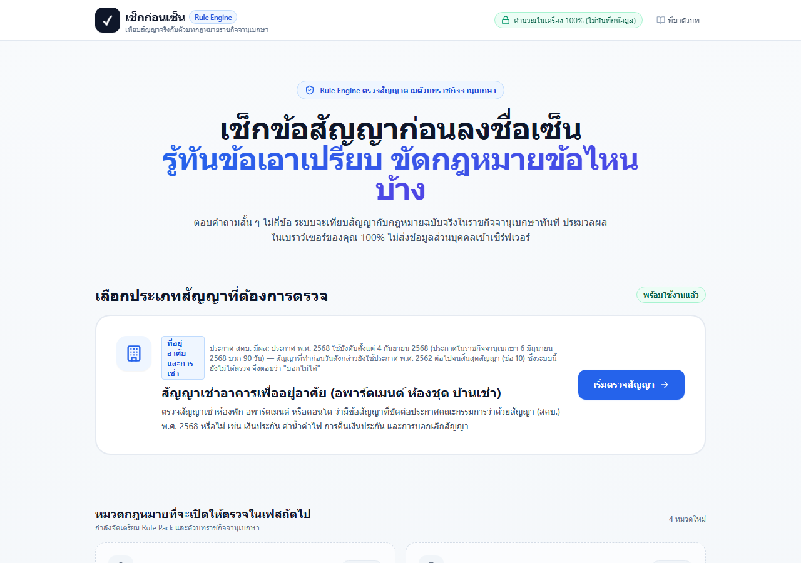 | 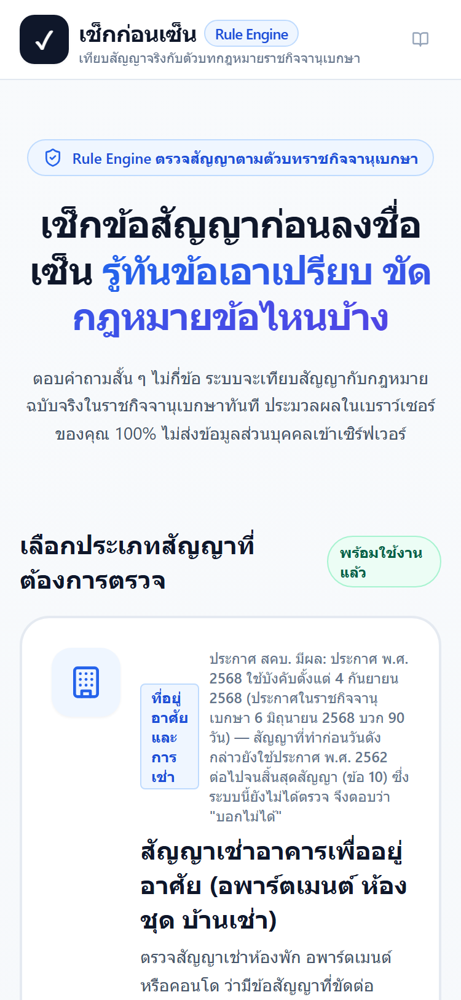 |
| ข้อ 1 คำถามขอบเขต | 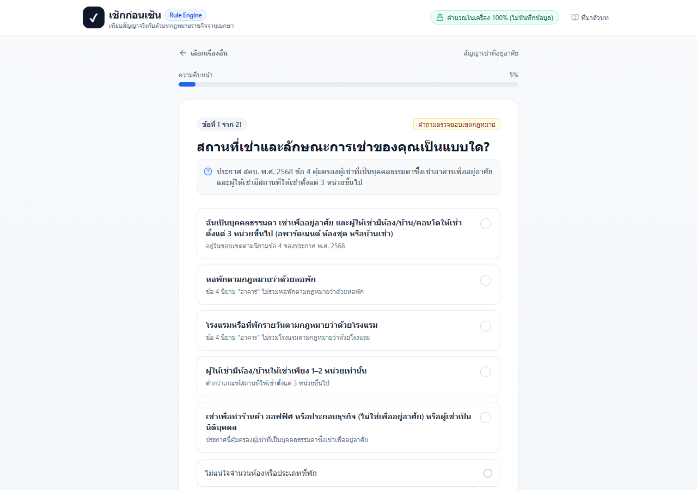 | 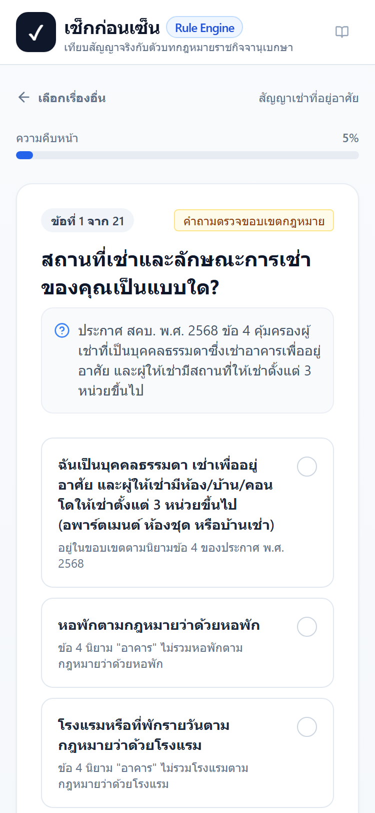 |
| ข้อ 2 เลือก "ตั้งแต่ 5 ก.ย. 68" | 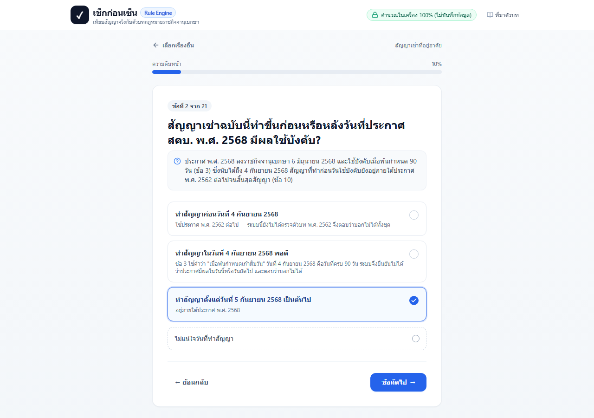 | 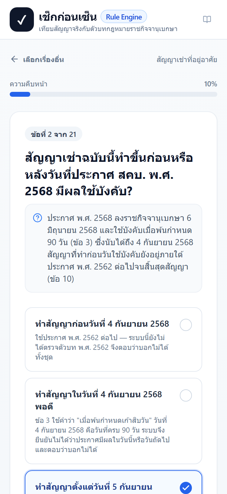 |
| ผลเส้นทางปกติ | 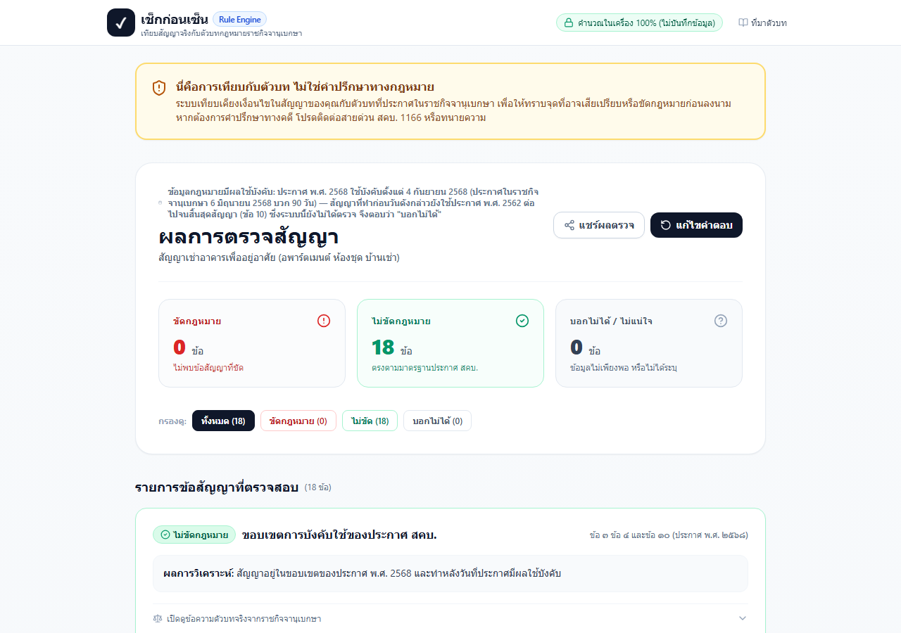 | 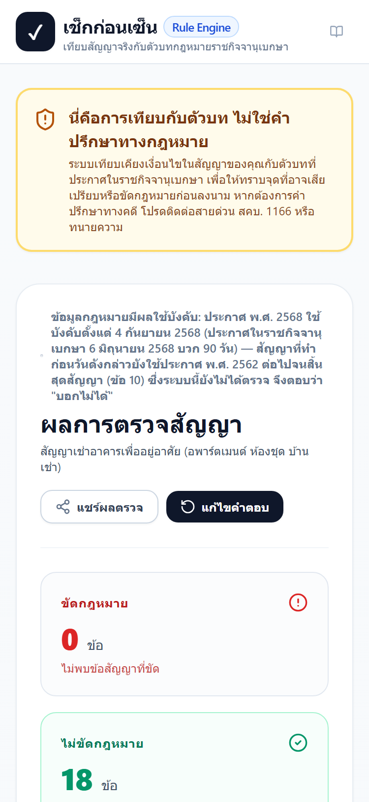 |
| ข้อ 2 เลือก "ก่อน 4 ก.ย. 68" (ปุ่มเป็น "ดูผล") | 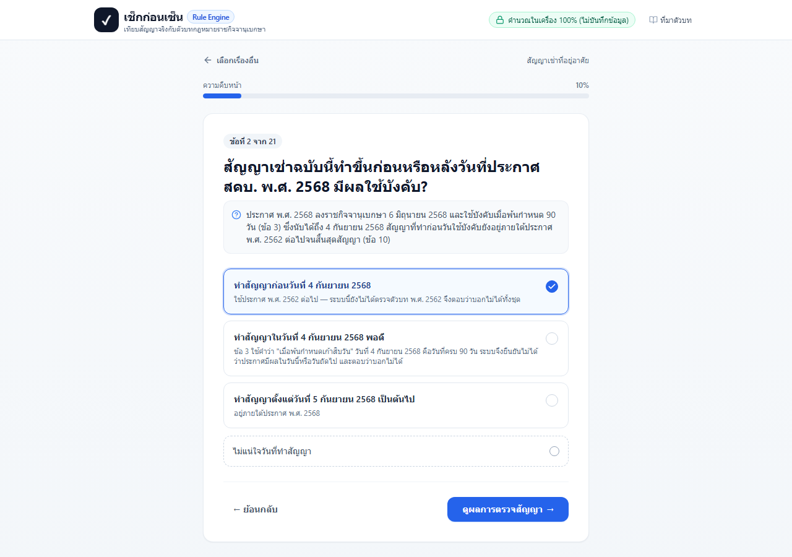 | 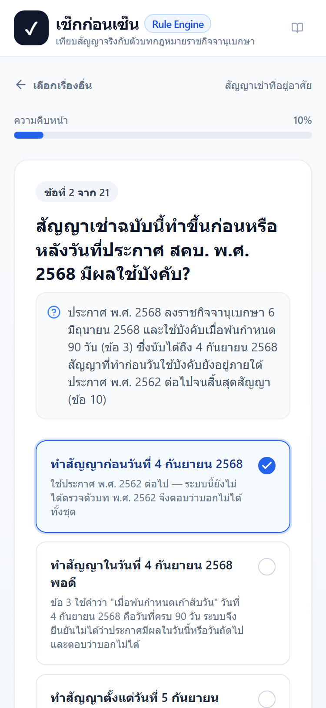 |
| หน้าผลทันทีหลังข้อ 2 (บนสุด) | 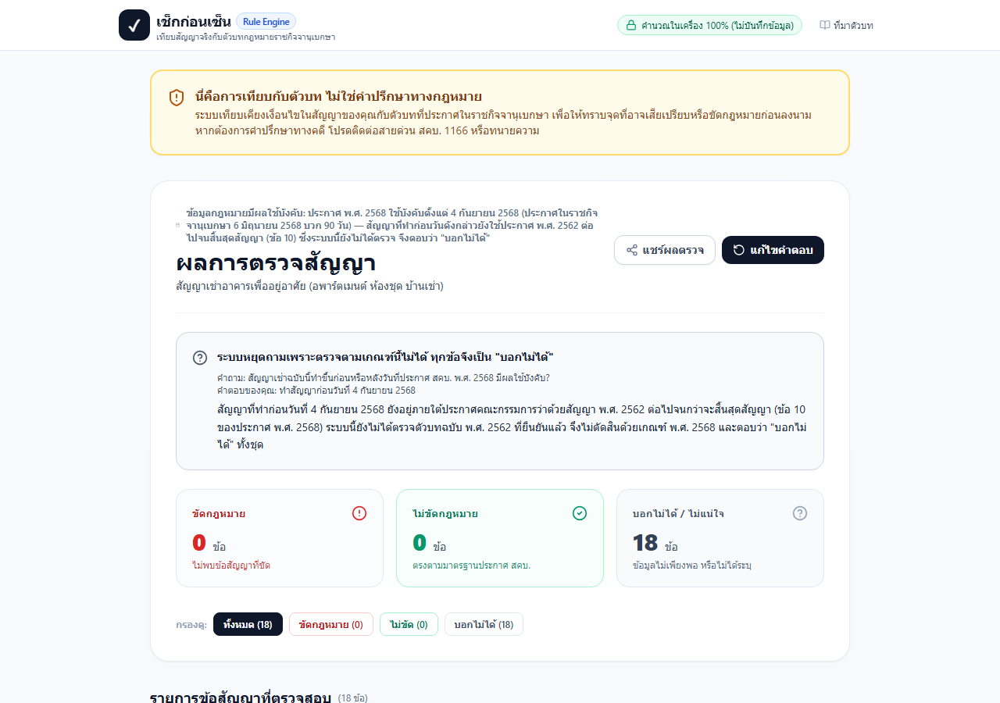 | 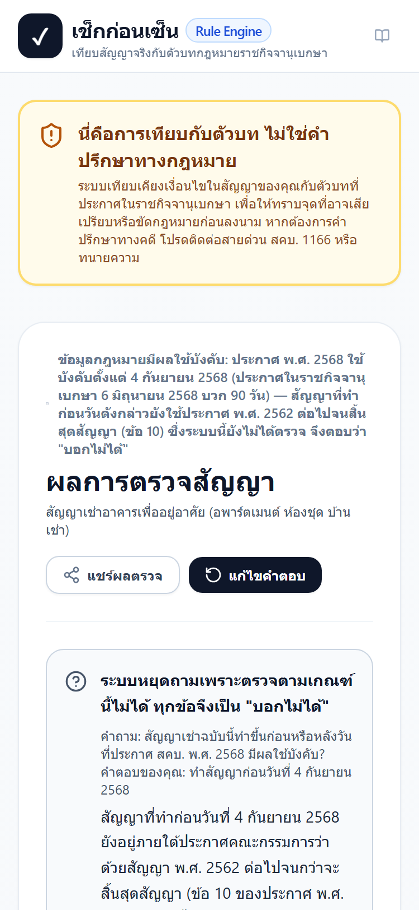 |
| กรอบ "ระบบหยุดถาม" | 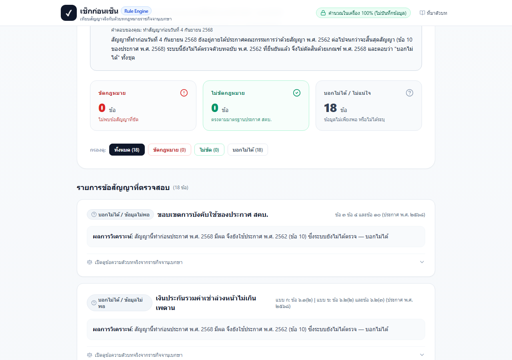 | 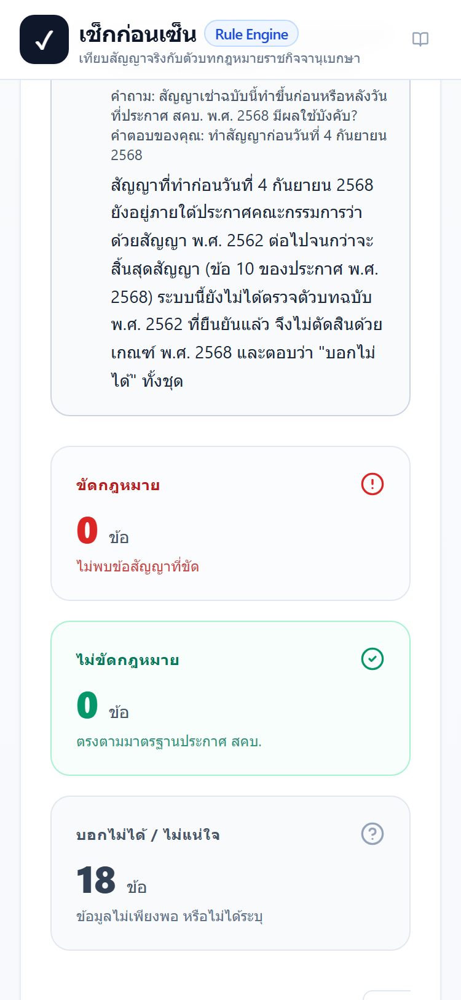 |
| `/check/ไม่มีอยู่จริง` (404) | 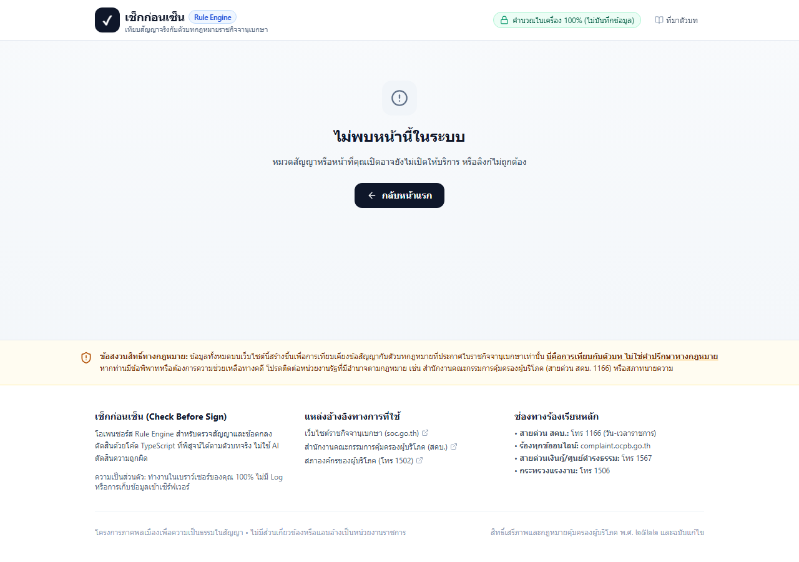 | 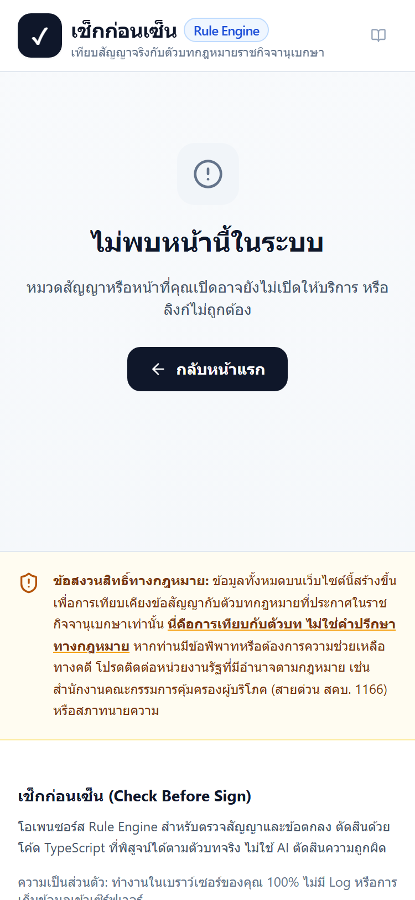 |

## 7. สิ่งที่ยังไม่ได้ตรวจ / ข้อจำกัด

1. **ยังไม่ได้ deploy บน Vercel จริง** — ตรวจด้วย `next start` ในเครื่องเท่านั้น พฤติกรรม 404, SSG และ header cache บน Vercel ยังไม่ได้ยืนยัน
2. **ตรวจเฉพาะ Chrome headless บน Windows** — ไม่ได้ตรวจ Safari/iOS, Firefox, Android จริง; ภาพ 375px มาจากการจำลอง viewport (`isMobile`, `deviceScaleFactor: 2`) ไม่ใช่มือถือจริง
3. **เส้นทางที่ไม่ได้คลิกผ่าน UI:** "4 ก.ย. 68 พอดี" และ "ไม่แน่ใจวันที่" ในข้อ 2 — ครอบด้วย unit test (`evaluatePack`) แล้ว แต่ไม่ได้คลิกในเบราว์เซอร์; ลิงก์แชร์ (`#share=`) ของผลที่จบการถามก็ตรวจด้วย unit test ของ engine ไม่ได้เปิดในเบราว์เซอร์
4. **เส้นทางปกติในเบราว์เซอร์ตอบตัวเลือกแรกทุกข้อ** (ได้ไม่ขัด 18 ข้อ) — ไม่ได้ทดสอบชุดคำตอบที่ "ขัด" ผ่าน UI; ตรรกะ "ขัด" ครอบด้วย unit test และ 26 เคส
5. **ไม่ได้ตรวจการเข้าถึง (a11y)** ด้วยเครื่องมือ เช่น ลำดับ focus หรือ screen reader ของกรอบ "หยุดถาม" (ใส่ `role="status"` ไว้แล้ว)
6. **ภาพหน้าจอใน README (`docs/screenshots/*.png` ชุดเดิม) ยังเป็นของ pack รุ่นก่อนรายงานที่ 1** — ไม่ได้ถ่ายใหม่ และ `scripts/take-screenshots.ts` / `capture-screenshots.ps1` เดิมยังใช้ share hash ของคำถามรุ่นเก่า
7. **ตกค้างจากรายงานที่ 1 (ยังไม่ได้แก้):** ลิงก์ประกาศ พ.ศ. 2562 ยังไม่ได้เปิดยืนยันเนื้อหา, การตีความวันมีผล 4 หรือ 5 ก.ย. 2568 ยังรอคุณตัดสินใจ
8. **ปัญหาหน้าตาเล็กน้อยที่พบแต่ไม่ได้แก้:** ไอคอนปฏิทินหน้า "ข้อมูลกฎหมายมีผลใช้บังคับ" หดเป็นจุดเมื่อข้อความยาว; ไม่มี favicon
9. **vitest ยังเป็น 2.1.9** ซึ่งมีช่องโหว่ตามหัวข้อ 5 (dev เท่านั้น)
10. `tsc --noEmit` ผ่านแม้ไม่มีโฟลเดอร์ `.next` แต่ในกรณีนั้นจะไม่ได้ตรวจชนิดของ route ที่ Next สร้าง (`.next/types`) — ถ้าต้องการให้ตรวจด้วย ให้รัน `npx next typegen` ก่อน

## 8. Output ดิบ

### npm run validate-packs

```text

> check-before-sign@0.1.0 validate-packs
> tsx scripts/validate-packs.ts

[Pack Validator] Scanning packs in: D:\check-before-sign\packs

--> Validating pack: rental
  [OK] pack.json is valid (21 questions, 18 rules)
  [OK] rules.ts exists
  [OK] cases.json is valid (26 test cases, all marked hypothetical)

[Pack Validator] All pack schemas validated successfully!
exit=0
```

### npx vitest run --reporter=verbose

```text
The CJS build of Vite's Node API is deprecated. See https://vite.dev/guide/troubleshooting.html#vite-cjs-node-api-deprecated for more details.

 RUN  v2.1.9 D:/check-before-sign

stdout | tests/rental-cases.test.ts > Rental Pack Cases Verification (ชุดตัวอย่างแต่งขึ้น) > summary: all hypothetical cases match expected outputs 100%

========================================
Rental Cases Test Summary: 26 / 26 Cases Passed (100% Match)
All cases are explicitly verified as hypothetical examples.
========================================


 ✓ tests/rental-cases.test.ts > Rental Pack Cases Verification (ชุดตัวอย่างแต่งขึ้น) > Case 1 (case-01-fully-compliant): กรณีสมมุติ 1: สัญญาตรงตามประกาศ พ.ศ. 2568 ครบทุกข้อ
 ✓ tests/rental-cases.test.ts > Rental Pack Cases Verification (ชุดตัวอย่างแต่งขึ้น) > Case 2 (case-02-classic-exploitative): กรณีสมมุติ 2: สัญญาเอาเปรียบหลายข้อ
 ✓ tests/rental-cases.test.ts > Rental Pack Cases Verification (ชุดตัวอย่างแต่งขึ้น) > Case 3 (case-03-out-of-scope-dormitory): กรณีสมมุติ 3: หอพักตามกฎหมายว่าด้วยหอพัก (นอกขอบเขต)
 ✓ tests/rental-cases.test.ts > Rental Pack Cases Verification (ชุดตัวอย่างแต่งขึ้น) > Case 4 (case-04-out-of-scope-few-units): กรณีสมมุติ 4: ผู้ให้เช่ามีห้องเช่าเพียง 1–2 หน่วย
 ✓ tests/rental-cases.test.ts > Rental Pack Cases Verification (ชุดตัวอย่างแต่งขึ้น) > Case 5 (case-05-out-of-scope-commercial): กรณีสมมุติ 5: เช่าเพื่อเปิดร้านหรือสำนักงาน
 ✓ tests/rental-cases.test.ts > Rental Pack Cases Verification (ชุดตัวอย่างแต่งขึ้น) > Case 6 (case-06-out-of-scope-hotel): กรณีสมมุติ 6: ที่พักรายวันตามกฎหมายโรงแรม
 ✓ tests/rental-cases.test.ts > Rental Pack Cases Verification (ชุดตัวอย่างแต่งขึ้น) > Case 7 (case-07-advance-2-deposit-1-compliant): กรณีสมมุติ 7: ค่าเช่าล่วงหน้า 2 เดือน + เงินประกัน 1 เดือน ต้องไม่ขัด
 ✓ tests/rental-cases.test.ts > Rental Pack Cases Verification (ชุดตัวอย่างแต่งขึ้น) > Case 8 (case-08-boundary-deposit-2-advance-1): กรณีสมมุติ 8: ค่าตรงขอบ เงินประกัน 2 + ค่าเช่าล่วงหน้า 1 = 3 เดือน
 ✓ tests/rental-cases.test.ts > Rental Pack Cases Verification (ชุดตัวอย่างแต่งขึ้น) > Case 9 (case-09-over-cap-by-half-month): กรณีสมมุติ 9: เกินเพดานครึ่งเดือน (2.5 + 1 = 3.5)
 ✓ tests/rental-cases.test.ts > Rental Pack Cases Verification (ชุดตัวอย่างแต่งขึ้น) > Case 10 (case-10-advance-unknown-undetermined): กรณีสมมุติ 10: ไม่ทราบค่าเช่าล่วงหน้า ต้องบอกไม่ได้
 ✓ tests/rental-cases.test.ts > Rental Pack Cases Verification (ชุดตัวอย่างแต่งขึ้น) > Case 11 (case-11-deposit-alone-over-cap): กรณีสมมุติ 11: เงินประกันเพียงอย่างเดียวเกินเพดาน แม้ไม่ทราบค่าเช่าล่วงหน้า
 ✓ tests/rental-cases.test.ts > Rental Pack Cases Verification (ชุดตัวอย่างแต่งขึ้น) > Case 12 (case-12-long-term-annual-compliant): กรณีสมมุติ 12: เช่าระยะยาว ค่าเช่ารายปี รวม 1 ปีพอดี
 ✓ tests/rental-cases.test.ts > Rental Pack Cases Verification (ชุดตัวอย่างแต่งขึ้น) > Case 13 (case-13-long-term-annual-over): กรณีสมมุติ 13: เช่าระยะยาว ค่าเช่ารายปี รวมเกิน 1 ปี
 ✓ tests/rental-cases.test.ts > Rental Pack Cases Verification (ชุดตัวอย่างแต่งขึ้น) > Case 14 (case-14-short-term-annual-rent): กรณีสมมุติ 14: เช่าระยะสั้น ค่าเช่ารายปี (ตัวบทไม่มีเพดาน)
 ✓ tests/rental-cases.test.ts > Rental Pack Cases Verification (ชุดตัวอย่างแต่งขึ้น) > Case 15 (case-15-legacy-contract-before-effective-date): กรณีสมมุติ 15: ทำสัญญาก่อน 4 ก.ย. 2568 — บอกไม่ได้ทั้งชุด
 ✓ tests/rental-cases.test.ts > Rental Pack Cases Verification (ชุดตัวอย่างแต่งขึ้น) > Case 16 (case-16-boundary-day): กรณีสมมุติ 16: ทำสัญญาวันที่ 4 ก.ย. 2568 พอดี — บอกไม่ได้ทั้งชุด
 ✓ tests/rental-cases.test.ts > Rental Pack Cases Verification (ชุดตัวอย่างแต่งขึ้น) > Case 17 (case-17-unsure-contract-date): กรณีสมมุติ 17: ไม่แน่ใจวันที่ทำสัญญา — บอกไม่ได้ทั้งชุด
 ✓ tests/rental-cases.test.ts > Rental Pack Cases Verification (ชุดตัวอย่างแต่งขึ้น) > Case 18 (case-18-refund-in-working-days): กรณีสมมุติ 18: คืนเงินประกัน "7 วันทำการ"
 ✓ tests/rental-cases.test.ts > Rental Pack Cases Verification (ชุดตัวอย่างแต่งขึ้น) > Case 19 (case-19-refund-after-deduction-30-days): กรณีสมมุติ 19: หักค่าเสียหายแล้วคืนส่วนที่เหลือภายใน 30 วัน
 ✓ tests/rental-cases.test.ts > Rental Pack Cases Verification (ชุดตัวอย่างแต่งขึ้น) > Case 20 (case-20-lessor-terminates-after-7-days-arrears): กรณีสมมุติ 20: ผู้ให้เช่าบอกเลิกได้หลังค้างค่าเช่า 7 วัน
 ✓ tests/rental-cases.test.ts > Rental Pack Cases Verification (ชุดตัวอย่างแต่งขึ้น) > Case 21 (case-21-disturbance-3-day-notice): กรณีสมมุติ 21: รบกวนผู้เช่ารายอื่น บอกเลิกได้หลังแจ้ง 3 วัน
 ✓ tests/rental-cases.test.ts > Rental Pack Cases Verification (ชุดตัวอย่างแต่งขึ้น) > Case 22 (case-22-tenant-termination-late-refund): กรณีสมมุติ 22: ผู้เช่าเลิกได้ แต่คืนค่าเช่าล่วงหน้าหลัง 30 วัน
 ✓ tests/rental-cases.test.ts > Rental Pack Cases Verification (ชุดตัวอย่างแต่งขึ้น) > Case 23 (case-23-all-unsure): กรณีสมมุติ 23: ไม่แน่ใจทุกข้อ (หลังตอบขอบเขตและวันที่ทำสัญญา)
 ✓ tests/rental-cases.test.ts > Rental Pack Cases Verification (ชุดตัวอย่างแต่งขึ้น) > Case 24 (case-24-exemption-clause-judgement): กรณีสมมุติ 24: มีข้อยกเว้นความรับผิดของผู้ให้เช่า
 ✓ tests/rental-cases.test.ts > Rental Pack Cases Verification (ชุดตัวอย่างแต่งขึ้น) > Case 25 (case-25-flat-rate-utilities-unknown): กรณีสมมุติ 25: ค่าน้ำค่าไฟเหมาจ่ายแต่ไม่ทราบอัตราจริง
 ✓ tests/rental-cases.test.ts > Rental Pack Cases Verification (ชุดตัวอย่างแต่งขึ้น) > Case 26 (case-26-legacy-two-answers-only): กรณีสมมุติ 26: ทำสัญญาก่อน 4 ก.ย. 2568 แล้วระบบหยุดถามทันที (ตอบแค่ 2 ข้อ)
 ✓ tests/rental-cases.test.ts > Rental Pack Cases Verification (ชุดตัวอย่างแต่งขึ้น) > has at least 15 cases and every case answers only questions that exist in pack.json
 ✓ tests/rental-cases.test.ts > Rental Pack Cases Verification (ชุดตัวอย่างแต่งขึ้น) > every in-scope case sums to the number of rules (counts are exhaustive)
 ✓ tests/rental-cases.test.ts > Rental Pack Cases Verification (ชุดตัวอย่างแต่งขึ้น) > summary: all hypothetical cases match expected outputs 100%
 ✓ tests/rental-rules.test.ts > Rental Pack Rules Unit Tests (ขัด, ไม่ขัด, บอกไม่ได้, ค่าตรงขอบ) > Scope Gatekeeper: evaluateRentalScope > returns inScope: true for standard residential rental
 ✓ tests/rental-rules.test.ts > Rental Pack Rules Unit Tests (ขัด, ไม่ขัด, บอกไม่ได้, ค่าตรงขอบ) > Scope Gatekeeper: evaluateRentalScope > returns inScope: false for dormitories under the dormitory act
 ✓ tests/rental-rules.test.ts > Rental Pack Rules Unit Tests (ขัด, ไม่ขัด, บอกไม่ได้, ค่าตรงขอบ) > Scope Gatekeeper: evaluateRentalScope > returns inScope: false for hotel / daily stay (exclusion)
 ✓ tests/rental-rules.test.ts > Rental Pack Rules Unit Tests (ขัด, ไม่ขัด, บอกไม่ได้, ค่าตรงขอบ) > Scope Gatekeeper: evaluateRentalScope > returns inScope: false for small landlord under 3 units
 ✓ tests/rental-rules.test.ts > Rental Pack Rules Unit Tests (ขัด, ไม่ขัด, บอกไม่ได้, ค่าตรงขอบ) > Scope Gatekeeper: evaluateRentalScope > returns inScope: false for commercial rentals
 ✓ tests/rental-rules.test.ts > Rental Pack Rules Unit Tests (ขัด, ไม่ขัด, บอกไม่ได้, ค่าตรงขอบ) > Scope Gatekeeper: evaluateRentalScope > out-of-scope reasons warn that the 2562 notice was not checked
 ✓ tests/rental-rules.test.ts > Rental Pack Rules Unit Tests (ขัด, ไม่ขัด, บอกไม่ได้, ค่าตรงขอบ) > Scope Gatekeeper: evaluateRentalScope > returns inScope: undetermined when unsure
 ✓ tests/rental-rules.test.ts > Rental Pack Rules Unit Tests (ขัด, ไม่ขัด, บอกไม่ได้, ค่าตรงขอบ) > toNum helper > parses numbers and rejects missing / unsure / negative / non-numeric
 ✓ tests/rental-rules.test.ts > Rental Pack Rules Unit Tests (ขัด, ไม่ขัด, บอกไม่ได้, ค่าตรงขอบ) > Applicability gate: contract date vs the 2568 notice (ข้อ 3 และข้อ 10) > before the effective date → EVERY rule is undetermined, never violated/compliant
 ✓ tests/rental-rules.test.ts > Rental Pack Rules Unit Tests (ขัด, ไม่ขัด, บอกไม่ได้, ค่าตรงขอบ) > Applicability gate: contract date vs the 2568 notice (ข้อ 3 และข้อ 10) > explains the transition (ข้อ 10) and that the 2562 text is not checked
 ✓ tests/rental-rules.test.ts > Rental Pack Rules Unit Tests (ขัด, ไม่ขัด, บอกไม่ได้, ค่าตรงขอบ) > Applicability gate: contract date vs the 2568 notice (ข้อ 3 และข้อ 10) > boundary day (4 Sep 2568) → every rule undetermined
 ✓ tests/rental-rules.test.ts > Rental Pack Rules Unit Tests (ขัด, ไม่ขัด, บอกไม่ได้, ค่าตรงขอบ) > Applicability gate: contract date vs the 2568 notice (ข้อ 3 และข้อ 10) > missing / unsure date → every rule undetermined
 ✓ tests/rental-rules.test.ts > Rental Pack Rules Unit Tests (ขัด, ไม่ขัด, บอกไม่ได้, ค่าตรงขอบ) > Applicability gate: contract date vs the 2568 notice (ข้อ 3 และข้อ 10) > on/after the effective date → gate is open
 ✓ tests/rental-rules.test.ts > Rental Pack Rules Unit Tests (ขัด, ไม่ขัด, บอกไม่ได้, ค่าตรงขอบ) > rule_rental_scope > returns compliant when in_scope and after effective date
 ✓ tests/rental-rules.test.ts > Rental Pack Rules Unit Tests (ขัด, ไม่ขัด, บอกไม่ได้, ค่าตรงขอบ) > rule_rental_scope > returns violated when out of scope
 ✓ tests/rental-rules.test.ts > Rental Pack Rules Unit Tests (ขัด, ไม่ขัด, บอกไม่ได้, ค่าตรงขอบ) > rule_rental_scope > returns undetermined when unsure
 ✓ tests/rental-rules.test.ts > Rental Pack Rules Unit Tests (ขัด, ไม่ขัด, บอกไม่ได้, ค่าตรงขอบ) > rule_deposit_amount (เงินประกันรวมค่าเช่าล่วงหน้า — ข้อ 6.1(2), 6.2(2), 6.2(3)) > compliant: advance 2 months + deposit 1 month = 3 months (spec case)
 ✓ tests/rental-rules.test.ts > Rental Pack Rules Unit Tests (ขัด, ไม่ขัด, บอกไม่ได้, ค่าตรงขอบ) > rule_deposit_amount (เงินประกันรวมค่าเช่าล่วงหน้า — ข้อ 6.1(2), 6.2(2), 6.2(3)) > compliant boundary: deposit 2 + advance 1 = 3 (equal to cap is allowed)
 ✓ tests/rental-rules.test.ts > Rental Pack Rules Unit Tests (ขัด, ไม่ขัด, บอกไม่ได้, ค่าตรงขอบ) > rule_deposit_amount (เงินประกันรวมค่าเช่าล่วงหน้า — ข้อ 6.1(2), 6.2(2), 6.2(3)) > compliant: deposit 1 + advance 1
 ✓ tests/rental-rules.test.ts > Rental Pack Rules Unit Tests (ขัด, ไม่ขัด, บอกไม่ได้, ค่าตรงขอบ) > rule_deposit_amount (เงินประกันรวมค่าเช่าล่วงหน้า — ข้อ 6.1(2), 6.2(2), 6.2(3)) > compliant: no deposit and no advance (0 + 0)
 ✓ tests/rental-rules.test.ts > Rental Pack Rules Unit Tests (ขัด, ไม่ขัด, บอกไม่ได้, ค่าตรงขอบ) > rule_deposit_amount (เงินประกันรวมค่าเช่าล่วงหน้า — ข้อ 6.1(2), 6.2(2), 6.2(3)) > violated just over the cap: deposit 2.5 + advance 1 = 3.5
 ✓ tests/rental-rules.test.ts > Rental Pack Rules Unit Tests (ขัด, ไม่ขัด, บอกไม่ได้, ค่าตรงขอบ) > rule_deposit_amount (เงินประกันรวมค่าเช่าล่วงหน้า — ข้อ 6.1(2), 6.2(2), 6.2(3)) > violated: deposit 2 + advance 2 = 4
 ✓ tests/rental-rules.test.ts > Rental Pack Rules Unit Tests (ขัด, ไม่ขัด, บอกไม่ได้, ค่าตรงขอบ) > rule_deposit_amount (เงินประกันรวมค่าเช่าล่วงหน้า — ข้อ 6.1(2), 6.2(2), 6.2(3)) > floating-point safe: 1.1 + 1.9 = 3 is not over the cap
 ✓ tests/rental-rules.test.ts > Rental Pack Rules Unit Tests (ขัด, ไม่ขัด, บอกไม่ได้, ค่าตรงขอบ) > rule_deposit_amount (เงินประกันรวมค่าเช่าล่วงหน้า — ข้อ 6.1(2), 6.2(2), 6.2(3)) > advance rent unknown + deposit within cap → undetermined, never assumed
 ✓ tests/rental-rules.test.ts > Rental Pack Rules Unit Tests (ขัด, ไม่ขัด, บอกไม่ได้, ค่าตรงขอบ) > rule_deposit_amount (เงินประกันรวมค่าเช่าล่วงหน้า — ข้อ 6.1(2), 6.2(2), 6.2(3)) > deposit unknown + advance within cap → undetermined
 ✓ tests/rental-rules.test.ts > Rental Pack Rules Unit Tests (ขัด, ไม่ขัด, บอกไม่ได้, ค่าตรงขอบ) > rule_deposit_amount (เงินประกันรวมค่าเช่าล่วงหน้า — ข้อ 6.1(2), 6.2(2), 6.2(3)) > one side alone already over the cap → violated even if the other is unknown (lower bound)
 ✓ tests/rental-rules.test.ts > Rental Pack Rules Unit Tests (ขัด, ไม่ขัด, บอกไม่ได้, ค่าตรงขอบ) > rule_deposit_amount (เงินประกันรวมค่าเช่าล่วงหน้า — ข้อ 6.1(2), 6.2(2), 6.2(3)) > both unknown → undetermined
 ✓ tests/rental-rules.test.ts > Rental Pack Rules Unit Tests (ขัด, ไม่ขัด, บอกไม่ได้, ค่าตรงขอบ) > rule_deposit_amount (เงินประกันรวมค่าเช่าล่วงหน้า — ข้อ 6.1(2), 6.2(2), 6.2(3)) > long-term form B, monthly rent → same 3-month cap (ข้อ 6.2(2))
 ✓ tests/rental-rules.test.ts > Rental Pack Rules Unit Tests (ขัด, ไม่ขัด, บอกไม่ได้, ค่าตรงขอบ) > rule_deposit_amount (เงินประกันรวมค่าเช่าล่วงหน้า — ข้อ 6.1(2), 6.2(2), 6.2(3)) > long-term form B, annual rent → cap is 1 year (ข้อ 6.2(3))
 ✓ tests/rental-rules.test.ts > Rental Pack Rules Unit Tests (ขัด, ไม่ขัด, บอกไม่ได้, ค่าตรงขอบ) > rule_deposit_amount (เงินประกันรวมค่าเช่าล่วงหน้า — ข้อ 6.1(2), 6.2(2), 6.2(3)) > short-term form A with annual rent → 6.1(2) states no cap → undetermined
 ✓ tests/rental-rules.test.ts > Rental Pack Rules Unit Tests (ขัด, ไม่ขัด, บอกไม่ได้, ค่าตรงขอบ) > rule_deposit_amount (เงินประกันรวมค่าเช่าล่วงหน้า — ข้อ 6.1(2), 6.2(2), 6.2(3)) > unknown contract form → undetermined
 ✓ tests/rental-rules.test.ts > Rental Pack Rules Unit Tests (ขัด, ไม่ขัด, บอกไม่ได้, ค่าตรงขอบ) > rule_advance_rent has been removed (ตัวบทไม่มีเพดานค่าเช่าล่วงหน้า 1 เดือน) > no rule, no question and no legal text mention a separate 1-month advance-rent cap
 ✓ tests/rental-rules.test.ts > Rental Pack Rules Unit Tests (ขัด, ไม่ขัด, บอกไม่ได้, ค่าตรงขอบ) > rule_electricity_tariff / rule_water_tariff (ข้อ 6.1(6)) > electricity: compliant / violated / flat-unknown / unsure
 ✓ tests/rental-rules.test.ts > Rental Pack Rules Unit Tests (ขัด, ไม่ขัด, บอกไม่ได้, ค่าตรงขอบ) > rule_electricity_tariff / rule_water_tariff (ข้อ 6.1(6)) > water: compliant / violated / flat-unknown / unsure
 ✓ tests/rental-rules.test.ts > Rental Pack Rules Unit Tests (ขัด, ไม่ขัด, บอกไม่ได้, ค่าตรงขอบ) > rule_deposit_refund_period (แบบ ก ข้อ 10(ก): ภายใน 7 วัน ไม่ใช่วันทำการ) > compliant: within 7 days
 ✓ tests/rental-rules.test.ts > Rental Pack Rules Unit Tests (ขัด, ไม่ขัด, บอกไม่ได้, ค่าตรงขอบ) > rule_deposit_refund_period (แบบ ก ข้อ 10(ก): ภายใน 7 วัน ไม่ใช่วันทำการ) > violated: over 7 days, and the reason says "วัน" not "วันทำการ"
 ✓ tests/rental-rules.test.ts > Rental Pack Rules Unit Tests (ขัด, ไม่ขัด, บอกไม่ได้, ค่าตรงขอบ) > rule_deposit_refund_period (แบบ ก ข้อ 10(ก): ภายใน 7 วัน ไม่ใช่วันทำการ) > undetermined: unsure or missing
 ✓ tests/rental-rules.test.ts > Rental Pack Rules Unit Tests (ขัด, ไม่ขัด, บอกไม่ได้, ค่าตรงขอบ) > rule_deposit_refund_period (แบบ ก ข้อ 10(ก): ภายใน 7 วัน ไม่ใช่วันทำการ) > pack text no longer says 7 วันทำการ as the legal standard
 ✓ tests/rental-rules.test.ts > Rental Pack Rules Unit Tests (ขัด, ไม่ขัด, บอกไม่ได้, ค่าตรงขอบ) > rule_deposit_refund_after_deduction (แบบ ก ข้อ 10(ข): ภายใน 14 วัน) > compliant: within 14 days
 ✓ tests/rental-rules.test.ts > Rental Pack Rules Unit Tests (ขัด, ไม่ขัด, บอกไม่ได้, ค่าตรงขอบ) > rule_deposit_refund_after_deduction (แบบ ก ข้อ 10(ข): ภายใน 14 วัน) > violated: over 14 days (reason cites 14 วัน, not วันทำการ)
 ✓ tests/rental-rules.test.ts > Rental Pack Rules Unit Tests (ขัด, ไม่ขัด, บอกไม่ได้, ค่าตรงขอบ) > rule_deposit_refund_after_deduction (แบบ ก ข้อ 10(ข): ภายใน 14 วัน) > undetermined: unsure or missing
 ✓ tests/rental-rules.test.ts > Rental Pack Rules Unit Tests (ขัด, ไม่ขัด, บอกไม่ได้, ค่าตรงขอบ) > rule_deposit_refund_after_deduction (แบบ ก ข้อ 10(ข): ภายใน 14 วัน) > the 7-day and 14-day questions are independent (no cross-contamination)
 ✓ tests/rental-rules.test.ts > Rental Pack Rules Unit Tests (ขัด, ไม่ขัด, บอกไม่ได้, ค่าตรงขอบ) > rule_deposit_forfeiture (ข้อ 6.1(4): ริบโดยมิใช่ความผิดของผู้เช่า) > compliant / violated / undetermined
 ✓ tests/rental-rules.test.ts > Rental Pack Rules Unit Tests (ขัด, ไม่ขัด, บอกไม่ได้, ค่าตรงขอบ) > rule_tenant_termination (แบบ ก ข้อ 13) > compliant: conforms
 ✓ tests/rental-rules.test.ts > Rental Pack Rules Unit Tests (ขัด, ไม่ขัด, บอกไม่ได้, ค่าตรงขอบ) > rule_tenant_termination (แบบ ก ข้อ 13) > violated: prohibited — reason carries half-term, 30-day notice
 ✓ tests/rental-rules.test.ts > Rental Pack Rules Unit Tests (ขัด, ไม่ขัด, บอกไม่ได้, ค่าตรงขอบ) > rule_tenant_termination (แบบ ก ข้อ 13) > violated: stricter conditions than the standard form
 ✓ tests/rental-rules.test.ts > Rental Pack Rules Unit Tests (ขัด, ไม่ขัด, บอกไม่ได้, ค่าตรงขอบ) > rule_tenant_termination (แบบ ก ข้อ 13) > violated: advance rent refunded later than 7 days from the termination notice
 ✓ tests/rental-rules.test.ts > Rental Pack Rules Unit Tests (ขัด, ไม่ขัด, บอกไม่ได้, ค่าตรงขอบ) > rule_tenant_termination (แบบ ก ข้อ 13) > undetermined: unsure or missing
 ✓ tests/rental-rules.test.ts > Rental Pack Rules Unit Tests (ขัด, ไม่ขัด, บอกไม่ได้, ค่าตรงขอบ) > rule_lessor_termination_notice (แบบ ก ข้อ 14 วรรคหนึ่ง: ≥ 30 วัน) > compliant: ≥ 30 days notice
 ✓ tests/rental-rules.test.ts > Rental Pack Rules Unit Tests (ขัด, ไม่ขัด, บอกไม่ได้, ค่าตรงขอบ) > rule_lessor_termination_notice (แบบ ก ข้อ 14 วรรคหนึ่ง: ≥ 30 วัน) > violated: shorter than 30 days, including for rent arrears — no "7 วันกรณีค้างค่าเช่า" exception
 ✓ tests/rental-rules.test.ts > Rental Pack Rules Unit Tests (ขัด, ไม่ขัด, บอกไม่ได้, ค่าตรงขอบ) > rule_lessor_termination_notice (แบบ ก ข้อ 14 วรรคหนึ่ง: ≥ 30 วัน) > violated: no notice at all
 ✓ tests/rental-rules.test.ts > Rental Pack Rules Unit Tests (ขัด, ไม่ขัด, บอกไม่ได้, ค่าตรงขอบ) > rule_lessor_termination_notice (แบบ ก ข้อ 14 วรรคหนึ่ง: ≥ 30 วัน) > undetermined: unsure or missing
 ✓ tests/rental-rules.test.ts > Rental Pack Rules Unit Tests (ขัด, ไม่ขัด, บอกไม่ได้, ค่าตรงขอบ) > rule_lessor_termination_notice (แบบ ก ข้อ 14 วรรคหนึ่ง: ≥ 30 วัน) > no pack text claims a 7-day exception for rent arrears
 ✓ tests/rental-rules.test.ts > Rental Pack Rules Unit Tests (ขัด, ไม่ขัด, บอกไม่ได้, ค่าตรงขอบ) > rule_lessor_termination_disturbance (แบบ ก ข้อ 14 วรรคสอง: ≥ 7 วัน) > compliant: ≥ 7 days notice, or no special clause
 ✓ tests/rental-rules.test.ts > Rental Pack Rules Unit Tests (ขัด, ไม่ขัด, บอกไม่ได้, ค่าตรงขอบ) > rule_lessor_termination_disturbance (แบบ ก ข้อ 14 วรรคสอง: ≥ 7 วัน) > violated: shorter than 7 days or immediate
 ✓ tests/rental-rules.test.ts > Rental Pack Rules Unit Tests (ขัด, ไม่ขัด, บอกไม่ได้, ค่าตรงขอบ) > rule_lessor_termination_disturbance (แบบ ก ข้อ 14 วรรคสอง: ≥ 7 วัน) > undetermined: unsure or missing
 ✓ tests/rental-rules.test.ts > Rental Pack Rules Unit Tests (ขัด, ไม่ขัด, บอกไม่ได้, ค่าตรงขอบ) > rule_lessor_terminate_without_breach (ข้อ 6.1(9)) > compliant / violated / undetermined
 ✓ tests/rental-rules.test.ts > Rental Pack Rules Unit Tests (ขัด, ไม่ขัด, บอกไม่ได้, ค่าตรงขอบ) > rule_inspection_privacy (ข้อ 6.1(5)) > compliant / violated / undetermined
 ✓ tests/rental-rules.test.ts > Rental Pack Rules Unit Tests (ขัด, ไม่ขัด, บอกไม่ได้, ค่าตรงขอบ) > rule_self_help_lockout (ข้อ 6.1(7)) > compliant / violated / undetermined
 ✓ tests/rental-rules.test.ts > Rental Pack Rules Unit Tests (ขัด, ไม่ขัด, บอกไม่ได้, ค่าตรงขอบ) > rule_liability_exemption (ข้อ 6.1(1) — ต้องพิจารณา "เหตุผลที่สมควรเพียงพอ") > compliant: no such clause
 ✓ tests/rental-rules.test.ts > Rental Pack Rules Unit Tests (ขัด, ไม่ขัด, บอกไม่ได้, ค่าตรงขอบ) > rule_liability_exemption (ข้อ 6.1(1) — ต้องพิจารณา "เหตุผลที่สมควรเพียงพอ") > undetermined (not violated): clause exists but whether it lacks adequate justification is a judgement call
 ✓ tests/rental-rules.test.ts > Rental Pack Rules Unit Tests (ขัด, ไม่ขัด, บอกไม่ได้, ค่าตรงขอบ) > rule_liability_exemption (ข้อ 6.1(1) — ต้องพิจารณา "เหตุผลที่สมควรเพียงพอ") > undetermined: unsure or missing
 ✓ tests/rental-rules.test.ts > Rental Pack Rules Unit Tests (ขัด, ไม่ขัด, บอกไม่ได้, ค่าตรงขอบ) > rule_rent_change_during_term (ข้อ 6.1(3)) > compliant / violated / undetermined
 ✓ tests/rental-rules.test.ts > Rental Pack Rules Unit Tests (ขัด, ไม่ขัด, บอกไม่ได้, ค่าตรงขอบ) > rule_renewal_fee (ข้อ 6.1(8)) > compliant / violated / undetermined
 ✓ tests/rental-rules.test.ts > Rental Pack Rules Unit Tests (ขัด, ไม่ขัด, บอกไม่ได้, ค่าตรงขอบ) > rule_normal_wear_liability (ข้อ 6.1(10) และ 6.1(12)) > compliant / violated / undetermined
 ✓ tests/rental-rules.test.ts > Rental Pack Rules Unit Tests (ขัด, ไม่ขัด, บอกไม่ได้, ค่าตรงขอบ) > rule_force_majeure_liability (ข้อ 6.1(11)) > compliant / violated / undetermined
 ✓ tests/rental-rules.test.ts > Rental pack ↔ statute coverage and source integrity > every rule in pack.json has an evaluator, and every evaluator has a rule
 ✓ tests/rental-rules.test.ts > Rental pack ↔ statute coverage and source integrity > every question referenced by an evaluator exists in pack.json (no orphan answers)
 ✓ tests/rental-rules.test.ts > Rental pack ↔ statute coverage and source integrity > the contract-date question comes immediately after the scope question
 ✓ tests/rental-rules.test.ts > Rental pack ↔ statute coverage and source integrity > all 12 prohibited clauses of ข้อ 6.1 are covered by a rule that cites them
 ✓ tests/rental-rules.test.ts > Rental pack ↔ statute coverage and source integrity > the 2568 source links to the official OCPB PDF, not the old gazette id 72766
 ✓ tests/rental-rules.test.ts > Rental pack ↔ statute coverage and source integrity > the 2562 source is a different document from the 2568 one
 ✓ tests/rental-rules.test.ts > Rental pack ↔ statute coverage and source integrity > gazette ref for 2562 does not claim an unverified page number
 ✓ tests/rental-rules.test.ts > Rental pack ↔ statute coverage and source integrity > effective date is 4 Sep 2568 = 6 Jun 2568 + 90 days
 ✓ tests/rental-rules.test.ts > Rental pack ↔ statute coverage and source integrity > no legal text carries claims that are not in the notice ("โมฆะ", "ข้อ ๕ ที่ห้ามมิให้")
 ✓ tests/rental-rules.test.ts > Rental: questionnaire ends right after the contract-date question (engine endsQuestionnaire) > q_contract_date is question 2, right after the scope question
 ✓ tests/rental-rules.test.ts > Rental: questionnaire ends right after the contract-date question (engine endsQuestionnaire) > before_effective: with only 2 answers → result page, all 18 rules undetermined, no evaluator verdict
 ✓ tests/rental-rules.test.ts > Rental: questionnaire ends right after the contract-date question (engine endsQuestionnaire) > boundary_day: with only 2 answers → result page, all 18 rules undetermined, no evaluator verdict
 ✓ tests/rental-rules.test.ts > Rental: questionnaire ends right after the contract-date question (engine endsQuestionnaire) > __unsure__: with only 2 answers → result page, all 18 rules undetermined, no evaluator verdict
 ✓ tests/rental-rules.test.ts > Rental: questionnaire ends right after the contract-date question (engine endsQuestionnaire) > on_or_after_effective does not end the questionnaire
 ✓ tests/rental-rules.test.ts > Rental: questionnaire ends right after the contract-date question (engine endsQuestionnaire) > a legacy contract with violating later answers still yields 0 violated (later answers ignored)
 ✓ tests/rental-rules.test.ts > Rental: questionnaire ends right after the contract-date question (engine endsQuestionnaire) > out-of-scope answer on question 1 still wins over the date gate
 ✓ tests/rental-rules.test.ts > Rental: questionnaire ends right after the contract-date question (engine endsQuestionnaire) > the gate in rules.ts covers values pack.json does not list (garbage → unknown-date text)
 ✓ tests/engine.test.ts > Engine Core (Decoupled from Rental Pack) > validates dummy pack against Zod schema
 ✓ tests/engine.test.ts > Engine Core (Decoupled from Rental Pack) > Questionnaire-ending answers (declared in pack.json) > an option with endsQuestionnaire → every rule undetermined with the declared ruleReason
 ✓ tests/engine.test.ts > Engine Core (Decoupled from Rental Pack) > Questionnaire-ending answers (declared in pack.json) > works when nothing after the ending question was answered (the UI path)
 ✓ tests/engine.test.ts > Engine Core (Decoupled from Rental Pack) > Questionnaire-ending answers (declared in pack.json) > never runs the rule evaluators once the questionnaire has ended
 ✓ tests/engine.test.ts > Engine Core (Decoupled from Rental Pack) > Questionnaire-ending answers (declared in pack.json) > unsureEndsQuestionnaire ends on the unsure answer; ruleReason defaults to reason
 ✓ tests/engine.test.ts > Engine Core (Decoupled from Rental Pack) > Questionnaire-ending answers (declared in pack.json) > an option without endsQuestionnaire continues normally (no endedEarly)
 ✓ tests/engine.test.ts > Engine Core (Decoupled from Rental Pack) > Questionnaire-ending answers (declared in pack.json) > out of scope still takes precedence over an ending answer
 ✓ tests/engine.test.ts > Engine Core (Decoupled from Rental Pack) > Questionnaire-ending answers (declared in pack.json) > getQuestionnaireEnd / findQuestionnaireEnd read only pack.json flags
 ✓ tests/engine.test.ts > Engine Core (Decoupled from Rental Pack) > Questionnaire-ending answers (declared in pack.json) > schema rejects an option that is both isOutOfScope and endsQuestionnaire
 ✓ tests/engine.test.ts > Engine Core (Decoupled from Rental Pack) > Questionnaire-ending answers (declared in pack.json) > schema rejects unsureEndsQuestionnaire on a question without allowUnsure
 ✓ tests/engine.test.ts > Engine Core (Decoupled from Rental Pack) > Questionnaire-ending answers (declared in pack.json) > schema rejects an endsQuestionnaire with an empty reason
 ✓ tests/engine.test.ts > Engine Core (Decoupled from Rental Pack) > Schema validation behaviour (pinned across zod upgrades) > rejects an invalid source URL with the Thai message
 ✓ tests/engine.test.ts > Engine Core (Decoupled from Rental Pack) > Schema validation behaviour (pinned across zod upgrades) > rejects an invalid legalRef.sourceUrl
 ✓ tests/engine.test.ts > Engine Core (Decoupled from Rental Pack) > Schema validation behaviour (pinned across zod upgrades) > rejects a scopeQuestionId that matches no question
 ✓ tests/engine.test.ts > Engine Core (Decoupled from Rental Pack) > Schema validation behaviour (pinned across zod upgrades) > defaults allowUnsure to true when omitted
 ✓ tests/engine.test.ts > Engine Core (Decoupled from Rental Pack) > Schema validation behaviour (pinned across zod upgrades) > TestCaseSchema requires isHypothetical: true, with the Thai message
 ✓ tests/engine.test.ts > Engine Core (Decoupled from Rental Pack) > Schema validation behaviour (pinned across zod upgrades) > TestCaseSchema accepts ruleStatuses keyed by any rule id but only the 3 statuses
 ✓ tests/engine.test.ts > Engine Core (Decoupled from Rental Pack) > Schema limits > accepts 25 questions and rejects 26
 ✓ tests/engine.test.ts > Engine Core (Decoupled from Rental Pack) > stops evaluation early when out of scope
 ✓ tests/engine.test.ts > Engine Core (Decoupled from Rental Pack) > evaluates all rules when in scope (compliant and violated)
 ✓ tests/engine.test.ts > Engine Core (Decoupled from Rental Pack) > returns undetermined when answers are unsure or missing
 ✓ tests/engine.test.ts > Engine Core (Decoupled from Rental Pack) > Privacy-Safe Link Sharing > encodes and decodes answers accurately without PII
 ✓ tests/engine.test.ts > Engine Core (Decoupled from Rental Pack) > Privacy-Safe Link Sharing > returns null gracefully on invalid hash

 Test Files  3 passed (3)
      Tests  135 passed (135)
   Start at  17:10:34
   Duration  1.16s (transform 358ms, setup 0ms, collect 912ms, tests 120ms, environment 1ms, prepare 717ms)

exit=0
```

### npm run typecheck

```text

> check-before-sign@0.1.0 typecheck
> tsc --noEmit

exit=0
```

### npm run build (build สุดท้าย หลังลบ .next)

```text

> check-before-sign@0.1.0 prebuild
> tsx scripts/validate-packs.ts

[Pack Validator] Scanning packs in: D:\check-before-sign\packs

--> Validating pack: rental
  [OK] pack.json is valid (21 questions, 18 rules)
  [OK] rules.ts exists
  [OK] cases.json is valid (26 test cases, all marked hypothetical)

[Pack Validator] All pack schemas validated successfully!

> check-before-sign@0.1.0 build
> next build

▲ Next.js 16.4.5 (Turbopack)
✓ Running next.config took 18ms

  Creating an optimized production build ...
✓ Compiled successfully in 3.8s
  Running TypeScript ...
  Finished TypeScript in 3.7s ...
  Collecting page data using 5 workers ...
  Generating static pages using 5 workers (0/4) ...
  Generating static pages using 5 workers (1/4) 
  Generating static pages using 5 workers (2/4) 
  Generating static pages using 5 workers (3/4) 
✓ Generating static pages using 5 workers (4/4) in 761ms
  Finalizing page optimization ...

Route (app)
┌ ○ /
├ ○ /_not-found
└   /check/[packId]
  └ ● /check/rental


○  (Static)  prerendered as static content
●  (SSG)     prerendered as static HTML (uses generateStaticParams)

build exit=0
```

### npm audit — หลังอัปเกรด (ทั้งหมด)
exit code 1

```text
# npm audit report

@vitest/mocker  <=4.1.11
Severity: moderate
Vitest: Path Traversal / Arbitrary File Read via @vitest/mocker Redirect Mock - https://github.com/advisories/GHSA-82fw-gwwq-j7x9
Vitest: Code injection via unauthenticated manual mock registration - https://github.com/advisories/GHSA-qxg6-89mg-rqv8
Depends on vulnerable versions of vite
fix available via `npm audit fix --force`
Will install vitest@5.1.0, which is a breaking change
node_modules/@vitest/mocker
  vitest  <=4.1.10
  Depends on vulnerable versions of @vitest/mocker
  Depends on vulnerable versions of tinypool
  Depends on vulnerable versions of vite
  Depends on vulnerable versions of vite-node
  node_modules/vitest

esbuild  <=0.24.2
Severity: moderate
esbuild enables any website to send any requests to the development server and read the response - https://github.com/advisories/GHSA-67mh-4wv8-2f99
fix available via `npm audit fix --force`
Will install vitest@5.1.0, which is a breaking change
node_modules/vite/node_modules/esbuild
  vite  <=6.4.3
  Depends on vulnerable versions of esbuild
  node_modules/vite
    vite-node  <=2.2.0-beta.2
    Depends on vulnerable versions of vite
    node_modules/vite-node

tinypool  <=2.1.1
Severity: critical
Tinypool: Prototype Pollution gadget in worker options leads to Remote Code Execution - https://github.com/advisories/GHSA-5gmw-xhrv-c9v3
Tinypool: Prototype Pollution Gadget to RCE in run() options - https://github.com/advisories/GHSA-85c8-ppgw-ccpr
fix available via `npm audit fix --force`
Will install vitest@5.1.0, which is a breaking change
node_modules/tinypool


6 vulnerabilities (3 moderate, 1 high, 2 critical)

To address all issues (including breaking changes), run:
  npm audit fix --force
```

### npm audit --omit=dev — หลังอัปเกรด
exit code 0

```text
found 0 vulnerabilities
```

### npm audit — ก่อนอัปเกรด (ทั้งหมด, next 14.2.35 / zod 3)
exit code 1

```text
# npm audit report

@vitest/mocker  <=4.1.11
Severity: moderate
Vitest: Path Traversal / Arbitrary File Read via @vitest/mocker Redirect Mock - https://github.com/advisories/GHSA-82fw-gwwq-j7x9
Vitest: Code injection via unauthenticated manual mock registration - https://github.com/advisories/GHSA-qxg6-89mg-rqv8
Depends on vulnerable versions of vite
fix available via `npm audit fix --force`
Will install vitest@5.1.0, which is a breaking change
node_modules/@vitest/mocker
  vitest  <=4.1.10
  Depends on vulnerable versions of @vitest/mocker
  Depends on vulnerable versions of tinypool
  Depends on vulnerable versions of vite
  Depends on vulnerable versions of vite-node
  node_modules/vitest

esbuild  <=0.24.2
Severity: moderate
esbuild enables any website to send any requests to the development server and read the response - https://github.com/advisories/GHSA-67mh-4wv8-2f99
fix available via `npm audit fix --force`
Will install vitest@5.1.0, which is a breaking change
node_modules/vite/node_modules/esbuild
  vite  <=6.4.3
  Depends on vulnerable versions of esbuild
  node_modules/vite
    vite-node  <=2.2.0-beta.2
    Depends on vulnerable versions of vite
    node_modules/vite-node

next  9.3.4-canary.0 - 16.3.0-preview.10
Severity: critical
Next.js self-hosted applications vulnerable to DoS via Image Optimizer remotePatterns configuration - https://github.com/advisories/GHSA-9g9p-9gw9-jx7f
Next.js HTTP request deserialization can lead to DoS when using insecure React Server Components - https://github.com/advisories/GHSA-h25m-26qc-wcjf
Next.js: HTTP request smuggling in rewrites - https://github.com/advisories/GHSA-ggv3-7p47-pfv8
Next.js: Unbounded next/image disk cache growth can exhaust storage - https://github.com/advisories/GHSA-3x4c-7xq6-9pq8
Next.js has a Denial of Service with Server Components - https://github.com/advisories/GHSA-q4gf-8mx6-v5v3
Next.js Vulnerable to Denial of Service with Server Components - https://github.com/advisories/GHSA-8h8q-6873-q5fj
Next.js's Middleware / Proxy redirects can be cache-poisoned - https://github.com/advisories/GHSA-3g8h-86w9-wvmq
Next.js vulnerable to cross-site scripting in App Router applications using CSP nonces - https://github.com/advisories/GHSA-ffhc-5mcf-pf4q
Next.js vulnerable to cache poisoning via collisions in React Server Component cache-busting - https://github.com/advisories/GHSA-vfv6-92ff-j949
Next.js has cross-site scripting in beforeInteractive scripts with untrusted input - https://github.com/advisories/GHSA-gx5p-jg67-6x7h
Next.js has a Denial of Service in the Image Optimization API - https://github.com/advisories/GHSA-h64f-5h5j-jqjh
Next.js vulnerable to server-side request forgery in applications using WebSocket upgrades - https://github.com/advisories/GHSA-c4j6-fc7j-m34r
Next.js vulnerable to cache poisoning in React Server Component responses - https://github.com/advisories/GHSA-wfc6-r584-vfw7
Next.js has a Middleware / Proxy bypass in Pages Router applications using i18n - https://github.com/advisories/GHSA-36qx-fr4f-26g5
Next.js: Denial of Service in App Router using Server Actions - https://github.com/advisories/GHSA-m99w-x7hq-7vfj
Next.js: Server-Side Request Forgery in Server Actions on custom servers - https://github.com/advisories/GHSA-89xv-2m56-2m9x
Next.js: Cache confusion of response bodies for requests with bodies - https://github.com/advisories/GHSA-68g3-v927-f742
Next.js: Cache confusion of response bodies for requests with bodies containing invalid UTF-8 byte sequences - https://github.com/advisories/GHSA-4633-3j49-mh5q
Next.js: Unbounded Server Action payload in Edge runtime - https://github.com/advisories/GHSA-4c39-4ccg-62r3
Next.js: Server-Side Request Forgery in rewrites via attacker-controlled destination hostname - https://github.com/advisories/GHSA-p9j2-gv94-2wf4
Next.js: Unauthenticated disclosure of internal Server Function endpoints - https://github.com/advisories/GHSA-955p-x3mx-jcvp
Next.js: Unauthenticated Remote Code Execution on windows-hosted servers - https://github.com/advisories/GHSA-p293-qw3h-jr36
Next.js: Unauthenticated Remote Code Execution in Image Optimization API when AVIF files are used - https://github.com/advisories/GHSA-2xp9-vwfh-vxw4
Next.js: Unauthenticated Remote Code Execution in Image Optimization API when SVG files are used - https://github.com/advisories/GHSA-2464-fhr4-w9xw
Next.js: Denial of Service in App Router using Server Actions - https://github.com/advisories/GHSA-p3m5-59mp-jv5r
Depends on vulnerable versions of postcss
fix available via `npm audit fix --force`
Will install next@16.4.5, which is a breaking change
node_modules/next

postcss  <=8.5.22
Severity: high
PostCSS has XSS via Unescaped </style> in its CSS Stringify Output - https://github.com/advisories/GHSA-qx2v-qp2m-jg93
PostCSS: Arbitrary file read and information disclosure via attacker-controlled sourceMappingURL in CSS comments - https://github.com/advisories/GHSA-6g55-p6wh-862q
PostCSS: incomplete fix of GHSA-6g55-p6wh-862q — attacker-controlled sourceMappingURL reads arbitrary .map files when `from` is unset - https://github.com/advisories/GHSA-fxqj-rqcc-2cmp
PostCSS: Path Traversal in Previous Source Map Auto-Loading (sourceMappingURL) leads to Arbitrary .map File Disclosure - https://github.com/advisories/GHSA-r28c-9q8g-f849
fix available via `npm audit fix --force`
Will install next@16.4.5, which is a breaking change
node_modules/next/node_modules/postcss

tinypool  <=2.1.1
Severity: critical
Tinypool: Prototype Pollution gadget in worker options leads to Remote Code Execution - https://github.com/advisories/GHSA-5gmw-xhrv-c9v3
Tinypool: Prototype Pollution Gadget to RCE in run() options - https://github.com/advisories/GHSA-85c8-ppgw-ccpr
fix available via `npm audit fix --force`
Will install vitest@5.1.0, which is a breaking change
node_modules/tinypool


zod  <4.6.6
Severity: high
Zod can exhaust memory while validating oversized constrained collections - https://github.com/advisories/GHSA-mrhx-c7xc-m3w5
fix available via `npm audit fix --force`
Will install zod@4.6.7, which is a breaking change
node_modules/zod

9 vulnerabilities (3 moderate, 3 high, 3 critical)

To address all issues (including breaking changes), run:
  npm audit fix --force
```

### npm audit --omit=dev — ก่อนอัปเกรด
exit code 1

```text
# npm audit report

next  9.3.4-canary.0 - 16.3.0-preview.10
Severity: critical
Next.js self-hosted applications vulnerable to DoS via Image Optimizer remotePatterns configuration - https://github.com/advisories/GHSA-9g9p-9gw9-jx7f
Next.js HTTP request deserialization can lead to DoS when using insecure React Server Components - https://github.com/advisories/GHSA-h25m-26qc-wcjf
Next.js: HTTP request smuggling in rewrites - https://github.com/advisories/GHSA-ggv3-7p47-pfv8
Next.js: Unbounded next/image disk cache growth can exhaust storage - https://github.com/advisories/GHSA-3x4c-7xq6-9pq8
Next.js has a Denial of Service with Server Components - https://github.com/advisories/GHSA-q4gf-8mx6-v5v3
Next.js Vulnerable to Denial of Service with Server Components - https://github.com/advisories/GHSA-8h8q-6873-q5fj
Next.js's Middleware / Proxy redirects can be cache-poisoned - https://github.com/advisories/GHSA-3g8h-86w9-wvmq
Next.js vulnerable to cross-site scripting in App Router applications using CSP nonces - https://github.com/advisories/GHSA-ffhc-5mcf-pf4q
Next.js vulnerable to cache poisoning via collisions in React Server Component cache-busting - https://github.com/advisories/GHSA-vfv6-92ff-j949
Next.js has cross-site scripting in beforeInteractive scripts with untrusted input - https://github.com/advisories/GHSA-gx5p-jg67-6x7h
Next.js has a Denial of Service in the Image Optimization API - https://github.com/advisories/GHSA-h64f-5h5j-jqjh
Next.js vulnerable to server-side request forgery in applications using WebSocket upgrades - https://github.com/advisories/GHSA-c4j6-fc7j-m34r
Next.js vulnerable to cache poisoning in React Server Component responses - https://github.com/advisories/GHSA-wfc6-r584-vfw7
Next.js has a Middleware / Proxy bypass in Pages Router applications using i18n - https://github.com/advisories/GHSA-36qx-fr4f-26g5
Next.js: Denial of Service in App Router using Server Actions - https://github.com/advisories/GHSA-m99w-x7hq-7vfj
Next.js: Server-Side Request Forgery in Server Actions on custom servers - https://github.com/advisories/GHSA-89xv-2m56-2m9x
Next.js: Cache confusion of response bodies for requests with bodies - https://github.com/advisories/GHSA-68g3-v927-f742
Next.js: Cache confusion of response bodies for requests with bodies containing invalid UTF-8 byte sequences - https://github.com/advisories/GHSA-4633-3j49-mh5q
Next.js: Unbounded Server Action payload in Edge runtime - https://github.com/advisories/GHSA-4c39-4ccg-62r3
Next.js: Server-Side Request Forgery in rewrites via attacker-controlled destination hostname - https://github.com/advisories/GHSA-p9j2-gv94-2wf4
Next.js: Unauthenticated disclosure of internal Server Function endpoints - https://github.com/advisories/GHSA-955p-x3mx-jcvp
Next.js: Unauthenticated Remote Code Execution on windows-hosted servers - https://github.com/advisories/GHSA-p293-qw3h-jr36
Next.js: Unauthenticated Remote Code Execution in Image Optimization API when AVIF files are used - https://github.com/advisories/GHSA-2xp9-vwfh-vxw4
Next.js: Unauthenticated Remote Code Execution in Image Optimization API when SVG files are used - https://github.com/advisories/GHSA-2464-fhr4-w9xw
Next.js: Denial of Service in App Router using Server Actions - https://github.com/advisories/GHSA-p3m5-59mp-jv5r
Depends on vulnerable versions of postcss
fix available via `npm audit fix --force`
Will install next@16.4.5, which is a breaking change
node_modules/next

postcss  <=8.5.22
Severity: high
PostCSS has XSS via Unescaped </style> in its CSS Stringify Output - https://github.com/advisories/GHSA-qx2v-qp2m-jg93
PostCSS: Arbitrary file read and information disclosure via attacker-controlled sourceMappingURL in CSS comments - https://github.com/advisories/GHSA-6g55-p6wh-862q
PostCSS: incomplete fix of GHSA-6g55-p6wh-862q — attacker-controlled sourceMappingURL reads arbitrary .map files when `from` is unset - https://github.com/advisories/GHSA-fxqj-rqcc-2cmp
PostCSS: Path Traversal in Previous Source Map Auto-Loading (sourceMappingURL) leads to Arbitrary .map File Disclosure - https://github.com/advisories/GHSA-r28c-9q8g-f849
fix available via `npm audit fix --force`
Will install next@16.4.5, which is a breaking change
node_modules/next/node_modules/postcss

zod  <4.6.6
Severity: high
Zod can exhaust memory while validating oversized constrained collections - https://github.com/advisories/GHSA-mrhx-c7xc-m3w5
fix available via `npm audit fix --force`
Will install zod@4.6.7, which is a breaking change
node_modules/zod

3 vulnerabilities (2 high, 1 critical)

To address all issues (including breaking changes), run:
  npm audit fix --force
```

### curl -sI (หลัง npm start)
กรองเฉพาะ header HTTP / content-type / cache

```text
$ curl -sI http://localhost:3020/
HTTP/1.1 200 OK
x-nextjs-cache: HIT
Cache-Control: s-maxage=31536000
Content-Type: text/html; charset=utf-8
$ curl -sI http://localhost:3020/check/rental
HTTP/1.1 200 OK
x-nextjs-cache: HIT
Cache-Control: s-maxage=31536000
Content-Type: text/html; charset=utf-8
$ curl -sI http://localhost:3020/check/%E0%B9%84%E0%B8%A1%E0%B9%88%E0%B8%A1%E0%B8%B5%E0%B8%AD%E0%B8%A2%E0%B8%B9%E0%B9%88%E0%B8%88%E0%B8%A3%E0%B8%B4%E0%B8%87
HTTP/1.1 404 Not Found
Cache-Control: private, no-cache, no-store, max-age=0, must-revalidate
x-nextjs-cache: HIT
Content-Type: text/html; charset=utf-8
$ curl -sI http://localhost:3020/check/does-not-exist
HTTP/1.1 404 Not Found
Cache-Control: private, no-cache, no-store, max-age=0, must-revalidate
x-nextjs-cache: HIT
Content-Type: text/html; charset=utf-8
```

### node scripts/ui-check.cjs

```text
browser: C:\Program Files\Google\Chrome\Application\chrome.exe
PASS  [desktop] GET / → 200
PASS  [desktop] home shows the rental pack card
PASS  [desktop] home: no horizontal scroll (scrollWidth 1280 <= clientWidth 1280)
PASS  [desktop] GET /check/rental → 200
PASS  [desktop] normal: question 2 (contract date) shown after scope
PASS  [desktop] normal: continues to question 3 of 21 (got {"n":3,"of":21})
PASS  [desktop] normal: reached the result page after all 21 questions
PASS  [desktop] normal: no "ended early" banner on the normal path
PASS  [desktop] normal result: no horizontal scroll (scrollWidth 1280 <= clientWidth 1280)
PASS  [desktop] legacy: button on question 2 reads "ดูผลการตรวจสัญญา" (got "ดูผลการตรวจสัญญา
→")
PASS  [desktop] legacy: result page shown immediately after question 2
PASS  [desktop] legacy: banner with the clause 10 explanation is shown
PASS  [desktop] legacy: filter tab "บอกไม่ได้ (18)" = 18
PASS  [desktop] legacy result: no horizontal scroll (scrollWidth 1280 <= clientWidth 1280)
PASS  [desktop] GET /check/ไม่มีอยู่จริง → HTTP 404
PASS  [desktop] 404 page shows the Thai not-found message
INFO  [desktop] responses >= 400: 404 http://localhost:3020/favicon.ico | 404 http://localhost:3020/check/ไม่มีอยู่จริง
FAIL  [desktop] no unexpected failed requests (only the deliberate 404 page): 404 http://localhost:3020/favicon.ico
INFO  [desktop] browser console errors: 2 → Failed to load resource: the server responded with a status of 404 (Not Found) | Failed to load resource: the server responded with a status of 404 (Not Found)
PASS  [mobile375] GET / → 200
PASS  [mobile375] home shows the rental pack card
PASS  [mobile375] home: no horizontal scroll (scrollWidth 375 <= clientWidth 375)
PASS  [mobile375] GET /check/rental → 200
PASS  [mobile375] normal: question 2 (contract date) shown after scope
PASS  [mobile375] normal: continues to question 3 of 21 (got {"n":3,"of":21})
PASS  [mobile375] normal: reached the result page after all 21 questions
PASS  [mobile375] normal: no "ended early" banner on the normal path
PASS  [mobile375] normal result: no horizontal scroll (scrollWidth 375 <= clientWidth 375)
PASS  [mobile375] legacy: button on question 2 reads "ดูผลการตรวจสัญญา" (got "ดูผลการตรวจสัญญา
→")
PASS  [mobile375] legacy: result page shown immediately after question 2
PASS  [mobile375] legacy: banner with the clause 10 explanation is shown
PASS  [mobile375] legacy: filter tab "บอกไม่ได้ (18)" = 18
PASS  [mobile375] legacy result: no horizontal scroll (scrollWidth 375 <= clientWidth 375)
PASS  [mobile375] GET /check/ไม่มีอยู่จริง → HTTP 404
PASS  [mobile375] 404 page shows the Thai not-found message
INFO  [mobile375] responses >= 400: 404 http://localhost:3020/check/ไม่มีอยู่จริง
PASS  [mobile375] no unexpected failed requests (only the deliberate 404 page): none
INFO  [mobile375] browser console errors: 1 → Failed to load resource: the server responded with a status of 404 (Not Found)
exit=1
```

### codemod (`npx @next/codemod@latest upgrade latest --yes --skip-adoption --skip-eslint-upgrade --verbose`)
ตัดเฉพาะบรรทัด "NOC <ไฟล์>" (ไฟล์ที่ transform ไม่แก้) และบรรทัดสถานะ worker ของ jscodeshift ออก จาก 414 บรรทัดเหลือ 120 บรรทัด ส่วนอื่นคงไว้ตามจริง

```text
  Running in non-interactive mode. Every prompt will accept its default.
  Resolved upgrade target: latest
  Target version: 16.4.5
  Detected installed versions:
  - React: v18.3.1
  - Next.js: v14.2.35
  Applying all codemods recommended for your upgrade:
    - next-request-geo-ip
    - next-async-request-api
    - app-dir-runtime-config-experimental-edge
    - next-experimental-turbo-to-turbopack
    - next-lint-to-eslint-cli
    - middleware-to-proxy
    - remove-unstable-prefix
    - remove-experimental-ppr
Upgrading your project to Next.js 16.4.5...
npm warn ERESOLVE overriding peer dependency
npm warn While resolving: check-before-sign@0.1.0
npm warn Found: react@18.3.1
npm warn node_modules/react
npm warn   react@"19.3.1" from the root project
npm warn   3 more (lucide-react, react-dom, next)
npm warn
npm warn Could not resolve dependency:
npm warn peer react@"^18.3.1" from react-dom@18.3.1
npm warn node_modules/react-dom
npm warn   react-dom@"19.3.1" from the root project
npm warn   1 more (next)
added 5 packages, removed 7 packages, changed 11 packages, and audited 174 packages in 29s
46 packages are looking for funding
  run `npm fund` for details
7 vulnerabilities (3 moderate, 2 high, 2 critical)
To address all issues (including breaking changes), run:
  npm audit fix --force
Run `npm audit` for details.
Skipping next-lint-to-eslint-cli. Complete any required lint migration manually before verification.
WARNING: Git directory is not clean. Forcibly continuing.
Executing command: jscodeshift --verbose=2 --parser=tsx --ignore-pattern=**/node_modules/** --ignore-pattern=**/.next/** --extensions=tsx,ts,jsx,js,mjs --transform C:\Users\Thinkpad\AppData\Local\npm-cache\_npx\04c93779852ad6b7\node_modules\@next\codemod\transforms\next-request-geo-ip.js D:\check-before-sign
0 errors
25 unmodified
0 skipped
0 ok
Time elapsed: 1.919seconds 
WARNING: Git directory is not clean. Forcibly continuing.
Executing command: jscodeshift --verbose=2 --parser=tsx --ignore-pattern=**/node_modules/** --ignore-pattern=**/.next/** --extensions=tsx,ts,jsx,js,mjs --transform C:\Users\Thinkpad\AppData\Local\npm-cache\_npx\04c93779852ad6b7\node_modules\@next\codemod\transforms\next-async-request-api.js D:\check-before-sign
 OKK D:\check-before-sign\app\check\[packId]\page.tsx
0 errors
24 unmodified
0 skipped
1 ok
Time elapsed: 2.801seconds 
WARNING: Git directory is not clean. Forcibly continuing.
Executing command: jscodeshift --verbose=2 --parser=tsx --ignore-pattern=**/node_modules/** --ignore-pattern=**/.next/** --extensions=tsx,ts,jsx,js,mjs --transform C:\Users\Thinkpad\AppData\Local\npm-cache\_npx\04c93779852ad6b7\node_modules\@next\codemod\transforms\app-dir-runtime-config-experimental-edge.js D:\check-before-sign
0 errors
25 unmodified
0 skipped
0 ok
Time elapsed: 1.294seconds 
WARNING: Git directory is not clean. Forcibly continuing.
Executing command: jscodeshift --verbose=2 --parser=tsx --ignore-pattern=**/node_modules/** --ignore-pattern=**/.next/** --extensions=tsx,ts,jsx,js,mjs --transform C:\Users\Thinkpad\AppData\Local\npm-cache\_npx\04c93779852ad6b7\node_modules\@next\codemod\transforms\next-experimental-turbo-to-turbopack.js D:\check-before-sign
0 errors
25 unmodified
0 skipped
0 ok
Time elapsed: 1.459seconds 
WARNING: Git directory is not clean. Forcibly continuing.
Executing command: jscodeshift --verbose=2 --parser=tsx --ignore-pattern=**/node_modules/** --ignore-pattern=**/.next/** --extensions=tsx,ts,jsx,js,mjs --transform C:\Users\Thinkpad\AppData\Local\npm-cache\_npx\04c93779852ad6b7\node_modules\@next\codemod\transforms\middleware-to-proxy.js D:\check-before-sign
0 errors
25 unmodified
0 skipped
0 ok
Time elapsed: 1.730seconds 
WARNING: Git directory is not clean. Forcibly continuing.
Executing command: jscodeshift --verbose=2 --parser=tsx --ignore-pattern=**/node_modules/** --ignore-pattern=**/.next/** --extensions=tsx,ts,jsx,js,mjs --transform C:\Users\Thinkpad\AppData\Local\npm-cache\_npx\04c93779852ad6b7\node_modules\@next\codemod\transforms\remove-unstable-prefix.js D:\check-before-sign
0 errors
25 unmodified
0 skipped
0 ok
Time elapsed: 1.700seconds 
WARNING: Git directory is not clean. Forcibly continuing.
Executing command: jscodeshift --verbose=2 --parser=tsx --ignore-pattern=**/node_modules/** --ignore-pattern=**/.next/** --extensions=tsx,ts,jsx,js,mjs --transform C:\Users\Thinkpad\AppData\Local\npm-cache\_npx\04c93779852ad6b7\node_modules\@next\codemod\transforms\remove-experimental-ppr.js D:\check-before-sign
0 errors
25 unmodified
0 skipped
0 ok
Time elapsed: 1.297seconds 
[1/2] 🔍 Resolving package from registry: https://app.codemod.com ...
[2/2] 🏁 Running codemod: react/19/migration-recipe
Workflow started 5a423480-47b8-4f38-8d61-3f0ef1f02ec9
⏺ Replace ReactDOM.render with createRoot
Bundled codemods
  Running react-19-replace-reactdom-render
⏺ Replace string refs with callback refs
Bundled codemods
  Running react-19-replace-string-ref
⏺ Migrate act from react-dom/test-utils to react
Bundled codemods
  Running react-19-replace-act-import
⏺ Replace useFormState with useActionState
Bundled codemods
  Running react-19-replace-use-form-state
⏺ Convert PropTypes to TypeScript props
Bundled codemods
  Running react-prop-types-typescript
Workflow completed in 9.0s
Run summary
  Modified     0
  Unmodified   104
npm warn EBADENGINE Unsupported engine {
npm warn EBADENGINE   package: 'types-react-codemod@3.5.3',
npm warn EBADENGINE   required: { node: '18.x || 20.x || 22.x' },
npm warn EBADENGINE   current: { node: 'v24.16.0', npm: '11.13.0' }
npm warn EBADENGINE }
executing "node C:\Users\Thinkpad\AppData\Local\npm-cache\_npx\88922f3510aef8ef\node_modules\jscodeshift\bin\jscodeshift.js --extensions=tsx,ts "--ignore-pattern=**/node_modules/**" --no-babel --transform C:\Users\Thinkpad\AppData\Local\npm-cache\_npx\88922f3510aef8ef\node_modules\types-react-codemod\transforms\preset-19.js --preset19Transforms="deprecated-legacy-ref,deprecated-prop-types-types,deprecated-react-child,deprecated-react-node-array,deprecated-react-fragment,deprecated-react-text,deprecated-void-function-component,no-implicit-ref-callback-return,react-element-default-any-props,refobject-defaults,scoped-jsx,useRef-required-initial" ."
0 errors
26 unmodified
0 skipped
0 ok
Time elapsed: 3.946seconds 
✔ Codemods have been applied successfully.
```
