# รายงานที่ 3 — ปรับหน้าตาเว็บให้เป็นเครื่องมือภาคพลเมือง (ui-refresh)

- วันที่: 9 พฤศจิกายน 2569
- branch: `ui-refresh` (แตกจาก `main` ที่ `1b3630c`) **ยังไม่ได้ push**
- ขอบเขต: แก้เฉพาะ UI, ข้อความที่แสดงผล และข้อความ 2 จุดใน `packs/rental/pack.json` ตามข้อ 4 ของโจทย์
- **ไม่ได้แตะ** `packs/*/rules.ts`, `lib/engine/evaluator.ts`, `lib/engine/schema.ts` หรือ test ใด ๆ (ตรวจด้วย `git diff --stat` แล้วว่างเปล่า) ผลตัดสินทุกข้อจึงเหมือนเดิม

## 1. สรุปผล

| รายการ | ผล |
|---|---|
| `npm test` | **135 / 135 ผ่าน** (เท่าเดิม ไม่ได้เพิ่มหรือแก้ test) |
| `npx tsc --noEmit` | exit 0 |
| `npm run build` | exit 0 (ครั้งแรกล้ม เพราะต่อ Google Fonts ไม่ได้ชั่วคราว ดูข้อ 7 และ 8.4) |
| `node scripts/ui-check.cjs` | **87 PASS / 0 FAIL** ทั้ง 375px และ 1366px |
| คำขอที่ออกนอกเว็บ (รวม Google Fonts) | 0 ทั้งสองขนาดจอ |
| favicon / app icon / OG image | ได้ 200 ทั้งหมด (`/favicon.ico`, `/icon.svg`, `/apple-icon.png`, `/opengraph-image.png`) |

Commit บน `ui-refresh`:

| commit | เนื้อหา |
|---|---|
| `2082189` | docs: DESIGN.md |
| `bae9a5e` | feat(ui): ปรับทุกหน้าตาม DESIGN.md |
| `8470883` | feat(ui): favicon, app icon, OG image และภาพหน้าจอใน hero |
| `9a261f4` | fix(rental): ข้อความวันมีผลใน pack.json (ข้อความเท่านั้น) |
| `8738d81` | test(ui): ui-check รุ่นใหม่, ภาพหน้าจอรายงานและ README |
| (commit ถัดไป) | docs: รายงานนี้ |

## 2. งานแต่ละข้อ

### 2.1 ออกแบบก่อนเขียนโค้ด: `DESIGN.md`

- ใช้ skill `website-design:web-design-system` ส่วน UXKIN (คลังเว็บจริงสำหรับเทียบ) ยังไม่ได้เชื่อมต่อ จึงไม่ได้เทียบกับเว็บอื่น ระบุไว้ใน DESIGN.md §0 แล้ว
- เปิดดู landometer.com/v3/citymeter ได้เฉพาะข้อความในหน้า ไม่เห็นสี ภาพ หรือชื่อฟอนต์
  - หลักการที่นำมาใช้มาจากคำอธิบายในโจทย์ ประกอบกับโครงหน้าที่เห็น ได้แก่ hero คู่กับภาพหน้าจอจริงที่ติดป้ายว่าเป็นภาพจริง, ตัวเลขสรุป, น้ำเสียงตรง และบอกข้อจำกัดไว้ในเนื้อหา
  - ไม่ได้นำโลโก้ ชื่อ ข้อความ หรือสีของเขามาใช้
- ชุดสีตั้งใหม่ทั้งหมด:
  - พื้นกระดาษอุ่น `#F5F0E6`
  - หมึกน้ำเงินเข้ม `#1E3A5F` สำหรับปุ่มหลักและลิงก์
  - พื้น hero ไล่สีจาก `#101A2B` ไป `#1E3658`
  - สีทองเหลือง `#E0B25B` ใช้บนพื้นเข้มเท่านั้น
- สีผลตัดสินมีความหมายคงที่ทั้งเว็บ ตั้งไว้ที่ไฟล์เดียวคือ [components/Verdict.tsx](../components/Verdict.tsx) ทุกผลมีไอคอน คำกำกับ และสีครบ:
  - **ขัด**: `OctagonX` รูปป้ายหยุด สีแดง
  - **ไม่ขัด**: `CircleCheck` สีเขียว
  - **บอกไม่ได้**: `CircleHelp` สีน้ำตาลอมเหลือง
- ตาราง contrast ทุกคู่สีอยู่ใน DESIGN.md §1 คู่ตัวอักษรที่ต่ำสุดคือ `ink-3` บน `sunk` ที่ 4.89 : 1
- ฟอนต์โหลดผ่าน `next/font/google` ไฟล์ฟอนต์ถูกดาวน์โหลดตอน build แล้วเสิร์ฟจากโดเมนเดียวกับเว็บ ui-check ยืนยันว่าไม่มีคำขอออกนอกเว็บเลย
  - หัวข้อ: Noto Serif Thai
  - เนื้อหา: IBM Plex Sans Thai Looped
  - เลขข้ออ้างอิงและตัวเลข: IBM Plex Mono

### 2.2 ทำตาม DESIGN.md ทุกหน้า

| หน้า / ส่วน | สิ่งที่เปลี่ยน |
|---|---|
| Header | เอาป้าย "Rule Engine" ออก ใช้โลโก้ใหม่ (เครื่องหมายถูกบนเส้นลงชื่อ) เมนูมี "ข้อจำกัด" และ "ทำงานอย่างไร" (มือถือแสดงเฉพาะ "ข้อจำกัด") เพิ่มลิงก์ "ข้ามไปที่เนื้อหา" สำหรับคีย์บอร์ด |
| หน้าแรก | <ul><li>hero พื้นเข้มคู่กับภาพหน้าจอจริงของหน้าผล (`public/hero-result.png`) ติดป้าย "ภาพหน้าจอจริง · คำตอบตัวอย่างที่แต่งขึ้น"</li><li>ปุ่มทรงแคปซูล</li><li>แถบตัวเลข **18 ข้อที่ตรวจ · 21 คำถาม · 3 ผลที่เป็นไปได้** คำนวณจาก pack จริง ไม่ได้พิมพ์ค่าตายตัว</li><li>section ใหม่: "ผลมีได้ 3 แบบ" และ "สิ่งที่ระบบนี้ทำไม่ได้"</li><li>หัวข้อ "ทำงานอย่างไร" เป็นที่เดียวที่มีคำว่า Rule Engine</li></ul> |
| หัวข้อ hero | <ul><li>จัดถ้อยคำเป็นสองวลีที่แต่ละวลีขึ้นบรรทัดของตัวเอง: "ก่อนเซ็นสัญญาเช่า / เช็กว่าข้อไหนขัดกฎหมาย"</li><li>ใช้ `text-wrap: balance` กับหัวข้อทั้งเว็บ</li><li>ui-check วัดความกว้างแต่ละบรรทัด ได้ 2 บรรทัดทั้ง 375px และ 1366px บรรทัดสั้นสุดยาว 0.76 เท่าของบรรทัดยาวสุด ไม่มีคำตกบรรทัดเดี่ยว</li></ul> |
| ป้ายหมวดบนการ์ด pack | <ul><li>ย้ายออกจาก flex ที่ถูกบีบ ให้อยู่ในแถวของตัวเอง</li><li>ใส่ `whitespace-nowrap`</li><li>ui-check ยืนยันว่าป้ายอยู่บรรทัดเดียว</li></ul> |
| หน้าคำถาม | <ul><li>ตัวเลือกเป็น `<button aria-pressed>` เมื่อเลือกแล้ววงกลมเปลี่ยนจากเปล่าเป็นทึบมีเครื่องหมายถูก จึงเห็นได้จากรูปทรง ไม่ใช่จากสีอย่างเดียว</li><li>ตัวเลือก "ไม่แน่ใจ" ใช้ขอบเส้นประ</li><li>แถบความคืบหน้ามี `role="progressbar"`</li><li>เมื่อเปลี่ยนข้อ โฟกัสย้ายไปที่หัวข้อคำถาม เพื่อให้โปรแกรมอ่านหน้าจออ่านข้อใหม่</li></ul> |
| หน้าผล | <ul><li>ตัวเลขสรุป ขัด / ไม่ขัด / บอกไม่ได้ อยู่บนสุด และกดเพื่อกรองได้ (เป็นปุ่มจริง เดิมเป็น `div` ที่คีย์บอร์ดกดไม่ได้)</li><li>เรียง **ขัด → บอกไม่ได้ → ไม่ขัด** โดยลำดับภายในกลุ่มคงเดิม เป็นการเรียงตอนแสดงผลเท่านั้น</li><li>เลขข้ออ้างอิงเป็นตัว mono แยกบรรทัดตามแบบสัญญา ก / ข</li><li>การ์ดแต่ละข้อมีแถบสีผลตัดสินด้านซ้าย</li></ul> |
| กรอบหยุดถามกลางทาง | <ul><li>ใช้สี "บอกไม่ได้" พร้อมไอคอน</li><li>แสดงคำถาม คำตอบ และเหตุผล</li><li>เพิ่มปุ่ม "แก้คำตอบข้อนี้" ที่พากลับไปข้อนั้นโดยตรง (เพิ่ม `handleEditQuestion` ใน `EngineContainer.tsx` ซึ่งเป็นส่วน UI ไม่ได้แตะ `handleNext` หรือการเรียก `evaluatePack`)</li></ul> |
| นอกขอบเขต | ใช้สีกลาง ไม่ใช้สีผลตัดสิน เพราะไม่ใช่ผลตัดสิน |
| 404 | ใช้ดีไซน์ใหม่ มีลิงก์ "กลับหน้าแรก" และ "ตรวจสัญญาเช่า" ยังตอบ HTTP 404 จริง |
| Footer | แก้ข้อความตามข้อ 4 จัดช่องทางร้องเรียนเป็นรายการ ข้อสงวนสิทธิ์ใช้สีกลาง |

### 2.3 สิ่งที่เพิ่มเข้ามา

- `app/icon.svg` เป็นต้นฉบับโลโก้ และ Next สร้าง `<link rel="icon">` ให้เอง
- `app/favicon.ico` บรรจุ PNG ขนาด 16, 32 และ 48px ปัญหา `/favicon.ico` 404 ในรายงานที่ 2 จึงหมดไป
- `app/apple-icon.png` ขนาด 180px
- `app/opengraph-image.png` ขนาด 1200×630 (ภาพตอนแชร์ลิงก์)
- `public/hero-result.png` คือภาพหน้าจอจริงของหน้าผลตรวจ
- ไฟล์ภาพทั้งหมดสร้างจาก build จริงด้วย [scripts/make-brand-assets.cjs](../scripts/make-brand-assets.cjs) จึงใช้ฟอนต์ที่ฝังมากับเว็บ ถ้าหน้าผลเปลี่ยนต้องรันใหม่ แล้ว build อีกครั้ง
- `metadataBase` ใน `layout.tsx` อ่านค่าจาก `NEXT_PUBLIC_SITE_URL` ถ้าไม่ได้ตั้งไว้จะใช้ `VERCEL_PROJECT_PRODUCTION_URL` ถ้ายังไม่มีอีกจะใช้ `http://localhost:3020`
- README เปลี่ยนไปใช้ภาพใหม่ใน `docs/screenshots/readme/` (ขนาดหน้าจอจริง 4 หน้า × 2 ขนาด) ภาพชุดเดิมใน `docs/screenshots/*.png` ยังเก็บไว้ เพราะรายงานที่ 0 อ้างถึง

### 2.4 ข้อความที่ผิด (แก้ข้อความเท่านั้น)

ดูตาราง เดิม → ใหม่ ในข้อ 5

ส่วนเรื่องเลขอารบิกหรือเลขไทย ผมเลือก **เลขอารบิกทั้งเว็บ** ตามตัวอย่าง "ข้อ 6.1(2)" ในโจทย์:
- pack.json ใช้เลขไทยใน 4 ฟิลด์ คือชื่อประกาศ, `gazetteRef`, เลขข้อ (18 ข้อ) และตัวบท (16 ข้อ) **ผมไม่ได้แก้ข้อมูลเหล่านี้** แต่แปลงตอนแสดงผลด้วย `toArabicDigits()` ใน [lib/format.ts](../lib/format.ts)
  - เหตุผล: โจทย์อนุญาตให้แก้ pack.json เฉพาะจุดที่ระบุ และตัวบทควรคงตรงกับราชกิจจาฯ ในข้อมูลต้นฉบับ
  - กล่องตัวบทบนหน้าผลมีหมายเหตุว่า "แสดงเลขไทยในตัวบทเป็นเลขอารบิก ถ้อยคำอื่นตรงตามต้นฉบับ"
  - ข้อความเจรจาที่ผู้ใช้กดคัดลอกก็แปลงเลขด้วย
- เลขไทยในโค้ด UI มี 2 จุด แก้ในซอร์สตรง ๆ:
  - Footer ซึ่งเปลี่ยนทั้งประโยคตามข้อ 4
  - `lib/packs/registry.ts` คำอธิบาย pack ที่ยังไม่เปิด จาก "พ.ศ. ๒๕๔๑" เป็น "พ.ศ. 2541"
- ui-check ยืนยันว่าหน้าผลไม่มีเลขไทยเหลืออยู่

### 2.5 การตรวจ

- รายละเอียดผลลัพธ์ดิบอยู่ในข้อ 8
- ui-check ตรวจหน้า 5 หน้าตามโจทย์ ที่ 375px (DPR 2) และ 1366px รายการที่ตรวจในแต่ละหน้า:
  - HTTP status
  - ไม่มีแถบเลื่อนแนวนอน
  - contrast ของตัวอักษรทุกชิ้นตามเกณฑ์ WCAG AA (คำนวณจากสีจริงในหน้า)
  - คำว่า "Rule Engine" อยู่เฉพาะในหัวข้อ "ทำงานอย่างไร"
  - ไม่มีคำว่า "ครอบคลุม 100%"
  - หัวข้อ hero ไม่มีบรรทัดที่เกือบว่าง
  - ป้ายหมวดอยู่บรรทัดเดียว
  - แถบตัวเลขเท่ากับ 18 · 21 · 3
  - ตัวนับบนหน้าผล ได้ [4,11,3] และในเส้นทางหยุดกลางทางได้ [0,0,18]
  - ลำดับรายการบนหน้าผล
  - ชิปผลตัดสินมีไอคอนและคำ
  - เลขข้อเป็นฟอนต์ IBM Plex Mono
  - ไม่มีเลขไทย
  - ปุ่ม "แก้คำตอบข้อนี้" ทำงาน
  - ไฟล์ไอคอนและ OG image เปิดได้
  - ไม่มีคำขอออกนอกเว็บ
  - ไม่มี JavaScript error
- **คีย์บอร์ด** ตรวจที่ 1366px บนหน้าคำถามข้อ 1:
  - กด Tab จากต้นหน้าไปถึงตัวเลือกแรก แล้วไล่ครบทั้ง 6 ตัวตามลำดับ รวม "ไม่แน่ใจ"
  - ตัวเลือกที่โฟกัสอยู่ทุกตัวมี `:focus-visible` เป็นเส้น solid หนา 3px สี `#1E3A5F` (contrast 11.2 : 1 กับพื้นการ์ด) ดูภาพ `after-d1366-keyboard-focus-ring.png`
  - กด Space เลือกตัวเลือกได้ (`aria-pressed=true`) แล้ว Tab ไปที่ "ข้อถัดไป" และกด Enter ไปข้อ 2 ได้

## 3. ภาพก่อน / หลัง

ภาพทั้งหมดอยู่ใน `docs/screenshots/report-3/` เป็นภาพเต็มหน้า:
- ภาพ "ก่อน" ถ่ายจาก `main` (`1b3630c`) ด้วยสคริปต์และคำตอบชุดเดียวกัน ก่อนเริ่มแก้
- ภาพ "หลัง" มาจาก `node scripts/ui-check.cjs` บน build สุดท้าย

| หน้า | 375px ก่อน | 375px หลัง | 1366px ก่อน | 1366px หลัง |
|---|---|---|---|---|
| หน้าแรก | 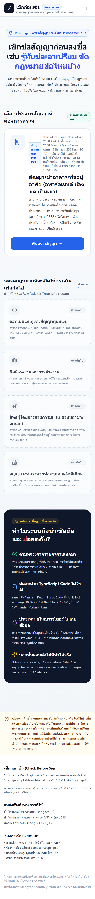 |  | 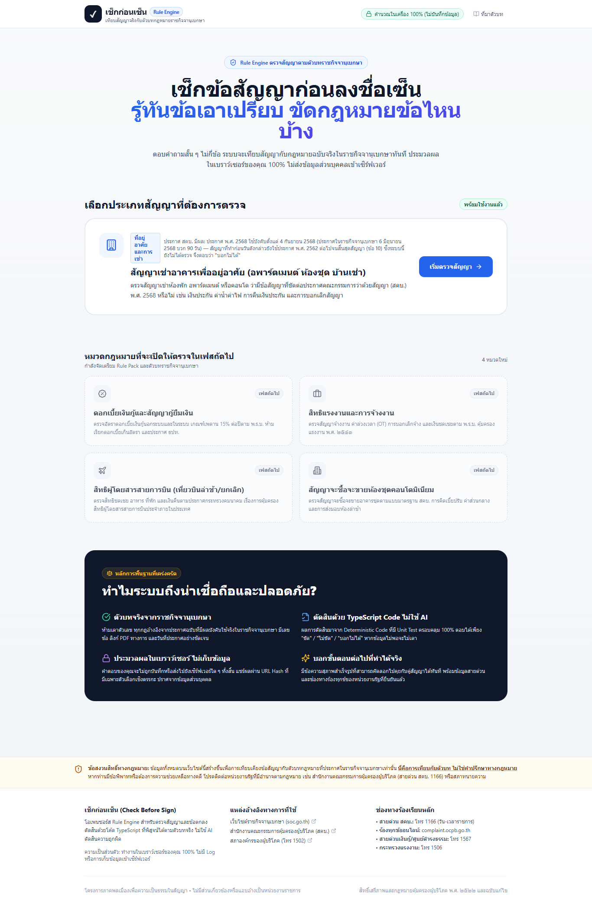 | 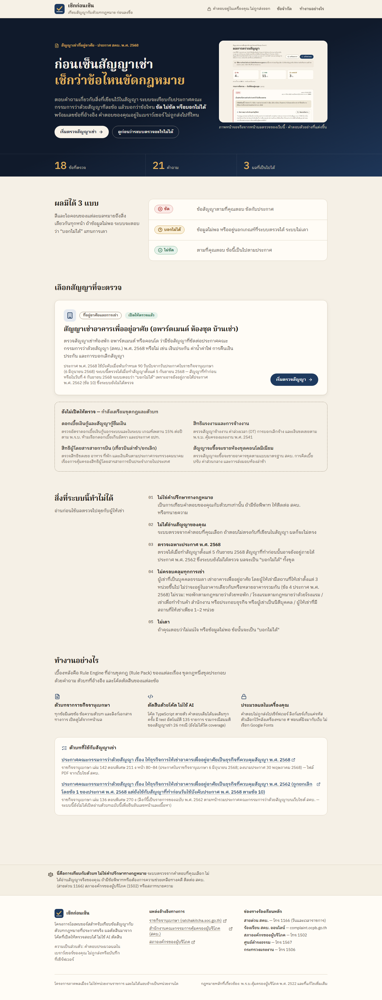 |
| คำถามข้อ 1 | 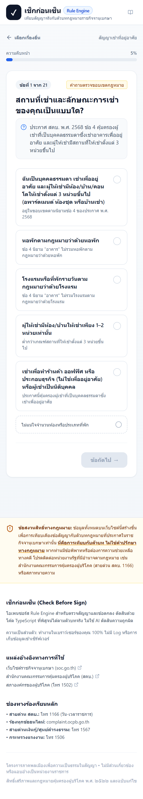 | 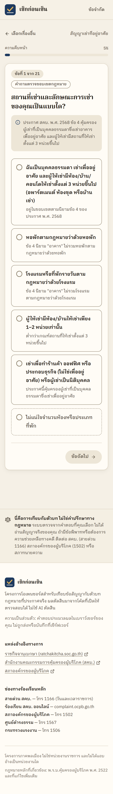 | 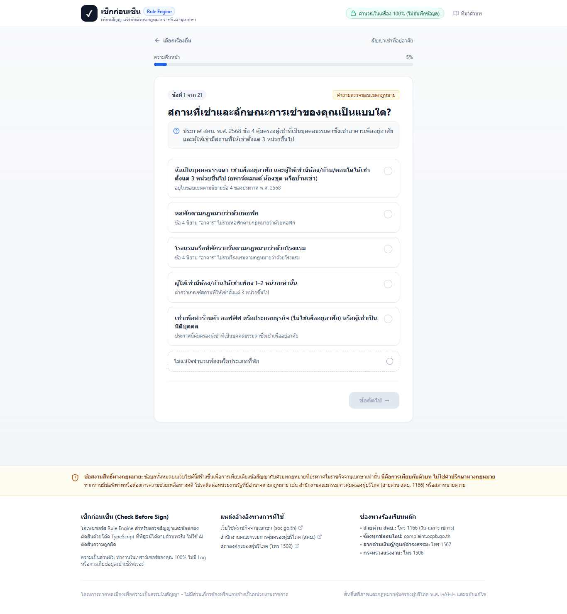 | 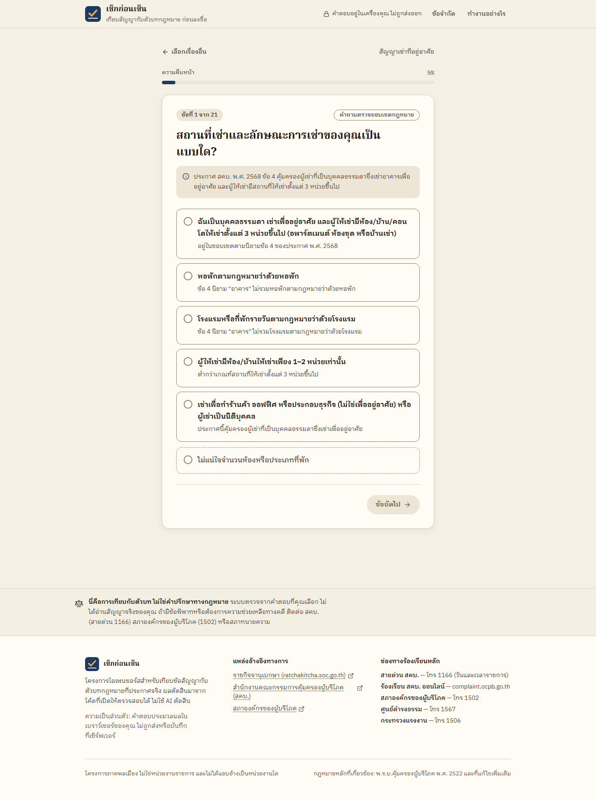 |
| หยุดถามกลางทาง (สัญญาก่อน 4 ก.ย. 2568) |  |  | 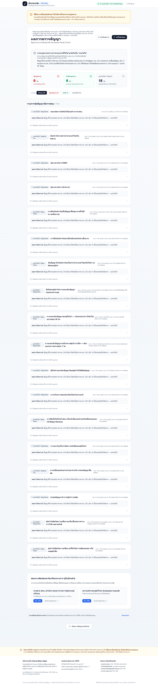 | 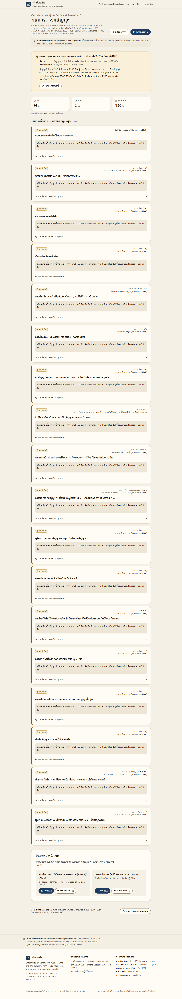 |
| หน้าผลมีทั้ง 3 ผล (4 / 11 / 3) |  |  | 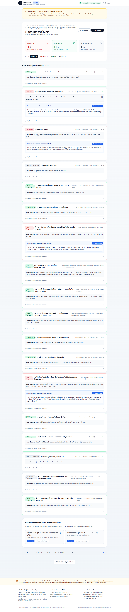 | 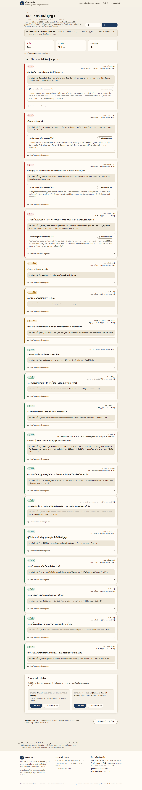 |
| 404 | 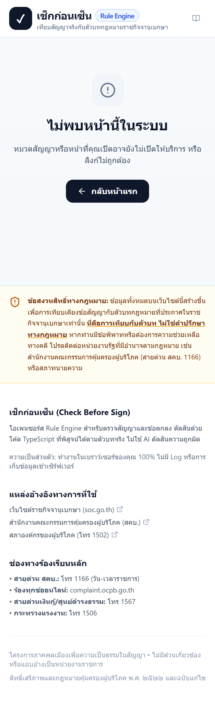 | 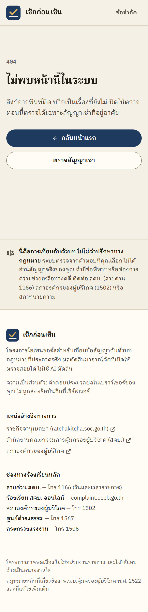 | 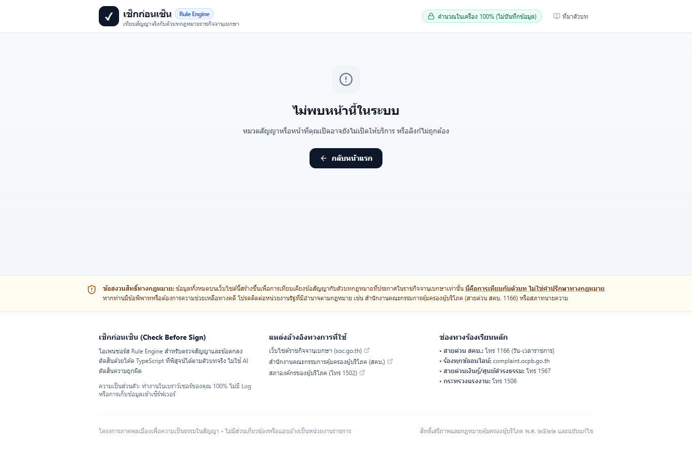 | 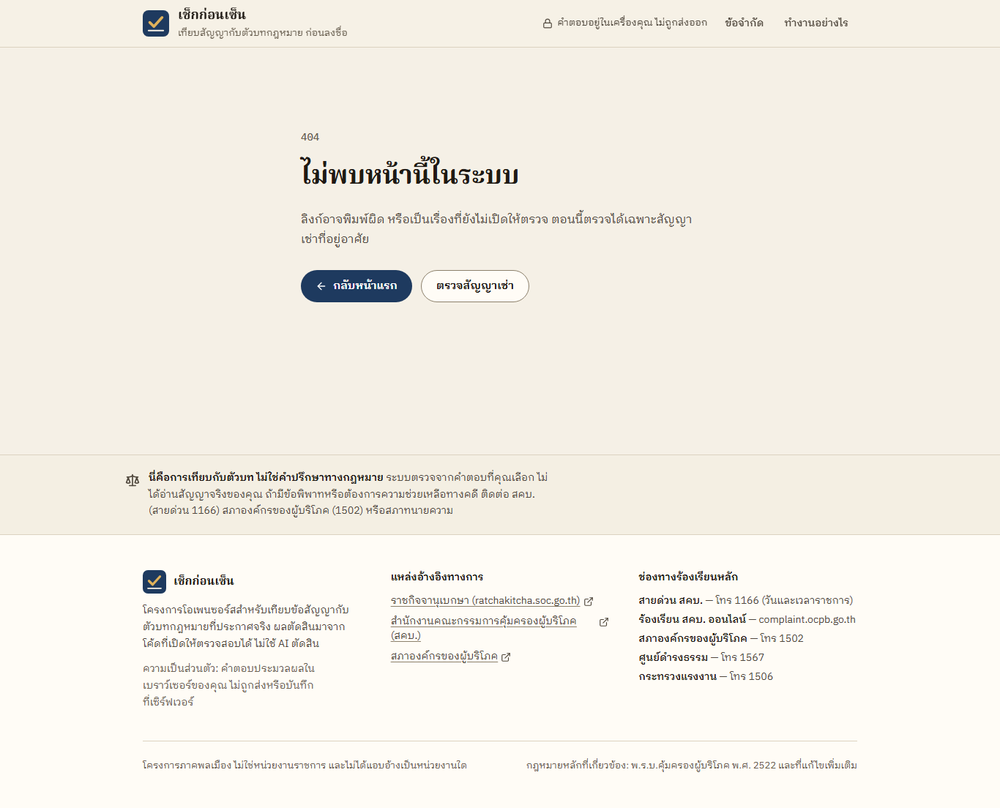 |

ภาพเพิ่มเติม (หลังแก้เท่านั้น):
- โฟกัสคีย์บอร์ด: `after-d1366-keyboard-focus-ring.png`
- หน้านอกขอบเขต: `after-m375-6-out-of-scope.png` และ `after-d1366-6-out-of-scope.png`

คำตอบที่ใช้กับหน้าผลแบบ 3 ผลเป็นชุดที่แต่งขึ้น อยู่ในตัวแปร `MIXED` ของ `scripts/ui-check.cjs` และ `DEMO_ANSWERS` ใน `make-brand-assets.cjs` (ชุดเดียวกัน)

## 4. สิ่งที่ตัดสินใจเองระหว่างทาง (ควรทบทวน)

1. **ลำดับบนหน้าผล** โจทย์บอกแค่ให้ "ขัด" ขึ้นก่อน ผมเรียงต่อเป็น บอกไม่ได้ แล้ว ไม่ขัด เพราะ "บอกไม่ได้" ยังต้องให้ผู้ใช้ตรวจเพิ่ม
2. **แปลงเลขตอนแสดงผล รวมถึงในตัวบท** แทนการแก้ pack.json (ดู 2.4)
3. **ข้อความ "มี test อัตโนมัติ 135 รายการ"** บนหน้าแรกเป็นค่าที่พิมพ์ไว้ในโค้ด (`AUTOMATED_TEST_COUNT` ใน `app/page.tsx`) เพราะหน้าเว็บอ่านผล vitest ไม่ได้ ถ้าจำนวน test เปลี่ยน ต้องแก้ตัวเลขนี้ด้วย ส่วนจำนวนกรณีสมมติ (26) อ่านจาก `cases.json` จริง
4. **Footer** ย้าย "สภาองค์กรของผู้บริโภค 1502" ไปอยู่ในรายการช่องทางร้องเรียนด้วย ข้อความกฎหมายหลักใส่คำนำว่า "กฎหมายหลักที่เกี่ยวข้อง:" นำหน้าข้อความที่โจทย์กำหนด
5. **หัวข้อคำถามใช้ `text-wrap: pretty` แทน `balance`** เพราะ balance บีบคำถามยาวจนตัดคำอย่าง "การ|เช่า" ส่วนหัวข้ออื่นยังใช้ balance และจัดวลีเป็น `inline-block` ในหัวข้อที่เคยตัดกลางคำ
6. **หัวข้อคำถามไม่มีวงโฟกัส** เมื่อระบบย้ายโฟกัสไปเพื่อโปรแกรมอ่านหน้าจอ หัวข้อไม่ใช่ปุ่มที่กดได้ จึงเป็นข้อยกเว้นข้อเดียวของกติกา focus ring
7. **เว็บมีแค่โหมดสว่าง** โจทย์ไม่ได้ขอโหมดมืด และ DESIGN.md ไม่ได้กำหนดไว้

## 5. ข้อความที่แก้ทุกจุด (เดิม → ใหม่)

### 5.1 ตามข้อ 4 ของโจทย์

| ไฟล์ | เดิม | ใหม่ |
|---|---|---|
| `packs/rental/pack.json` `meta.effectiveDateDisplay` | ประกาศ พ.ศ. 2568 ใช้บังคับตั้งแต่ 4 กันยายน 2568 (ประกาศในราชกิจจานุเบกษา 6 มิถุนายน 2568 บวก 90 วัน) — สัญญาที่ทำก่อนวันดังกล่าวยังใช้ประกาศ พ.ศ. 2562 ต่อไปจนสิ้นสุดสัญญา (ข้อ 10) ซึ่งระบบนี้ยังไม่ได้ตรวจ จึงตอบว่า "บอกไม่ได้" | ประกาศ พ.ศ. 2568 ใช้บังคับเมื่อพ้นกำหนด 90 วันนับจากวันประกาศในราชกิจจานุเบกษา (6 มิถุนายน 2568) ระบบนี้ตรวจได้เมื่อทำสัญญาตั้งแต่ 5 กันยายน 2568 — สัญญาที่ทำก่อนหรือในวันที่ 4 กันยายน 2568 ระบบตอบว่า "บอกไม่ได้" เพราะอาจยังอยู่ภายใต้ประกาศ พ.ศ. 2562 (ข้อ 10) ซึ่งระบบยังไม่ได้ตรวจ |
| `packs/rental/pack.json` `q_contract_date.helpText` | …และใช้บังคับเมื่อพ้นกำหนด 90 วัน (ข้อ 3) **ซึ่งนับได้ถึง 4 กันยายน 2568** สัญญาที่ทำก่อนวันใช้บังคับ… | …และใช้บังคับเมื่อพ้นกำหนด 90 วัน (ข้อ 3) **วันที่ 4 กันยายน 2568 เป็นวันครบ 90 วัน ระบบจึงตรวจได้เมื่อทำสัญญาตั้งแต่ 5 กันยายน 2568** สัญญาที่ทำก่อนวันใช้บังคับ… (ส่วนอื่นเหมือนเดิม) |
| `app/page.tsx` | ผลการตัดสินมาจาก Deterministic Code ที่มี Unit Test ครอบคลุม 100% ตอบได้เพียง "ขัด" / "ไม่ขัด" / "บอกไม่ได้" หากข้อมูลไม่พอจะไม่เดา | โค้ด TypeScript ตายตัว คำตอบเดิมได้ผลเดิมทุกครั้ง มี test อัตโนมัติ 135 รายการ รวมกรณีสมมติของสัญญาเช่า 26 กรณี (ยังไม่ได้วัด coverage) |
| `components/Footer.tsx` | สิทธิ์เสรีภาพและกฎหมายคุ้มครองผู้บริโภค พ.ศ. ๒๕๒๒ และฉบับแก้ไข | กฎหมายหลักที่เกี่ยวข้อง: พ.ร.บ.คุ้มครองผู้บริโภค พ.ศ. 2522 และที่แก้ไขเพิ่มเติม |
| `components/Footer.tsx` | สายด่วนเงินกู้/ศูนย์ดำรงธรรม: โทร 1567 | ศูนย์ดำรงธรรม — โทร 1567 |
| `lib/packs/registry.ts` | …พ.ร.บ. คุ้มครองแรงงาน พ.ศ. ๒๕๔๑ | …พ.ร.บ. คุ้มครองแรงงาน พ.ศ. 2541 |

**สิ่งที่ไม่ได้เปลี่ยนใน pack.json:**
- id ของตัวเลือก (`before_effective` / `boundary_day` / `on_or_after_effective`)
- `endsQuestionnaire`
- ผลตัดสิน
- ฟิลด์วันที่ `effectiveDate: "2568-09-04"` (ดูข้อ 7)

### 5.2 ข้อความ UI อื่นที่เปลี่ยนตามดีไซน์ใหม่

| ที่ | เดิม | ใหม่ |
|---|---|---|
| `layout.tsx` title | เช็กก่อนเซ็น \| ระบบตรวจสอบสัญญาตามตัวบทกฎหมายจริง | เช็กก่อนเซ็น — ตรวจสัญญาเช่ากับตัวบทกฎหมายก่อนลงชื่อ |
| `layout.tsx` description | ตรวจสัญญาเช่าหอพัก อพาร์ตเมนต์ คอนโด ว่าข้อไหนขัดประกาศ สคบ. ตัดสินด้วยโค้ด TypeScript ตามตัวบทจริงในราชกิจจานุเบกษา ทำงานในเครื่อง 100% ไม่เก็บข้อมูล | ตอบคำถามเกี่ยวกับสัญญาเช่าที่อยู่อาศัย แล้วดูว่าข้อไหนขัด ไม่ขัด หรือบอกไม่ได้ ตามประกาศคณะกรรมการว่าด้วยสัญญา พ.ศ. 2568 ทำงานในเบราว์เซอร์ ไม่เก็บคำตอบ ไม่ใช่คำปรึกษาทางกฎหมาย |
| Header ป้าย | Rule Engine | (เอาออก) |
| Header บรรทัดรอง | เทียบสัญญาจริงกับตัวบทกฎหมายราชกิจจานุเบกษา | เทียบสัญญากับตัวบทกฎหมาย ก่อนลงชื่อ |
| Header ป้ายความเป็นส่วนตัว | คำนวณในเครื่อง 100% (ไม่บันทึกข้อมูล) | คำตอบอยู่ในเครื่องคุณ ไม่ถูกส่งออก |
| Header ลิงก์ | ที่มาตัวบท | ข้อจำกัด · ทำงานอย่างไร |
| หน้าแรก ป้ายเหนือหัวข้อ | Rule Engine ตรวจสัญญาตามตัวบทราชกิจจานุเบกษา | สัญญาเช่าที่อยู่อาศัย · ประกาศ สคบ. พ.ศ. 2568 |
| หน้าแรก H1 | เช็กข้อสัญญาก่อนลงชื่อเซ็น รู้ทันข้อเอาเปรียบ ขัดกฎหมายข้อไหนบ้าง | ก่อนเซ็นสัญญาเช่า / เช็กว่าข้อไหนขัดกฎหมาย |
| หน้าแรก คำโปรย | ตอบคำถามสั้น ๆ ไม่กี่ข้อ ระบบจะเทียบสัญญากับกฎหมายฉบับจริงในราชกิจจานุเบกษาทันที ประมวลผลในเบราว์เซอร์ของคุณ 100% ไม่ส่งข้อมูลส่วนบุคคลเข้าเซิร์ฟเวอร์ | ตอบคำถามเกี่ยวกับสิ่งที่เขียนไว้ในสัญญา ระบบจะเทียบกับประกาศคณะกรรมการว่าด้วยสัญญาทีละข้อ แล้วบอกว่าข้อไหน ขัด ไม่ขัด หรือบอกไม่ได้ พร้อมเลขข้อที่อ้างอิง คำตอบของคุณอยู่ในเบราว์เซอร์ ไม่ถูกส่งไปที่ไหน |
| หน้าแรก ปุ่ม | (ไม่มีใน hero) | เริ่มตรวจสัญญาเช่า · ดูก่อนว่าระบบตรวจอะไรไม่ได้ |
| หน้าแรก หัวข้อ pack | เลือกประเภทสัญญาที่ต้องการตรวจ / พร้อมใช้งานแล้ว | เลือกสัญญาที่จะตรวจ / เปิดให้ตรวจแล้ว |
| การ์ด pack | ประกาศ สคบ. มีผล: {effectiveDateDisplay} | {effectiveDateDisplay} (ข้อความใหม่จาก 5.1) |
| pack ที่ยังไม่เปิด | หมวดกฎหมายที่จะเปิดให้ตรวจในเฟสถัดไป / กำลังจัดเตรียม Rule Pack และตัวบทราชกิจจานุเบกษา / 4 หมวดใหม่ / ป้าย "เฟสถัดไป" ทุกการ์ด | ยังไม่เปิดให้ตรวจ — กำลังเตรียมชุดกฎและตัวบท (เป็นรายการเดียว ไม่มีป้าย) |
| หน้าแรก section หลักการ | หลักการพื้นฐานที่เคร่งครัด / ทำไมระบบถึงน่าเชื่อถือและปลอดภัย? (มี 4 ข้อ) | ทำงานอย่างไร (มี 3 ข้อ ได้แก่ ตัวบทจากราชกิจจานุเบกษา / ตัดสินด้วยโค้ด ไม่ใช้ AI / ประมวลผลในเครื่องคุณ) พร้อมรายการตัวบทที่ใช้และลิงก์ ข้อ "บอกขั้นตอนต่อไปที่ทำได้จริง" ถูกตัดออก เพราะหน้าผลมีส่วนนี้อยู่แล้ว |
| หน้าแรก ข้อ "ตัวบทจริง" | ห้ามเดาตัวเลข ทุกกฎอ้างอิงจากประกาศฉบับที่มีผลบังคับใช้จริงในราชกิจจานุเบกษา มีเลขข้อ ลิงก์ PDF ทางการ และวันที่ประกาศอย่างชัดเจน | ทุกข้อมีเลขข้อ ข้อความตัวบท และลิงก์เอกสารทางการ เปิดดูได้จากหน้าผล |
| หน้าแรก ข้อ "ในเครื่อง" | คำตอบของคุณจะไม่ถูกบันทึกหรือส่งไปยังเซิร์ฟเวอร์ใด ๆ ทั้งสิ้น แชร์ผลผ่าน URL Hash ที่มีเฉพาะตัวเลือกเชิงตรรกะ ปราศจากข้อมูลส่วนบุคคล | คำตอบไม่ถูกส่งไปเซิร์ฟเวอร์ ลิงก์แชร์เก็บแค่รหัสตัวเลือกไว้หลังเครื่องหมาย # ฟอนต์ฝังมากับเว็บ ไม่เรียก Google Fonts |
| หน้าแรก section ใหม่ | — | "ผลมีได้ 3 แบบ" และ "สิ่งที่ระบบนี้ทำไม่ได้" (5 ข้อ: ไม่ใช่คำปรึกษาทางกฎหมาย / ไม่ได้อ่านสัญญาของคุณ / ตรวจเฉพาะประกาศ พ.ศ. 2568 / ไม่ครอบคลุมทุกการเช่า / ไม่เดา) |
| Footer ข้อสงวนสิทธิ์ | ข้อสงวนสิทธิ์ทางกฎหมาย: ข้อมูลทั้งหมดบนเว็บไซต์นี้สร้างขึ้นเพื่อการเทียบเคียง… นี่คือการเทียบกับตัวบท ไม่ใช่คำปรึกษาทางกฎหมาย หากท่านมีข้อพิพาท… (สายด่วน สคบ. 1166) หรือสภาทนายความ | นี่คือการเทียบกับตัวบท ไม่ใช่คำปรึกษาทางกฎหมาย ระบบตรวจจากคำตอบที่คุณเลือก ไม่ได้อ่านสัญญาจริงของคุณ ถ้ามีข้อพิพาทหรือต้องการความช่วยเหลือทางคดี ติดต่อ สคบ. (สายด่วน 1166) สภาองค์กรของผู้บริโภค (1502) หรือสภาทนายความ |
| Footer ชื่อโครงการ | เช็กก่อนเซ็น (Check Before Sign) | เช็กก่อนเซ็น |
| Footer ข้อความเกี่ยวกับโครงการ | โอเพนซอร์ส Rule Engine สำหรับตรวจสัญญาและข้อตกลง ตัดสินด้วยโค้ด TypeScript ที่พิสูจน์ได้ตามตัวบทจริง ไม่ใช้ AI ตัดสินความถูกผิด | โครงการโอเพนซอร์สสำหรับเทียบข้อสัญญากับตัวบทกฎหมายที่ประกาศจริง ผลตัดสินมาจากโค้ดที่เปิดให้ตรวจสอบได้ ไม่ใช้ AI ตัดสิน |
| Footer ความเป็นส่วนตัว | ความเป็นส่วนตัว: ทำงานในเบราว์เซอร์ของคุณ 100% ไม่มี Log หรือการเก็บข้อมูลเข้าเซิร์ฟเวอร์ | ความเป็นส่วนตัว: คำตอบประมวลผลในเบราว์เซอร์ของคุณ ไม่ถูกส่งหรือบันทึกที่เซิร์ฟเวอร์ |
| Footer หัวข้อ | แหล่งอ้างอิงทางการที่ใช้ | แหล่งอ้างอิงทางการ |
| Footer ลิงก์ | เว็บไซต์ราชกิจจานุเบกษา (soc.go.th) / สภาองค์กรของผู้บริโภค (โทร 1502) | ราชกิจจานุเบกษา (ratchakitcha.soc.go.th) / สภาองค์กรของผู้บริโภค (ย้ายเบอร์ 1502 ไปที่รายการช่องทางร้องเรียน) |
| Footer บรรทัดล่าง | โครงการภาคพลเมืองเพื่อความเป็นธรรมในสัญญา • ไม่มีส่วนเกี่ยวข้องหรือแอบอ้างเป็นหน่วยงานราชการ | โครงการภาคพลเมือง ไม่ใช่หน่วยงานราชการ และไม่ได้แอบอ้างเป็นหน่วยงานใด |
| หน้าคำถาม ปุ่ม | ← ย้อนกลับ / ข้อถัดไป → | ย้อนกลับ / ข้อถัดไป (ลูกศรเป็นไอคอน) |
| หน้าผล ชื่อผลตัดสิน | ขัดกฎหมาย / ไม่ขัดกฎหมาย / บอกไม่ได้ / ไม่แน่ใจ / บอกไม่ได้ / ข้อมูลไม่พอ | **ขัด / ไม่ขัด / บอกไม่ได้** (คำเดียวกันทุกที่) |
| หน้าผล คำใต้ตัวนับ | ควรเจรจาขอตัดออกหรือปรับแก้ / ไม่พบข้อสัญญาที่ขัด / ตรงตามมาตรฐานประกาศ สคบ. / ข้อมูลไม่เพียงพอ หรือไม่ได้ระบุ | (เอาออก เหลือ "ตรวจทั้งหมด 18 ข้อ · กดตัวเลขเพื่อกรอง") |
| หน้าผล วันมีผล | ข้อมูลกฎหมายมีผลใช้บังคับ: … | เกณฑ์ที่ใช้: … |
| หน้าผล ข้อสงวนสิทธิ์ | ระบบเทียบเคียงเงื่อนไขในสัญญาของคุณกับตัวบทที่ประกาศในราชกิจจานุเบกษา เพื่อให้ทราบจุดที่อาจเสียเปรียบหรือขัดกฎหมายก่อนลงนาม หากต้องการคำปรึกษาทางคดี โปรดติดต่อสายด่วน สคบ. 1166 หรือทนายความ | ผลนี้มาจากคำตอบที่คุณเลือก ไม่ได้อ่านสัญญาจริง ถ้าต้องการคำปรึกษาทางคดี โทรสายด่วน สคบ. 1166 หรือปรึกษาทนายความ |
| หน้าผล ตัวกรอง | กรองดู: ทั้งหมด (18) / ขัดกฎหมาย (n) / ไม่ขัด (n) / บอกไม่ได้ (n) | ตัวนับ 3 ช่องเป็นปุ่มกรอง + ลิงก์ "แสดงทั้งหมด" |
| หน้าผล หัวรายการ | รายการข้อสัญญาที่ตรวจสอบ | รายการที่ตรวจ — ข้อที่ขัดอยู่บนสุด / เฉพาะข้อที่ {ผล} |
| หน้าผล การ์ด | ผลการวิเคราะห์: | ทำไมได้ผลนี้: |
| หน้าผล ข้อความเจรจา | ข้อความสุภาพสำหรับคัดลอกไปคุยกับผู้ให้เช่า: / คัดลอกแล้ว! | ข้อความสุภาพสำหรับคุยกับผู้ให้เช่า / คัดลอกแล้ว |
| หน้าผล ตัวบท | เปิดดูข้อความตัวบทจริงจากราชกิจจานุเบกษา / ซ่อนตัวบทกฎหมายจริง / เปิดดูเอกสารทางการ (PDF) | อ่านตัวบทจากราชกิจจานุเบกษา / ซ่อนตัวบท / เปิดเอกสารทางการ + หมายเหตุเรื่องการแปลงเลข |
| หน้าผล ช่องทางช่วยเหลือ | ช่องทางติดต่อและร้องเรียนทางการ (ยืนยันแล้ว) / หากเจรจาแล้วผู้ให้เช่ายังยืนยันจะใช้สัญญาที่ขัดต่อกฎหมาย หรือถูกเอาเปรียบ สามารถขอความช่วยเหลือได้จากหน่วยงานภาครัฐ: / เปิดเว็บไซต์ร้องเรียน | ถ้าเจรจาแล้วไม่ได้ผล / ถ้าผู้ให้เช่ายังยืนยันจะใช้ข้อสัญญาที่ขัดกับประกาศ ขอความช่วยเหลือได้จากหน่วยงานเหล่านี้ / เว็บไซต์ร้องเรียน |
| หน้าผล การแชร์ | ความเป็นส่วนตัวในการแชร์: ลิงก์แชร์ผลตรวจจะเข้ารหัสเฉพาะรหัสคำตอบใน URL ไม่มีชื่อ เบอร์โทร หรือที่อยู่ของคุณ / คัดลอกลิงก์แล้ว! | ลิงก์แชร์เก็บอะไรบ้าง: เฉพาะรหัสตัวเลือกที่คุณตอบ ไว้หลังเครื่องหมาย # ไม่มีชื่อ เบอร์โทร หรือที่อยู่ และไม่ถูกส่งไปเซิร์ฟเวอร์ / คัดลอกลิงก์แล้ว (ปุ่มคัดลอกซ้ำด้านล่างถูกตัดออก เหลือปุ่มบนสุดปุ่มเดียว) |
| กรอบหยุดถาม | คำถาม: … / คำตอบของคุณ: … | คำถาม / คำตอบของคุณ (เป็นรายการคู่) + ปุ่มใหม่ "แก้คำตอบข้อนี้" หัวข้อในกรอบเหมือนเดิม |
| นอกขอบเขต | อยู่นอกขอบเขตการกำกับของประกาศฉบับนี้ / ระบบหยุดการตรวจสอบไว้ที่ข้อแรก / เหตุผลที่ไม่อยู่ในขอบเขต: / ตามหลักการที่โปร่งใส หากสถานการณ์ของคุณไม่อยู่ในนิยามของกฎหมายฉบับนี้ ระบบจะไม่นำกฎเกณฑ์มาตรวจต่อเพื่อป้องกันความเข้าใจผิดในสิทธิและหน้าที่ / ช่องทางติดต่อสอบถามหรือขอความช่วยเหลือทางการ | กรณีของคุณอยู่นอกขอบเขตของประกาศฉบับนี้ / เหตุผล / ระบบจึงไม่นำข้อกำหนดของประกาศนี้มาตรวจต่อ เพื่อไม่ให้เข้าใจผิดเรื่องสิทธิและหน้าที่ของคุณ ถ้าตอบข้อแรกผิด กดปุ่มด้านล่างเพื่อเริ่มใหม่ / สอบถามหรือขอความช่วยเหลือ |
| 404 | หมวดสัญญาหรือหน้าที่คุณเปิดอาจยังไม่เปิดให้บริการ หรือลิงก์ไม่ถูกต้อง | ลิงก์อาจพิมพ์ผิด หรือเป็นเรื่องที่ยังไม่เปิดให้ตรวจ ตอนนี้ตรวจได้เฉพาะสัญญาเช่าที่อยู่อาศัย (+ ปุ่ม "ตรวจสัญญาเช่า") |

## 6. ความเสี่ยงที่เปลี่ยนไปจากเดิม

- **build ต้องต่อ fonts.googleapis.com ได้** เพราะ `next/font/google` ดาวน์โหลดฟอนต์ตอน build
  - build ครั้งแรกล้มเพราะต่อไม่ได้ชั่วคราว ข้อความ error ดิบอยู่ในข้อ 8.4 ส่วน build ครั้งที่สองผ่านโดยไม่ได้แก้อะไร
  - Vercel ต่ออินเทอร์เน็ตได้ แต่ถ้าต้อง build แบบออฟไลน์ ให้เปลี่ยนไปใช้ `next/font/local` และ commit ไฟล์ฟอนต์ไว้ใน repo
  - ตอนใช้งานจริง ผู้ใช้ไม่ต้องต่อ Google เลย
- **ภาพใน hero และ OG image เป็นไฟล์ที่สร้างไว้ล่วงหน้า** ถ้าหน้าผลเปลี่ยน ภาพจะเก่า ต้องรัน `node scripts/make-brand-assets.cjs` แล้ว build ใหม่

## 7. สิ่งที่ยังไม่ได้ตรวจ / ยังไม่ได้ทำ

1. **โปรแกรมอ่านหน้าจอจริง** (NVDA, VoiceOver) ยังไม่ได้ลอง ตรวจแค่ DOM และ ARIA (`aria-pressed`, `aria-expanded`, `role=progressbar`, `role=status`) กับการย้ายโฟกัสผ่านสคริปต์
2. **ตรวจแค่ Chrome บน Windows** ยังไม่ได้ลอง Safari/iOS, Firefox และ Android
   - การตัดคำไทยต่างกันในแต่ละเบราว์เซอร์ ผลตรวจหัวข้อ hero ว่าไม่มีคำตกบรรทัดเดี่ยวจึงยืนยันได้กับ Chrome เท่านั้น
   - `text-wrap: balance/pretty` ใช้ไม่ได้ในเบราว์เซอร์เก่า ซึ่งจะกลับไปตัดบรรทัดแบบปกติ
3. **ขอบเขตของการตรวจ contrast อัตโนมัติ:**
   - ตรวจเฉพาะตัวอักษร ไม่รวมตัวอักษรที่อยู่ในรูปภาพ (ภาพหน้าจอใน hero, OG image)
   - ตัวอักษรบนพื้น hero ที่ไล่สี วัดเทียบกับจุดที่สว่างที่สุดของพื้นซึ่งเป็นกรณีแย่สุด
   - เส้นขอบและไอคอน (non-text contrast) คำนวณเองเฉพาะ `line-strong` (3.79 : 1) ที่เหลือไม่ได้ตรวจ
4. **คีย์บอร์ดตรวจที่หน้าคำถามข้อ 1 ที่ 1366px เท่านั้น** ยังไม่ได้ไล่ Tab บนหน้าผล ช่องกรอกตัวเลข และหน้าแรก (ปุ่มเหล่านี้เป็น `button`/`a` จริงที่ใช้ focus ring ชุดเดียวกัน แต่ยังไม่ได้ลองกดจริง)
5. **ภาพตอนแชร์ลิงก์บน Facebook, LINE และ X** ยังไม่ได้ลอง เพราะยังไม่ได้ deploy ส่วน `og:image` บน Vercel ขึ้นกับค่า `VERCEL_PROJECT_PRODUCTION_URL` หรือ `NEXT_PUBLIC_SITE_URL` ซึ่งยังไม่ได้ยืนยัน
6. **ยังไม่ได้ deploy บน Vercel จริง** (ค้างจากรายงานที่ 2)
7. **ข้อความใน pack.json ที่ยังขัดกับวันตัดสิน 5 ก.ย.** อยู่นอกขอบเขตข้อ 4 จึงไม่ได้แก้:
   - `q_contract_date.unsureEndsQuestionnaire.reason` ยังเขียนว่า "ประกาศ พ.ศ. 2568 มีผล (4 กันยายน 2568)"
   - ฟิลด์ `meta.effectiveDate` และ `officialSources[0].effectiveDate` ยังเป็น `"2568-09-04"` ฟิลด์เหล่านี้ไม่แสดงบนหน้าเว็บ แต่ควรตัดสินใจพร้อมกับเรื่องวันที่ 4 หรือ 5 ที่ค้างจากรายงานที่ 1
   - เหตุผลนอกขอบเขตจาก `rules.ts` ยังเขียนว่า "หากสัญญาทำก่อน 4 กันยายน 2568…" แก้ไม่ได้ เพราะห้ามแตะ `rules.ts`
8. **README ส่วนอื่น** แก้แค่ภาพหน้าจอ ยังมีคำว่า "ประมวลผลในเบราว์เซอร์ 100%", "ตรวจได้ใน 2 นาที", "ผ่านการทดสอบ 100%" และเลขไทย ซึ่งเป็นข้ออ้างแบบเดียวกับที่ลบจากหน้าเว็บ
9. **สคริปต์ภาพหน้าจอรุ่นเก่า** `scripts/take-screenshots.ts` และ `capture-screenshots.ps1` ยังอยู่และใช้ไม่ได้กับคำถามรุ่นปัจจุบัน ตอนนี้ใช้ `ui-check.cjs` และ `make-brand-assets.cjs` แทน
10. **จำนวน test บนหน้าแรก (135) พิมพ์ไว้ในโค้ด** ต้องแก้ตามเมื่อจำนวน test เปลี่ยน (ดูข้อ 4.3)
11. **ภาพก่อนแก้** ถ่ายด้วยสคริปต์ใน scratchpad ที่ไม่ได้อยู่ใน repo เพราะ `ui-check.cjs` รุ่นใหม่ใช้ selector ของ UI ใหม่ ลำดับการกดและคำตอบชุด 4/11/3 เหมือนกับภาพหลังแก้

## 8. Output ดิบ

### 8.1 `npm test`

```

> check-before-sign@0.1.0 test
> vitest run

The CJS build of Vite's Node API is deprecated. See https://vite.dev/guide/troubleshooting.html#vite-cjs-node-api-deprecated for more details.

 RUN  v2.1.9 D:/check-before-sign

stdout | tests/rental-cases.test.ts > Rental Pack Cases Verification (ชุดตัวอย่างแต่งขึ้น) > summary: all hypothetical cases match expected outputs 100%

========================================
Rental Cases Test Summary: 26 / 26 Cases Passed (100% Match)
All cases are explicitly verified as hypothetical examples.
========================================


 ✓ tests/rental-cases.test.ts (29 tests) 37ms
 ✓ tests/rental-rules.test.ts (83 tests) 58ms
 ✓ tests/engine.test.ts (23 tests) 55ms

 Test Files  3 passed (3)
      Tests  135 passed (135)
   Start at  21:19:21
   Duration  1.35s (transform 440ms, setup 0ms, collect 1.05s, tests 150ms, environment 1ms, prepare 796ms)

EXIT 0
```

### 8.2 `npx tsc --noEmit`

(ไม่มี output เมื่อผ่าน บรรทัด EXIT เติมโดยสคริปต์ที่รัน)

```
EXIT 0
```

### 8.3 `npm run build` (ครั้งสุดท้าย)

```

> check-before-sign@0.1.0 prebuild
> tsx scripts/validate-packs.ts

[Pack Validator] Scanning packs in: D:\check-before-sign\packs

--> Validating pack: rental
  [OK] pack.json is valid (21 questions, 18 rules)
  [OK] rules.ts exists
  [OK] cases.json is valid (26 test cases, all marked hypothetical)

[Pack Validator] All pack schemas validated successfully!

> check-before-sign@0.1.0 build
> next build

▲ Next.js 16.4.5 (Turbopack)
✓ Running next.config took 25ms

  Creating an optimized production build ...
✓ Compiled successfully in 1759ms
  Running TypeScript ...
  Finished TypeScript in 3.6s ...
  Collecting page data using 9 workers ...
  Generating static pages using 9 workers (0/8) ...
  Generating static pages using 9 workers (2/8) 
  Generating static pages using 9 workers (4/8) 
  Generating static pages using 9 workers (6/8) 
✓ Generating static pages using 9 workers (8/8) in 1034ms
  Finalizing page optimization ...

Route (app)
┌ ○ /
├ ○ /_not-found
├ ○ /apple-icon.png
├   /check/[packId]
│ └ ● /check/rental
├ ○ /icon.svg
└ ○ /opengraph-image.png


○  (Static)  prerendered as static content
●  (SSG)     prerendered as static HTML (uses generateStaticParams)

EXIT 0
```

### 8.4 `npm run build` ครั้งแรก (ล้ม — ต่อ Google Fonts ไม่ได้ชั่วคราว; ครั้งถัดไปผ่านโดยไม่แก้อะไร)

```

> check-before-sign@0.1.0 prebuild
> tsx scripts/validate-packs.ts

[Pack Validator] Scanning packs in: D:\check-before-sign\packs

--> Validating pack: rental
  [OK] pack.json is valid (21 questions, 18 rules)
  [OK] rules.ts exists
  [OK] cases.json is valid (26 test cases, all marked hypothetical)

[Pack Validator] All pack schemas validated successfully!

> check-before-sign@0.1.0 build
> next build

▲ Next.js 16.4.5 (Turbopack)
✓ Running next.config took 37ms

  Creating an optimized production build ...
Turbopack build encountered 3 warnings:
[next]/internal/font/google/ibm_plex_mono_a5bd59ca.module.css
Warning: Error while requesting resource
There was an issue establishing a connection while requesting https://fonts.googleapis.com/css2?family=IBM+Plex+Mono:wght@500&display=swap

Import trace:
  Server Component:
    [next]/internal/font/google/ibm_plex_mono_a5bd59ca.module.css
    [next]/internal/font/google/ibm_plex_mono_a5bd59ca.js
    ./app/layout.tsx


[next]/internal/font/google/ibm_plex_sans_thai_looped_879c634e.module.css
Warning: Error while requesting resource
There was an issue establishing a connection while requesting https://fonts.googleapis.com/css2?family=IBM+Plex+Sans+Thai+Looped:wght@400;500;600;700&display=swap

Import trace:
  Server Component:
    [next]/internal/font/google/ibm_plex_sans_thai_looped_879c634e.module.css
    [next]/internal/font/google/ibm_plex_sans_thai_looped_879c634e.js
    ./app/layout.tsx


[next]/internal/font/google/noto_serif_thai_cda028ad.module.css
Warning: Error while requesting resource
There was an issue establishing a connection while requesting https://fonts.googleapis.com/css2?family=Noto+Serif+Thai:wght@600;700&display=swap

Import trace:
  Server Component:
    [next]/internal/font/google/noto_serif_thai_cda028ad.module.css
    [next]/internal/font/google/noto_serif_thai_cda028ad.js
    ./app/layout.tsx


> Build error occurred
Error: Turbopack build failed with 3 errors:
[next]/internal/font/google/ibm_plex_mono_a5bd59ca.module.css
Error: next/font: error:
Failed to fetch IBM Plex Mono from Google Fonts.
If you are offline or behind a proxy, self-host the font with next/font/local, or set HTTP_PROXY/HTTPS_PROXY so Next.js can reach fonts.googleapis.com.

Import trace:
  Server Component:
    [next]/internal/font/google/ibm_plex_mono_a5bd59ca.module.css
    [next]/internal/font/google/ibm_plex_mono_a5bd59ca.js
    ./app/layout.tsx


[next]/internal/font/google/ibm_plex_sans_thai_looped_879c634e.module.css
Error: next/font: error:
Failed to fetch IBM Plex Sans Thai Looped from Google Fonts.
If you are offline or behind a proxy, self-host the font with next/font/local, or set HTTP_PROXY/HTTPS_PROXY so Next.js can reach fonts.googleapis.com.

Import trace:
  Server Component:
    [next]/internal/font/google/ibm_plex_sans_thai_looped_879c634e.module.css
    [next]/internal/font/google/ibm_plex_sans_thai_looped_879c634e.js
    ./app/layout.tsx


[next]/internal/font/google/noto_serif_thai_cda028ad.module.css
Error: next/font: error:
Failed to fetch Noto Serif Thai from Google Fonts.
If you are offline or behind a proxy, self-host the font with next/font/local, or set HTTP_PROXY/HTTPS_PROXY so Next.js can reach fonts.googleapis.com.

Import trace:
  Server Component:
    [next]/internal/font/google/noto_serif_thai_cda028ad.module.css
    [next]/internal/font/google/noto_serif_thai_cda028ad.js
    ./app/layout.tsx


    at ignore-listed frames
```

### 8.5 `node scripts/ui-check.cjs` (build สุดท้าย, server `npm start` :3020)

```
browser: C:/Program Files/Google/Chrome/Application/chrome.exe
PASS  [m375] GET / → 200
PASS  [m375] home shows the start button
PASS  [m375] "Rule Engine" only appears inside "ทำงานอย่างไร" (outside: [])
PASS  [m375] no "ครอบคลุม 100%" claim
PASS  [m375] hero heading has no near-empty line (lines 2, shortest/longest 0.76)
PASS  [m375] pack-card badges stay on one line: [{"text":"ที่อยู่อาศัยและการเช่า","oneLine":true},{"text":"เปิดให้ตรวจแล้ว","oneLine":true}]
PASS  [m375] hero shows the real result screenshot (naturalWidth 600)
PASS  [m375] stats strip = 18 · 21 · 3 (got 18 · 21 · 3)
PASS  [m375] og:image meta present → http://localhost:3020/opengraph-image.png?opengraph-image.243qfygtv2slh.png
INFO  [m375] icon links: /favicon.ico?favicon.2trnuhe_uaze8.ico, /icon.svg?icon.38el2ne66n9zo.svg, /apple-icon.png?apple-icon.3m37ou0gzx-e7.png
PASS  [m375] home: no horizontal scroll (scrollWidth 375 <= clientWidth 375)
PASS  [m375] home: every text meets WCAG AA contrast
PASS  [m375] GET /check/rental → 200
PASS  [m375] question 1: every text meets WCAG AA contrast
PASS  [m375] normal: question 2 (contract date) shown after scope
PASS  [m375] normal: continues to question 3 of 21 (got {"n":3,"of":21})
PASS  [m375] normal: reached the result page after all 21 questions
PASS  [m375] normal: no "ended early" box on the normal path
PASS  [m375] ended early: button on question 2 reads "ดูผลการตรวจสัญญา" (got "ดูผลการตรวจสัญญา")
PASS  [m375] ended early: result page shown immediately after question 2
PASS  [m375] ended early: box with the clause 10 reason and "แก้คำตอบข้อนี้"
PASS  [m375] ended early: counters ขัด/ไม่ขัด/บอกไม่ได้ = [0,0,18] (want [0,0,18])
PASS  [m375] ended-early result: no horizontal scroll (scrollWidth 375 <= clientWidth 375)
PASS  [m375] ended-early result: every text meets WCAG AA contrast
PASS  [m375] ended early: "แก้คำตอบข้อนี้" reopens question 2
PASS  [m375] mixed result: counters ขัด/ไม่ขัด/บอกไม่ได้ = [4,11,3] (want [4,11,3])
PASS  [m375] mixed result: "ขัด" listed first, then บอกไม่ได้, then ไม่ขัด
PASS  [m375] mixed result: every verdict chip has an icon and a word
PASS  [m375] mixed result: clause number "6.1(2)" set in "IBM Plex Mono"
PASS  [m375] mixed result: no Thai numerals on the page (Arabic everywhere)
PASS  [m375] mixed result: no horizontal scroll (scrollWidth 375 <= clientWidth 375)
PASS  [m375] mixed result: every text meets WCAG AA contrast
PASS  [m375] GET /check/ไม่มีอยู่จริง → HTTP 404
PASS  [m375] 404 page shows the Thai not-found message
PASS  [m375] 404: every text meets WCAG AA contrast
PASS  [m375] GET /favicon.ico → 200 image/x-icon
PASS  [m375] GET /icon.svg → 200 image/svg+xml
PASS  [m375] GET /apple-icon.png → 200 image/png
PASS  [m375] GET /opengraph-image.png → 200 image/png
PASS  [m375] no requests leave the site (fonts self-hosted, no Google Fonts): none
INFO  [m375] responses >= 400: 404 http://localhost:3020/check/ไม่มีอยู่จริง
PASS  [m375] no unexpected failed requests (only the deliberate 404 page): none
INFO  [m375] browser console errors: 1 → Failed to load resource: the server responded with a status of 404 (Not Found)
PASS  [m375] no JavaScript errors in the console (the deliberate 404 load excluded)
PASS  [d1366] GET / → 200
PASS  [d1366] home shows the start button
PASS  [d1366] "Rule Engine" only appears inside "ทำงานอย่างไร" (outside: [])
PASS  [d1366] no "ครอบคลุม 100%" claim
PASS  [d1366] hero heading has no near-empty line (lines 2, shortest/longest 0.76)
PASS  [d1366] pack-card badges stay on one line: [{"text":"ที่อยู่อาศัยและการเช่า","oneLine":true},{"text":"เปิดให้ตรวจแล้ว","oneLine":true}]
PASS  [d1366] hero shows the real result screenshot (naturalWidth 1200)
PASS  [d1366] stats strip = 18 · 21 · 3 (got 18 · 21 · 3)
PASS  [d1366] og:image meta present → http://localhost:3020/opengraph-image.png?opengraph-image.243qfygtv2slh.png
INFO  [d1366] icon links: /favicon.ico?favicon.2trnuhe_uaze8.ico, /icon.svg?icon.38el2ne66n9zo.svg, /apple-icon.png?apple-icon.3m37ou0gzx-e7.png
PASS  [d1366] home: no horizontal scroll (scrollWidth 1366 <= clientWidth 1366)
PASS  [d1366] home: every text meets WCAG AA contrast
PASS  [d1366] GET /check/rental → 200
PASS  [d1366] question 1: every text meets WCAG AA contrast
PASS  [d1366] keyboard: Tab reaches the first answer option
PASS  [d1366] keyboard: Tab visits all 6 options in order (incl. "ไม่แน่ใจ")
PASS  [d1366] keyboard: each focused option shows a solid ≥3px focus ring (rgb(30, 58, 95))
PASS  [d1366] keyboard: Space selects the focused option (aria-pressed=true)
PASS  [d1366] keyboard: Enter on "ข้อถัดไป" opens question 2
PASS  [d1366] normal: question 2 (contract date) shown after scope
PASS  [d1366] normal: continues to question 3 of 21 (got {"n":3,"of":21})
PASS  [d1366] normal: reached the result page after all 21 questions
PASS  [d1366] normal: no "ended early" box on the normal path
PASS  [d1366] ended early: button on question 2 reads "ดูผลการตรวจสัญญา" (got "ดูผลการตรวจสัญญา")
PASS  [d1366] ended early: result page shown immediately after question 2
PASS  [d1366] ended early: box with the clause 10 reason and "แก้คำตอบข้อนี้"
PASS  [d1366] ended early: counters ขัด/ไม่ขัด/บอกไม่ได้ = [0,0,18] (want [0,0,18])
PASS  [d1366] ended-early result: no horizontal scroll (scrollWidth 1366 <= clientWidth 1366)
PASS  [d1366] ended-early result: every text meets WCAG AA contrast
PASS  [d1366] ended early: "แก้คำตอบข้อนี้" reopens question 2
PASS  [d1366] mixed result: counters ขัด/ไม่ขัด/บอกไม่ได้ = [4,11,3] (want [4,11,3])
PASS  [d1366] mixed result: "ขัด" listed first, then บอกไม่ได้, then ไม่ขัด
PASS  [d1366] mixed result: every verdict chip has an icon and a word
PASS  [d1366] mixed result: clause number "6.1(2)" set in "IBM Plex Mono"
PASS  [d1366] mixed result: no Thai numerals on the page (Arabic everywhere)
PASS  [d1366] mixed result: no horizontal scroll (scrollWidth 1366 <= clientWidth 1366)
PASS  [d1366] mixed result: every text meets WCAG AA contrast
PASS  [d1366] GET /check/ไม่มีอยู่จริง → HTTP 404
PASS  [d1366] 404 page shows the Thai not-found message
PASS  [d1366] 404: every text meets WCAG AA contrast
PASS  [d1366] GET /favicon.ico → 200 image/x-icon
PASS  [d1366] GET /icon.svg → 200 image/svg+xml
PASS  [d1366] GET /apple-icon.png → 200 image/png
PASS  [d1366] GET /opengraph-image.png → 200 image/png
PASS  [d1366] no requests leave the site (fonts self-hosted, no Google Fonts): none
INFO  [d1366] responses >= 400: 404 http://localhost:3020/check/ไม่มีอยู่จริง
PASS  [d1366] no unexpected failed requests (only the deliberate 404 page): none
INFO  [d1366] browser console errors: 1 → Failed to load resource: the server responded with a status of 404 (Not Found)
PASS  [d1366] no JavaScript errors in the console (the deliberate 404 load excluded)
EXIT 0
```
