# รายงานที่ 5 — ทำให้เว็บเรียบขึ้น (cleanup)

- วันที่: 11 พฤศจิกายน 2569
- branch: `cleanup` แตกจาก `main` ที่ `6e3fc7a` **ยังไม่ได้ push**
- วิธีทำ: skill impeccable โหมด distill คือเน้นลดของ ไม่เพิ่มของ
- **ไม่ได้แก้ตรรกะหรือผลตัดสิน:** `git diff main -- packs lib/engine tests` ว่างเปล่า
- **ไม่ได้ลบข้อมูลกฎหมาย:** ย้ายไปไว้ที่ `/about` ดูตารางข้อ 3

## 1. สรุปผล

| รายการ | ผล |
|---|---|
| `npm test` | **135 / 135 ผ่าน** |
| `npx tsc --noEmit` | exit 0 |
| `npm run build` | exit 0 มีหน้าใหม่ `/about` (static) |
| `node scripts/ui-check.cjs` | **209 PASS / 0 FAIL** ที่ 375px และ 1366px |
| ความยาวหน้าแรก (`scrollHeight`) ที่ 375px | 5954 → **2403** px (−60%) |
| ความยาวหน้าแรก (`scrollHeight`) ที่ 1366px | 3492 → **2084** px (−40%) |

ทั้งสองค่าวัดด้วยสคริปต์เดียวกัน หลังโหลดฟอนต์เสร็จ (`document.fonts.ready`) ค่าที่ ui-check พิมพ์ (`INFO … home scrollHeight`) ตรงกัน

## 2. กฎที่โจทย์กำหนด และวิธีวัด

ทุกข้อด้านล่างเป็น check ใน `scripts/ui-check.cjs` และรันที่ทั้ง 375px และ 1366px

| กฎ | วิธีวัด | ผล |
|---|---|---|
| หน้าแรกไม่เกิน 4 ส่วนก่อน footer | นับ `section` ชั้นนอกสุดใน `main` | 4 ส่วน: hero / ทำงานอย่างไร / เลือกสัญญา / ข้อจำกัด |
| hero มีหัวข้อ + ประโยคเดียว + ปุ่มเดียว + บรรทัดเล็ก | นับลิงก์/ปุ่ม (1), ย่อหน้า (1), รูป (0) และเทียบข้อความบรรทัดเล็ก | ผ่าน บรรทัดเล็กคือ "ไม่เก็บคำตอบ · ไม่ใช่คำปรึกษากฎหมาย" |
| ภาพหน้าจอเล็กใน hero | ต้องไม่มี `img` หรือ `figure` ใน hero | เอาออก ไม่ได้ใช้ภาพตัดแทน (ดูข้อ 5.1) |
| 3 ขั้นตอนรวม "ผลมีได้ 3 แบบ" | ขั้นตอนต้องมีชิปผลตัดสินครบ 3 ชิป | ผ่าน |
| คำอธิบายการ์ดสัญญาเช่าไม่เกิน 2 บรรทัด | ความสูงของย่อหน้าหารด้วย line-height | 2 บรรทัดที่ 375px และ 1 บรรทัดที่ 1366px |
| เรื่องที่ยังไม่เปิดเหลือบรรทัดเดียว | `[data-coming-soon]` ต้องเป็น 1 บรรทัดที่ 1366px | 1 บรรทัดที่ 1366px **ที่ 375px ขึ้นเป็น 2 บรรทัด** (ดูข้อ 5.2) |
| ข้อจำกัด 3 ข้อ ข้อละบรรทัด และมีลิงก์ไป `/about` | นับ `li` และจำนวนบรรทัดของแต่ละข้อ | `[1,1,1]` ทั้งสองขนาดจอ |
| `/about` มีข้อจำกัดฉบับเต็ม วิธีทำงาน ตัวบท (ลิงก์ราชกิจจาฯ) และช่องทางร้องเรียน | หา section 4 ส่วน, ลิงก์ ratchakitcha.soc.go.th และข้อความที่ย้ายมา **44 ชิ้น** ซึ่งรวมข้อความจาก `pack.json` และ `registry.ts` ที่สคริปต์อ่านจากไฟล์จริง | พบครบทั้ง 44 ชิ้น |
| ข้อความเดียวกันปรากฏได้ครั้งเดียวต่อหน้า | นับ "ไม่เก็บ / ไม่ถูกส่ง / ไม่ส่งข้อมูล / ไม่บันทึก", "ไม่ใช่คำปรึกษา" และ "5 ก.ย. 2568 / 5 กันยายน 2568" ในหน้าแรก คำถามข้อ 1 หน้าผล (2 แบบ) `/about` และ 404 | ทุกหน้าไม่เกิน 1 ครั้ง หน้าผลมี "ไม่ใช่คำปรึกษา" **ครั้งเดียวพอดี** และอยู่ใต้ตัวเลขสรุปผล |
| Footer เดียวที่เรียบ | footer มีบล็อกเดียว มีลิงก์ `tel:1166`, `/about` และ GitHub และไม่มีคำเตือนหรือคำว่า "ข้อสงวน" | ผ่านทุกหน้า |
| การ์ดแบบเดียว ไม่มีเส้นประ ไม่มีพื้นหลังซ้อน | ไม่มี element ใดที่ `border-style: dashed`, ไม่มีขอบซ้ายหนากว่า 1px, ไม่มีกล่องพื้นสีหรือการ์ดซ้อนใน `.card` (ยกเว้นปุ่ม ชิป และช่องกรอก) | 0 ทุกหน้า |
| เนื้อหา ≥ 15px ข้อความรอง ≥ 13px | วัดขนาดฟอนต์ของข้อความทุกชิ้นที่มองเห็น: ข้อความใต้ `.text-meta` ต้อง ≥ 13px ที่เหลือต้อง ≥ 15px | ผ่าน `text-sm` ถูกปรับเป็น 15px |
| contrast AA | คำนวณจากสีจริงของข้อความทุกชิ้นตามเกณฑ์ WCAG (4.5 : 1 หรือ 3 : 1 สำหรับตัวใหญ่) | ผ่านทุกหน้า |
| หน้าคำถาม: คำอธิบายทางกฎหมายแสดงเฉพาะตัวเลือกที่ถูกเลือก | ก่อนเลือกมีคำอธิบายใต้ตัวเลือก 0 ชิ้น หลังเลือกมี 1 ชิ้นและอยู่ใต้ตัวเลือกที่เลือก ส่วนคำอธิบายของคำถามซ่อนใน `<details>` "ดูตัวบท" ที่ปิดอยู่ | ผ่าน |
| เอา "5%" ออก เหลือ "ข้อ 1 จาก 21" กับแถบความคืบหน้า | ป้ายต้องเป็น "ข้อ 1 จาก 21", มี `role=progressbar` และไม่มีตัวเลข % ใน `main` | ผ่าน |

check เดิมยังอยู่ครบ และผ่านทั้งหมด:
- เส้นทางปกติ 21 ข้อ และเส้นทางหยุดกลางทาง (0/0/18)
- หน้าผล 4/11/3 เรียงข้อที่ขัดก่อน และเลขข้อเป็นตัว mono
- คีย์บอร์ด: Tab ไล่ตัวเลือกได้ครบ เห็น focus ring 3px และใช้ Space / Enter ได้
- 404 จริง, favicon และ OG image
- ไม่มีคำขอออกนอกเว็บ และไม่มี JavaScript error

## 3. เนื้อหาแต่ละชิ้นย้ายไปไหน (ไม่มีอะไรหาย)

### 3.1 หน้าแรก

| เดิม | ตอนนี้ |
|---|---|
| ป้ายเหนือหัวข้อ "สัญญาเช่าที่อยู่อาศัย · ประกาศ สคบ. พ.ศ. 2568" | **เอาออก** เพราะ craft floor ของ impeccable ห้ามป้าย eyebrow ชื่อประกาศ พ.ศ. 2568 อยู่ในขั้นตอนที่ 2 ของหน้าแรก และใน `/about#sources` |
| หัวข้อ "ก่อนเซ็นสัญญาเช่า / เช็กว่าข้อไหนขัดกฎหมาย" | คงไว้ |
| คำโปรย 2 ประโยค ("ตอบคำถาม… ระบบจะเทียบกับประกาศคณะกรรมการว่าด้วยสัญญาทีละข้อ แล้วบอกว่าข้อไหน ขัด ไม่ขัด หรือบอกไม่ได้ พร้อมเลขข้อที่อ้างอิง คำตอบของคุณอยู่ในเบราว์เซอร์ ไม่ถูกส่งไปที่ไหน") | <ul><li>เหลือประโยคเดียว: "ตอบคำถามเกี่ยวกับสัญญาของคุณ แล้วดูทีละข้อว่าขัดประกาศ สคบ. หรือไม่ พร้อมเลขข้อที่อ้างอิง"</li><li>ส่วน "ขัด ไม่ขัด หรือบอกไม่ได้" ย้ายไปขั้นตอนที่ 3</li><li>ส่วนความเป็นส่วนตัวย่อเป็นบรรทัดเล็ก "ไม่เก็บคำตอบ" และฉบับเต็มอยู่ที่ `/about#how`</li></ul> |
| ปุ่มที่สองใน hero "ดูก่อนว่าระบบตรวจอะไรไม่ได้" | **เอาออก** เพราะ hero เหลือปุ่มเดียว ข้อจำกัดอยู่ที่ส่วนที่ 4 ของหน้าแรก และมีลิงก์ "อ่านข้อจำกัดและตัวบททั้งหมด" ไป `/about` |
| ภาพหน้าจอผลตรวจพร้อมคำบรรยาย "ภาพหน้าจอจริง… คำตอบตัวอย่างที่แต่งขึ้น" | <ul><li>**เอาออก** เพราะเล็กจนอ่านไม่ออก</li><li>ลบไฟล์ `public/hero-result.png` และโค้ดที่สร้างภาพนี้ใน `scripts/make-brand-assets.cjs`</li><li>ภาพหน้าจอจริงของหน้าผลยังอยู่ใน README และรายงาน</li></ul> |
| แถบตัวเลข "18 ข้อที่ตรวจ · 21 คำถาม · 3 ผลที่เป็นไปได้" | ตัวเลขทั้งสามย้ายเข้าในขั้นตอน และยังคำนวณจาก pack จริง: <ul><li>ขั้นตอน 1: "21 คำถาม"</li><li>ขั้นตอน 2: "เทียบคำตอบกับ 18 ข้อ"</li><li>ขั้นตอน 3: ชิปผลตัดสิน 3 แบบ</li></ul> |
| ส่วน "ผลมีได้ 3 แบบ" (ชิปและความหมาย, "สีและไอคอนของแต่ละผลหมายถึงสิ่งเดียวกันทุกหน้า… แทนการเดา") | <ul><li>ชิปและความหมายย้ายไปขั้นตอนที่ 3 "ได้ผลทีละข้อ"</li><li>"ระบบไม่เดา" อยู่ในความหมายของ "บอกไม่ได้" และในข้อจำกัดข้อ "ไม่เดา" ที่ `/about`</li><li>ประโยคเรื่องสีกับไอคอนคงที่เป็นกติกาการออกแบบ อยู่ใน DESIGN.md §1</li></ul> |
| การ์ดสัญญาเช่า: ป้ายหมวด "ที่อยู่อาศัยและการเช่า" | `/about#sources` ("หมวด: …") |
| การ์ดสัญญาเช่า: ป้าย "เปิดให้ตรวจแล้ว" | **เอาออก** เพราะการ์ดที่มีปุ่ม "เริ่มตรวจสัญญา" บอกอยู่แล้วว่าเปิดให้ตรวจ |
| การ์ดสัญญาเช่า: คำอธิบายยาว (`meta.description`) | <ul><li>ฉบับเต็มอยู่ที่ `/about#sources`</li><li>การ์ดใช้ประโยคสั้น "ห้องพัก อพาร์ตเมนต์ คอนโด หรือบ้านเช่า ที่ผู้ให้เช่ามีตั้งแต่ 3 หน่วยขึ้นไป"</li></ul> |
| การ์ดสัญญาเช่า: รายละเอียดวันมีผล (`effectiveDateDisplay`) | <ul><li>`/about#sources` ในหัวข้อ "วันมีผล:"</li><li>คำถามข้อ 2 มีคำอธิบายเรื่องวันมีผลอยู่แล้วใต้ปุ่ม "ดูตัวบท"</li><li>หน้าแรกเหลือแค่ข้อจำกัด "ตรวจได้เฉพาะสัญญาที่ทำตั้งแต่ 5 ก.ย. 2568"</li></ul> |
| การ์ด 4 ใบของเรื่องที่ยังไม่เปิด (ชื่อเต็มและคำอธิบาย) และหัวข้อ "ยังไม่เปิดให้ตรวจ — กำลังเตรียมชุดกฎและตัวบท" | <ul><li>หน้าแรกเหลือบรรทัดเดียว "เร็ว ๆ นี้: เงินกู้ · สัญญาจ้างงาน · ตั๋วเครื่องบิน · ซื้อคอนโด" (ป้ายสั้นเพิ่มเป็นฟิลด์ `soonLabel` ใน `registry.ts`)</li><li>ชื่อเต็มและคำอธิบายทั้ง 4 เรื่องอยู่ที่ `/about#sources` หัวข้อ "เรื่องที่กำลังเตรียม (ยังไม่เปิดให้ตรวจ)"</li></ul> |
| "สิ่งที่ระบบนี้ทำไม่ได้" 5 ข้อพร้อมคำอธิบาย และ "อ่านก่อนใช้ผลตรวจไปคุยกับผู้ให้เช่า" | <ul><li>ฉบับเต็มทั้ง 5 ข้ออยู่ที่ `/about#limits` ขอบเขตแสดงครบ รวมวงเล็บอ้างข้อ 4 ซึ่งเดิมถูกตัดออก</li><li>หน้าแรกเหลือ 3 ข้อ ข้อละบรรทัด</li><li>ประโยค "อ่านก่อนใช้ผลตรวจ…" ตัดออก ใช้ลิงก์ "อ่านข้อจำกัดและตัวบททั้งหมด" แทน</li></ul> |
| ข้อจำกัดข้อ "ตรวจเฉพาะประกาศ พ.ศ. 2568" ("ตรวจได้เมื่อทำสัญญาตั้งแต่ 5 กันยายน 2568…") | <ul><li>หน้าแรก: "ตรวจได้เฉพาะสัญญาที่ทำตั้งแต่ 5 ก.ย. 2568"</li><li>`/about`: "สัญญาที่ทำก่อนวันที่ประกาศนี้มีผล (ดูวันที่ในตัวบทที่ใช้) อาจยังอยู่ภายใต้ประกาศ พ.ศ. 2562…"</li><li>`/about` ไม่พิมพ์วันที่ซ้ำ เพื่อให้วันมีผลปรากฏครั้งเดียว</li></ul> |
| ข้อจำกัดข้อ "ไม่ใช่คำปรึกษาทางกฎหมาย" ("…ถ้ามีข้อพิพาท ให้ติดต่อ สคบ. หรือทนายความ") | รวมกับข้อความแถบคำเตือนเดิมใน footer เป็นข้อเดียวที่ `/about#limits` |
| ส่วน "ทำงานอย่างไร" (คำว่า Rule Engine, Rule Pack, 3 ข้อ และจำนวน test 135 กับกรณีสมมติ 26) | <ul><li>ฉบับเต็มอยู่ที่ `/about#how` คำว่า Rule Engine อยู่ที่นี่ที่เดียว</li><li>หน้าแรกใช้หัวข้อ "ทำงานอย่างไร" กับ 3 ขั้นตอนแบบภาษาคนทั่วไป</li></ul> |
| "ตัวบทที่ใช้กับสัญญาเช่า": 2 ประกาศ, `gazetteRef` และลิงก์ | `/about#sources` (หัวข้อ "ตัวบทที่ใช้") |

### 3.2 Header

| เดิม | ตอนนี้ |
|---|---|
| บรรทัดรอง "เทียบสัญญากับตัวบทกฎหมาย ก่อนลงชื่อ" | **เอาออก** เพราะซ้ำกับหัวข้อ hero ใจความเดียวกันอยู่ในหัวข้อ `/about` และ meta description |
| ป้าย "คำตอบอยู่ในเครื่องคุณ ไม่ถูกส่งออก" | `/about#how` "ประมวลผลในเครื่องคุณ" และบรรทัดเล็ก "ไม่เก็บคำตอบ" ใน hero |
| ลิงก์ "ข้อจำกัด" (`/#limits`) และ "ทำงานอย่างไร" (`/#how`) | ลิงก์เดียว "ข้อจำกัดและตัวบท" ไป `/about` |

### 3.3 Footer

| เดิม | ตอนนี้ |
|---|---|
| แถบคำเตือน "นี่คือการเทียบกับตัวบท ไม่ใช่คำปรึกษาทางกฎหมาย ระบบตรวจจากคำตอบที่คุณเลือก ไม่ได้อ่านสัญญาจริงของคุณ… ติดต่อ สคบ. (สายด่วน 1166) สภาองค์กรของผู้บริโภค (1502) หรือสภาทนายความ" | <ul><li>`/about#limits` ข้อ "ไม่ใช่คำปรึกษาทางกฎหมาย" และข้อ "ไม่ได้อ่านสัญญาของคุณ"</li><li>หน้าแรกมีบรรทัดเล็กใน hero</li><li>หน้าผลมีคำเตือนใต้ตัวเลขสรุปผล</li></ul> |
| คำอธิบาย "โครงการโอเพนซอร์สสำหรับเทียบข้อสัญญา… ไม่ใช้ AI ตัดสิน" | ย่อหน้าแรกของ `/about` ส่วน "ไม่ใช้ AI" อยู่ใน `/about#how` และขั้นตอนที่ 2 ของหน้าแรก |
| "ความเป็นส่วนตัว: คำตอบประมวลผลในเบราว์เซอร์ของคุณ ไม่ถูกส่งหรือบันทึกที่เซิร์ฟเวอร์" | `/about#how` (ข้อความเดิม รวมกับข้อความเรื่องลิงก์แชร์และฟอนต์) |
| "แหล่งอ้างอิงทางการ" 3 ลิงก์ (ราชกิจจาฯ, สคบ., สภาองค์กรของผู้บริโภค) | `/about#complaints` หัวข้อ "เว็บไซต์ทางการ" |
| "ช่องทางร้องเรียนหลัก" 5 รายการ (1166, complaint.ocpb.go.th, 1502, 1567, 1506) | `/about#complaints` และ footer ยังมี "สายด่วน สคบ. 1166" เป็นลิงก์โทรได้ |
| "โครงการภาคพลเมือง ไม่ใช่หน่วยงานราชการ และไม่ได้แอบอ้างเป็นหน่วยงานใด" | คงไว้ใน footer (ข้อความเดิมครบ) |
| "กฎหมายหลักที่เกี่ยวข้อง: พ.ร.บ.คุ้มครองผู้บริโภค พ.ศ. 2522 และที่แก้ไขเพิ่มเติม" | `/about#sources` |
| (ใหม่) ลิงก์ GitHub | footer |

### 3.4 หน้าคำถาม

| เดิม | ตอนนี้ |
|---|---|
| "ความคืบหน้า" และ "5%" | **เอาออก** เหลือ "ข้อ 1 จาก 21" กับแถบ ส่วนแถบมี `aria-valuetext` "ข้อ 1 จาก 21" ให้โปรแกรมอ่านหน้าจอ |
| ชิป "ข้อที่ 1 จาก 21" ในการ์ด | ย้ายขึ้นไปเหนือการ์ด เป็น "ข้อ 1 จาก 21" |
| ชื่อชุดกฎ "สัญญาเช่าที่อยู่อาศัย" มุมขวาบน | **เอาออก** เพราะที่เดิมใช้แสดง "ข้อ 1 จาก 21" แล้ว ชื่อชุดกฎยังอยู่บนหน้าผลและหน้าแรก |
| ป้าย "คำถามตรวจขอบเขตกฎหมาย" บนคำถามข้อ 1 | **เอาออก** เพราะตัวคำถามบอกอยู่แล้ว และคำอธิบายข้อ 4 อยู่ใต้ปุ่ม "ดูตัวบท" |
| คำอธิบายของคำถามในกล่องพื้นสี (เปิดตลอด) | อยู่ใต้ปุ่ม "ดูตัวบท" (`<details>`) ข้อความเดิมทุกตัว |
| คำอธิบายใต้ตัวเลือกทุกตัว (เปิดตลอด) | แสดงเฉพาะใต้ตัวเลือกที่ถูกเลือก ข้อความเดิมทุกตัว |
| ตัวเลือก "ไม่แน่ใจ" ขอบเส้นประ | หน้าตาเหมือนตัวเลือกอื่น ข้อความเดิม |

### 3.5 หน้าผลและหน้านอกขอบเขต

| เดิม | ตอนนี้ |
|---|---|
| "เกณฑ์ที่ใช้: {effectiveDateDisplay}" ใต้หัวข้อ | ลิงก์ "เกณฑ์ที่ใช้และวันมีผล" ไป `/about#sources` ซึ่งมีข้อความเต็ม |
| กล่องพื้นสีคำเตือน "นี่คือการเทียบกับตัวบท ไม่ใช่คำปรึกษาทางกฎหมาย ผลนี้มาจากคำตอบที่คุณเลือก ไม่ได้อ่านสัญญาจริง ถ้าต้องการคำปรึกษาทางคดี โทรสายด่วน สคบ. 1166 หรือปรึกษาทนายความ" | <ul><li>บรรทัดเดียวใต้ตัวเลขสรุปผล: "{disclaimer} · ผลนี้มาจากคำตอบที่คุณเลือก ไม่ได้อ่านสัญญาจริง"</li><li>ส่วน "โทร 1166" อยู่ในหัวข้อ "ถ้าเจรจาแล้วไม่ได้ผล" ท้ายหน้าเดียวกัน (มีปุ่มโทร) และใน footer</li><li>ส่วน "ปรึกษาทนายความ" อยู่ใน `/about#limits`</li></ul> |
| "ตรวจทั้งหมด 18 ข้อ · กดตัวเลขเพื่อกรอง" | <ul><li>จำนวนอยู่ที่หัวรายการ "(18 ข้อ)" และปุ่ม "แสดงทั้งหมด 18 ข้อ" (แสดงเมื่อกำลังกรอง)</li><li>คำแนะนำ "กดตัวเลขเพื่อกรอง" **ตัดออก** ตัวเลขยังเป็นปุ่ม `aria-pressed` ที่มี hover</li></ul> |
| การ์ดผล: ขอบซ้ายสี 4px | **เอาออก** เพราะ craft floor ห้าม ผลตัดสินยังบอกด้วยชิป (ไอคอน + คำ + สี) |
| การ์ดผล: กล่องพื้นสี "ทำไมได้ผลนี้", กล่องกรอบข้อความเจรจา, กล่องพื้นสีของตัวบท | เป็นย่อหน้าธรรมดาในการ์ด ข้อความเดิมทุกตัว ตัวบทเป็น blockquote เส้นซ้าย 1px |
| ปุ่ม "อ่านตัวบทจากราชกิจจานุเบกษา" / "ซ่อนตัวบท" | "ดูตัวบท" / "ซ่อนตัวบท" ส่วนลิงก์ "เปิดเอกสารทางการ" และหมายเหตุเรื่องการแปลงเลขยังอยู่ |
| "ช่องทางติดต่อ" เป็นการ์ดที่มีกล่องย่อยซ้อน | รายการธรรมดาไม่มีกรอบ ข้อความและปุ่มโทรเหมือนเดิม |
| หน้านอกขอบเขต: กล่องพื้นสี "เหตุผล" และการ์ดช่องทางช่วยเหลือ | ย่อหน้า "เหตุผล: …" ในการ์ดเดียว ส่วนช่องทางช่วยเหลือเป็นรายการธรรมดา ข้อความเดิม |

### 3.6 ข้อความที่เขียนใหม่ (ไม่มีในเว็บเดิม)

- hero: ประโยคใหม่ และบรรทัดเล็ก "ไม่เก็บคำตอบ · ไม่ใช่คำปรึกษากฎหมาย" ตามที่โจทย์กำหนด
- 3 ขั้นตอน:
  - ตอบคำถาม: "21 คำถามเกี่ยวกับสิ่งที่เขียนไว้ในสัญญา ไม่แน่ใจข้อไหนก็ตอบว่าไม่แน่ใจได้"
  - เทียบตัวบท: "ระบบเทียบคำตอบกับ 18 ข้อของประกาศคณะกรรมการว่าด้วยสัญญา พ.ศ. 2568 ด้วยโค้ด ไม่ใช้ AI"
  - ได้ผลทีละข้อ: ใช้ความหมายของผลตัดสินจาก `components/Verdict.tsx` (ข้อความเดิม)
- การ์ดสัญญาเช่า: "ห้องพัก อพาร์ตเมนต์ คอนโด หรือบ้านเช่า ที่ผู้ให้เช่ามีตั้งแต่ 3 หน่วยขึ้นไป"
- ข้อจำกัด 3 บรรทัด:
  - "ตรวจจากคำตอบของคุณ ไม่ได้อ่านสัญญาจริง"
  - "ตรวจได้เฉพาะสัญญาที่ทำตั้งแต่ 5 ก.ย. 2568"
  - "ไม่ครอบคลุมหอพัก โรงแรม และการเช่าเพื่อทำธุรกิจ"
- หัวข้อ `/about` "ข้อจำกัด วิธีทำงาน และตัวบทที่ใช้" กับสารบัญ 4 ลิงก์ และหัวข้อย่อย "วันมีผล:" / "เว็บไซต์ทางการ" / "เรื่องที่กำลังเตรียม (ยังไม่เปิดให้ตรวจ)"

## 4. ภาพก่อน / หลัง

ภาพอยู่ใน `docs/screenshots/report-5/` ถ่ายเต็มหน้าจาก production build ด้วยสคริปต์และคำตอบชุดเดียวกัน ภาพ "ก่อน" มาจาก `main` (`6e3fc7a`) ส่วนภาพ "หลัง" มาจาก `cleanup` ก่อนแก้ไม่มีหน้า `/about` (ตอบ 404)

| หน้า | 375px ก่อน | 375px หลัง | 1366px ก่อน | 1366px หลัง |
|---|---|---|---|---|
| หน้าแรก |  | 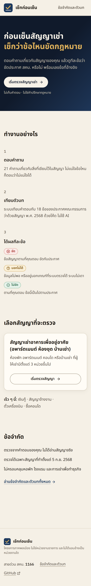 | 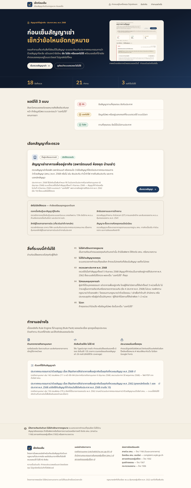 | 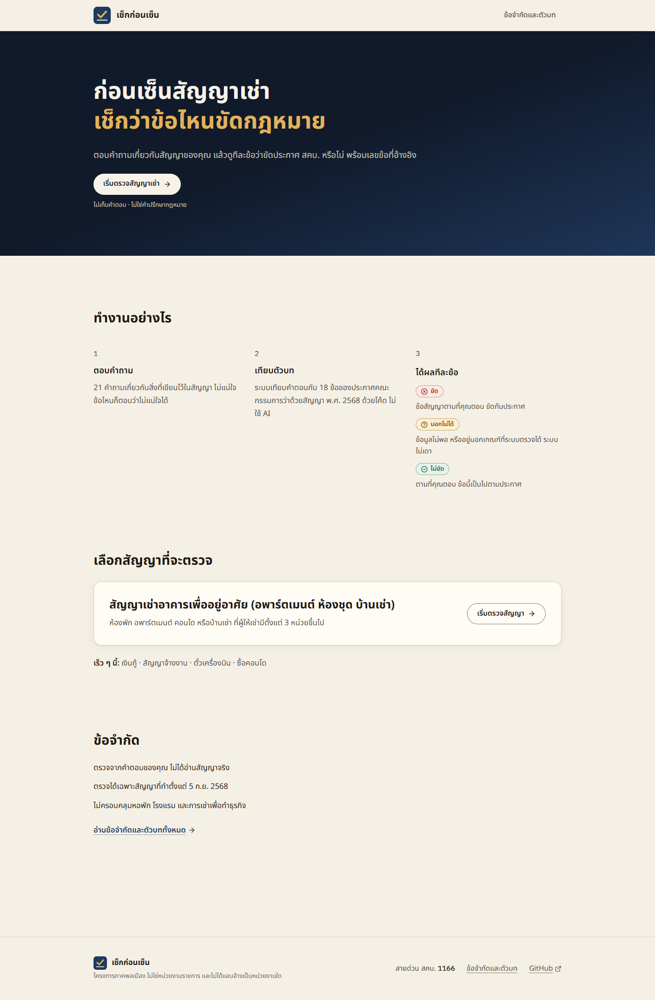 |
| คำถามข้อ 1 | 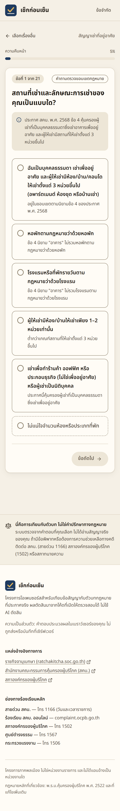 | 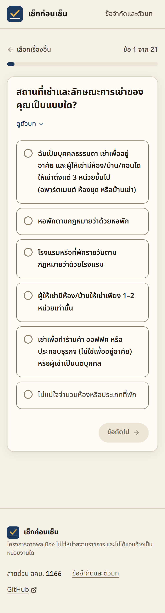 | 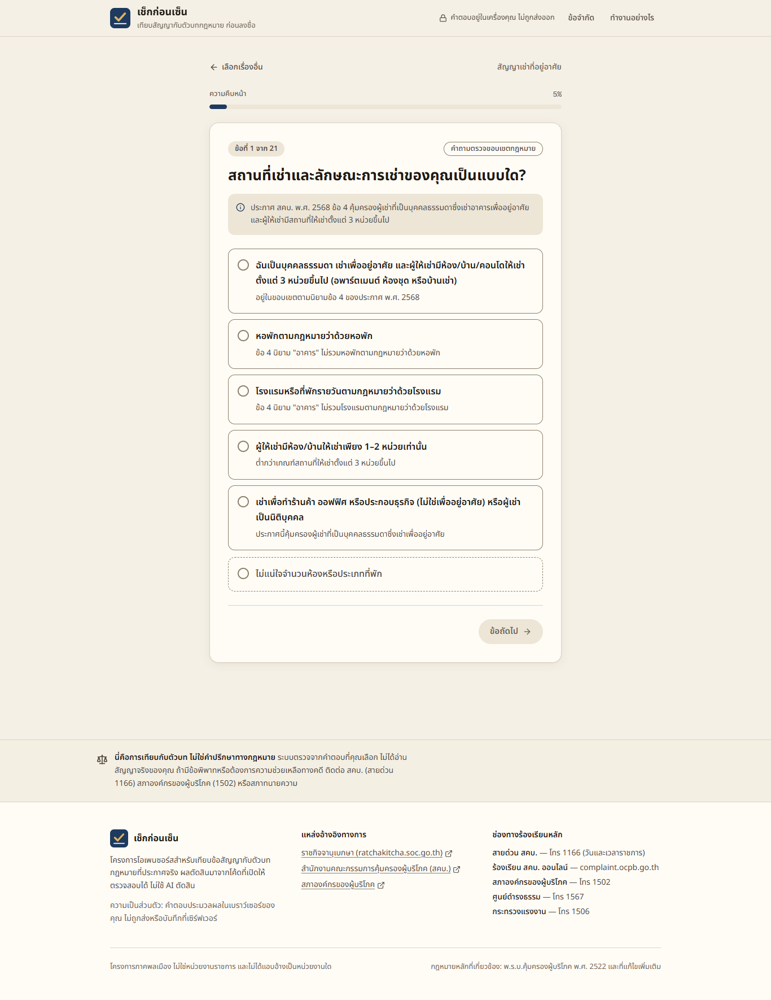 | 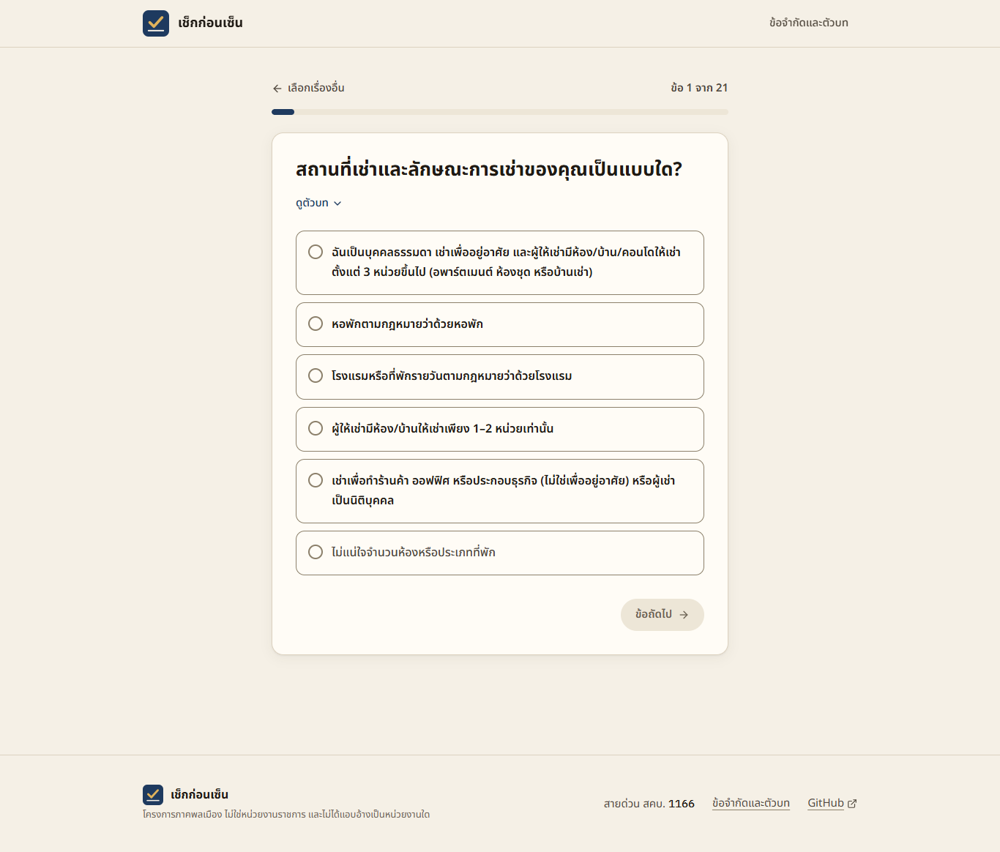 |
| หน้าผล (4 / 11 / 3) |  |  | 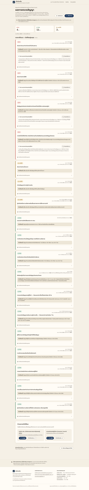 | 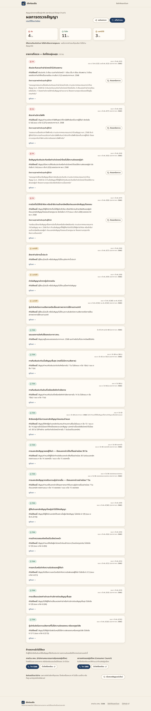 |
| /about | — (404) | 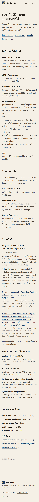 | — (404) | 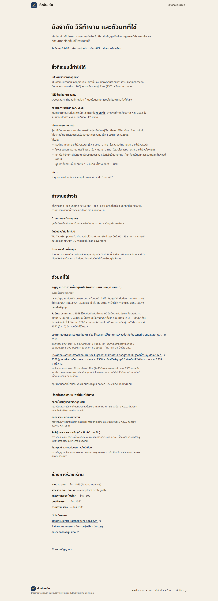 |

**หมายเหตุภาพหน้าผลที่ 375px:**
- ถ่ายที่ความละเอียด 1× ส่วนภาพอื่นที่ 375px เป็น 2×
- เหตุผล: ที่ 2× หน้าผลสูงเกิน 16,384 พิกเซลจริง และ Chrome วาดภาพเต็มหน้าซ้ำเป็นท่อน ภาพจึงดูเหมือนมีหน้าผลสองชุด ตรวจแล้วว่าหน้าเว็บจริงมี `h1` เดียวและ footer เดียว
- ภาพ 2× ชุดแรกจึงถูกแทนด้วยภาพ 1× ทั้งก่อนและหลัง (ภาพก่อนถ่ายใหม่จาก build ของ `main`)

ภาพใน README (`docs/screenshots/readme/`) ถ่ายใหม่ทั้ง 8 ภาพให้ตรงกับหน้าตาปัจจุบัน

## 5. สิ่งที่ตัดสินใจเอง หรือยังไม่ตรงโจทย์ 100%

1. **hero ไม่มีภาพเลย** โจทย์ให้เลือกระหว่างเอาออก กับแทนด้วยภาพตัดเฉพาะส่วนสรุปผล ผมเลือกเอาออก เพราะขั้นตอนที่ 3 แสดงชิปผลตัดสินจริงอยู่แล้ว ภาพตัดจะซ้ำของ และต้องคอยสร้างใหม่ทุกครั้งที่หน้าผลเปลี่ยน
2. **"เร็ว ๆ นี้" ที่ 375px ขึ้น 2 บรรทัด** ข้อความตามตัวอย่างในโจทย์ยาวเกินความกว้างจอ 375px ที่ขนาด 15–16px ผมกันไม่ให้ตัดกลางคำ เช่น "ซื้อ|คอนโด" แล้ว ที่เดสก์ท็อปเป็นบรรทัดเดียว ถ้าต้องการบรรทัดเดียวบนมือถือด้วย ต้องย่อคำ เช่น "จ้างงาน" แทน "สัญญาจ้างงาน"
3. **`text-sm` เปลี่ยนจาก 14px เป็น 15px ทั้งเว็บ** เพื่อให้กฎ ≥ 15px วัดได้ง่าย ข้อความรองใช้ `text-meta` (13px) อย่างเดียว เขียนไว้ใน DESIGN.md §2 แล้ว
4. **หัวข้อหน้าแรก "ทำงานอย่างไร"** ใช้กับ 3 ขั้นตอน ส่วนรายละเอียดเชิงเทคนิคใช้หัวข้อเดียวกันที่ `/about#how`
5. **ลิงก์ GitHub** ชี้ไป `https://github.com/SuphawitBonus/check-before-sign` ตาม repo ที่คุณให้ไว้ตอนต้น
6. **หน้า kit ไม่ได้ทำ** เพราะ `main` ยังไม่มีหน้า `/kit/rental` (งานนั้นอยู่บน branch `kit` ที่ยังไม่ merge) หลักการเดียวกันจึงยังไม่ได้ใช้กับหน้า kit ดูข้อ 6
7. **ป้ายสั้นของเรื่องที่ยังไม่เปิด** เพิ่มเป็นฟิลด์ `soonLabel` ใน `lib/packs/registry.ts` ไม่ได้พิมพ์ไว้ในหน้า

## 6. สิ่งที่ยังไม่ได้ตรวจ / ยังไม่ได้ทำ

1. **branch `kit` จะชนกับ `cleanup`** ทั้งสอง branch แก้ `ResultView`, `OutOfScopeView`, `Footer`, `app/page.tsx` และ `scripts/ui-check.cjs` ถ้าจะใช้ทั้งคู่ ต้อง rebase `kit` บน `cleanup` แล้วใช้หลักเดียวกันกับหน้า kit และกล่องคำถามถึงผู้ให้เช่า เช่น ไม่มีกล่องซ้อน และเส้นประของกล่องชุดเต็มต้องเอาออก ส่วนที่ค้างจากงาน kit ยังอยู่ครบ: เช็กลิสต์และแบบบันทึกเงินประกัน (รอ `content/kit/`), ui-check ส่วน kit และรายงานที่ 4
2. **ตรวจแค่ Chrome บน Windows** ยังไม่ได้ลอง Safari/iOS และ Firefox โดยเฉพาะการตัดคำไทยและ `<details>`
3. **โปรแกรมอ่านหน้าจอจริงยังไม่ได้ลอง** ตรวจแค่ ARIA ใน DOM และการกด Tab
4. **การวัด "ข้อความซ้ำ" นับเฉพาะ 3 กลุ่มที่โจทย์ระบุ** (ความเป็นส่วนตัว คำปรึกษากฎหมาย วันมีผล) ไม่ได้ตรวจทุกประโยคในเว็บ
5. **การวัด "การ์ดแบบเดียว" ตรวจกฎที่วัดได้** คือไม่มีเส้นประ ไม่มีกล่องซ้อน และไม่มีขอบซ้ายสี ส่วนความสม่ำเสมอของการ์ดใช้การดูด้วยตา
6. **จำนวน test 135 บน `/about` พิมพ์ไว้ในโค้ด** (ย้ายมาจากหน้าแรก) ต้องแก้ตามเมื่อจำนวน test เปลี่ยน
7. **ยังไม่ได้ deploy** ภาพตอนแชร์ลิงก์ (OG) ยังเป็นภาพเดิม ไม่ได้สร้างใหม่ ข้อความในภาพยังตรงกับหัวข้อ hero

## 7. ความผิดพลาดระหว่างทาง

- ภาพ "ก่อน" ชุดแรกถ่ายผิด เพราะเซิร์ฟเวอร์ตัวเก่าจากงาน kit ยังเปิดค้างอยู่ที่ port 3020 เซิร์ฟเวอร์ใหม่จึงเปิดไม่ขึ้น และสคริปต์ถ่ายจากตัวเก่า ผมเห็นจาก log ว่า port ถูกใช้อยู่ จึงปิดตัวเก่า ลบภาพชุดนั้น และถ่ายใหม่จาก build ของ `main` แล้วตรวจว่าหน้าที่ถ่ายไม่มีลิงก์ `/kit/rental`
- ตอนทำตารางในข้อ 3 พบว่า footer ใหม่ตัดข้อความ "และไม่ได้แอบอ้างเป็นหน่วยงานใด" หายไป จึงใส่กลับ build ใหม่ แล้วถ่ายภาพหลังแก้และรัน ui-check ใหม่ทั้งหมด

## 8. Output ดิบ

### 8.1 `npm test`

```

> check-before-sign@0.1.0 test
> vitest run

The CJS build of Vite's Node API is deprecated. See https://vite.dev/guide/troubleshooting.html#vite-cjs-node-api-deprecated for more details.

 RUN  v2.1.9 D:/check-before-sign

 ✓ tests/rental-rules.test.ts (83 tests) 29ms
stdout | tests/rental-cases.test.ts > Rental Pack Cases Verification (ชุดตัวอย่างแต่งขึ้น) > summary: all hypothetical cases match expected outputs 100%

========================================
Rental Cases Test Summary: 26 / 26 Cases Passed (100% Match)
All cases are explicitly verified as hypothetical examples.
========================================


 ✓ tests/rental-cases.test.ts (29 tests) 18ms
 ✓ tests/engine.test.ts (23 tests) 39ms

 Test Files  3 passed (3)
      Tests  135 passed (135)
   Start at  06:00:06
   Duration  996ms (transform 297ms, setup 0ms, collect 750ms, tests 87ms, environment 1ms, prepare 673ms)

EXIT 0
```

### 8.2 `npx tsc --noEmit`

(ไม่มี output เมื่อผ่าน บรรทัด EXIT เติมโดยสคริปต์ที่รัน)

```
EXIT 0
```

### 8.3 `npm run build` (build สุดท้าย หลังแก้ footer)

```

> check-before-sign@0.1.0 prebuild
> tsx scripts/validate-packs.ts

[Pack Validator] Scanning packs in: D:\check-before-sign\packs

--> Validating pack: rental
  [OK] pack.json is valid (21 questions, 18 rules)
  [OK] rules.ts exists
  [OK] cases.json is valid (26 test cases, all marked hypothetical)

[Pack Validator] All pack schemas validated successfully!

> check-before-sign@0.1.0 build
> next build

▲ Next.js 16.4.5 (Turbopack)
✓ Running next.config took 15ms

  Creating an optimized production build ...
✓ Compiled successfully in 1238ms
  Running TypeScript ...
  Finished TypeScript in 2.5s ...
  Collecting page data using 10 workers ...
  Generating static pages using 10 workers (0/9) ...
  Generating static pages using 10 workers (2/9) 
  Generating static pages using 10 workers (4/9) 
  Generating static pages using 10 workers (6/9) 
✓ Generating static pages using 10 workers (9/9) in 767ms
  Finalizing page optimization ...

Route (app)
┌ ○ /
├ ○ /_not-found
├ ○ /about
├ ○ /apple-icon.png
├   /check/[packId]
│ └ ● /check/rental
├ ○ /icon.svg
└ ○ /opengraph-image.png


○  (Static)  prerendered as static content
●  (SSG)     prerendered as static HTML (uses generateStaticParams)

EXIT 0
```

### 8.4 `node scripts/ui-check.cjs` (build สุดท้าย, `npm start` :3020)

```
browser: C:/Program Files/Google/Chrome/Application/chrome.exe
PASS  [m375] GET / → 200
PASS  [m375] home has 4 parts before the footer (≤ 4): ก่อนเซ็นสัญญาเช่า
เช็กว่าข้อไหนขัดกฎหมาย | ทำงานอย่างไร | เลือกสัญญาที่จะตรวจ | ข้อจำกัด
PASS  [m375] hero = heading + one sentence + one button, no screenshot (actions 1, paragraphs 1, images 0)
PASS  [m375] hero note reads "ไม่เก็บคำตอบ · ไม่ใช่คำปรึกษากฎหมาย" (got "ไม่เก็บคำตอบ · ไม่ใช่คำปรึกษากฎหมาย")
PASS  [m375] hero heading has no near-empty line (shortest/longest 0.76)
PASS  [m375] the 3 steps include the three verdicts (ขัด / บอกไม่ได้ / ไม่ขัด)
PASS  [m375] rental card description ≤ 2 lines (2)
PASS  [m375] "เร็ว ๆ นี้" is a single line (2 line(s): เร็ว ๆ นี้: เงินกู้ · สัญญาจ้างงาน · ตั๋วเครื่องบิน · ซื้อคอนโด)
PASS  [m375] 3 limits, one line each ([1,1,1])
PASS  [m375] limits link to /about
PASS  [m375] no "Rule Engine" on the home page (kept on /about)
PASS  [m375] no "ครอบคลุม 100%" claim
PASS  [m375] og:image meta present → http://localhost:3020/opengraph-image.png?opengraph-image.243qfygtv2slh.png
INFO  [m375] home scrollHeight = 2403px
PASS  [m375] home: content text ≥15px, secondary (.text-meta) ≥13px
PASS  [m375] home: no dashed borders (0)
PASS  [m375] home: no thick coloured left border
PASS  [m375] home: no boxes or cards inside a card
PASS  [m375] home: "ไม่เก็บ/ไม่ถูกส่ง…" appears at most once (1)
PASS  [m375] home: "ไม่ใช่คำปรึกษา" appears at most once (1)
PASS  [m375] home: the effective date (5 ก.ย. 2568) appears at most once (1)
PASS  [m375] home: one plain footer with สคบ. 1166, /about and GitHub, no disclaimer band ({"tel":true,"about":true,"github":true,"noBand":true,"blocks":1})
PASS  [m375] home: header links to /about
PASS  [m375] home: no horizontal scroll (scrollWidth 375 <= clientWidth 375)
PASS  [m375] home: every text meets WCAG AA contrast
PASS  [m375] GET /check/rental → 200
PASS  [m375] question 1: "ข้อ 1 จาก 21" + progress bar, no percentage (step "ข้อ 1 จาก 21", % shown: false)
PASS  [m375] question 1: no legal text under options before choosing; question background behind "ดูตัวบท" (closed)
PASS  [m375] question 1: content text ≥15px, secondary (.text-meta) ≥13px
PASS  [m375] question 1: no dashed borders (0)
PASS  [m375] question 1: no thick coloured left border
PASS  [m375] question 1: no boxes or cards inside a card
PASS  [m375] question 1: "ไม่เก็บ/ไม่ถูกส่ง…" appears at most once (0)
PASS  [m375] question 1: "ไม่ใช่คำปรึกษา" appears at most once (0)
PASS  [m375] question 1: the effective date (5 ก.ย. 2568) appears at most once (0)
PASS  [m375] question 1: one plain footer with สคบ. 1166, /about and GitHub, no disclaimer band ({"tel":true,"about":true,"github":true,"noBand":true,"blocks":1})
PASS  [m375] question 1: header links to /about
PASS  [m375] question 1: every text meets WCAG AA contrast
PASS  [m375] question 1: after choosing, legal text shows only under the chosen option (1)
PASS  [m375] normal: question 2 (contract date) shown after scope
PASS  [m375] normal: continues to question 3 of 21 (got {"n":3,"of":21})
PASS  [m375] normal: reached the result page after all 21 questions
PASS  [m375] normal: no "ended early" box on the normal path
PASS  [m375] ended early: result page shown immediately after question 2
PASS  [m375] ended early: box shown, counters [0,0,18] (want [0,0,18])
PASS  [m375] ended-early result: content text ≥15px, secondary (.text-meta) ≥13px
PASS  [m375] ended-early result: no dashed borders (0)
PASS  [m375] ended-early result: no thick coloured left border
PASS  [m375] ended-early result: no boxes or cards inside a card
PASS  [m375] ended-early result: "ไม่เก็บ/ไม่ถูกส่ง…" appears at most once (1)
PASS  [m375] ended-early result: "ไม่ใช่คำปรึกษา" exactly once, right under the result summary (1)
PASS  [m375] ended-early result: the effective date (5 ก.ย. 2568) appears at most once (0)
PASS  [m375] ended-early result: one plain footer with สคบ. 1166, /about and GitHub, no disclaimer band ({"tel":true,"about":true,"github":true,"noBand":true,"blocks":1})
PASS  [m375] ended-early result: header links to /about
PASS  [m375] ended-early result: every text meets WCAG AA contrast
PASS  [m375] mixed result: counters ขัด/ไม่ขัด/บอกไม่ได้ = [4,11,3] (want [4,11,3])
PASS  [m375] mixed result: ขัด first; every verdict chip has an icon and a word
PASS  [m375] mixed result: clause numbers in "IBM Plex Mono"; no Thai numerals
PASS  [m375] mixed result: content text ≥15px, secondary (.text-meta) ≥13px
PASS  [m375] mixed result: no dashed borders (0)
PASS  [m375] mixed result: no thick coloured left border
PASS  [m375] mixed result: no boxes or cards inside a card
PASS  [m375] mixed result: "ไม่เก็บ/ไม่ถูกส่ง…" appears at most once (1)
PASS  [m375] mixed result: "ไม่ใช่คำปรึกษา" exactly once, right under the result summary (1)
PASS  [m375] mixed result: the effective date (5 ก.ย. 2568) appears at most once (0)
PASS  [m375] mixed result: one plain footer with สคบ. 1166, /about and GitHub, no disclaimer band ({"tel":true,"about":true,"github":true,"noBand":true,"blocks":1})
PASS  [m375] mixed result: header links to /about
PASS  [m375] mixed result: no horizontal scroll (scrollWidth 375 <= clientWidth 375)
PASS  [m375] mixed result: every text meets WCAG AA contrast
PASS  [m375] GET /about → 200
PASS  [m375] /about contains all 44 moved items
PASS  [m375] /about has limits, how, sources and complaints sections (limits, how, sources, complaints)
PASS  [m375] /about links to ratchakitcha.soc.go.th (2)
PASS  [m375] /about: content text ≥15px, secondary (.text-meta) ≥13px
PASS  [m375] /about: no dashed borders (0)
PASS  [m375] /about: no thick coloured left border
PASS  [m375] /about: no boxes or cards inside a card
PASS  [m375] /about: "ไม่เก็บ/ไม่ถูกส่ง…" appears at most once (1)
PASS  [m375] /about: "ไม่ใช่คำปรึกษา" appears at most once (1)
PASS  [m375] /about: the effective date (5 ก.ย. 2568) appears at most once (1)
PASS  [m375] /about: one plain footer with สคบ. 1166, /about and GitHub, no disclaimer band ({"tel":true,"about":true,"github":true,"noBand":true,"blocks":1})
PASS  [m375] /about: header links to /about
PASS  [m375] /about: no horizontal scroll (scrollWidth 375 <= clientWidth 375)
PASS  [m375] /about: every text meets WCAG AA contrast
PASS  [m375] GET /check/ไม่มีอยู่จริง → HTTP 404
PASS  [m375] 404 page shows the Thai not-found message
PASS  [m375] 404: content text ≥15px, secondary (.text-meta) ≥13px
PASS  [m375] 404: no dashed borders (0)
PASS  [m375] 404: no thick coloured left border
PASS  [m375] 404: no boxes or cards inside a card
PASS  [m375] 404: "ไม่เก็บ/ไม่ถูกส่ง…" appears at most once (0)
PASS  [m375] 404: "ไม่ใช่คำปรึกษา" appears at most once (0)
PASS  [m375] 404: the effective date (5 ก.ย. 2568) appears at most once (0)
PASS  [m375] 404: one plain footer with สคบ. 1166, /about and GitHub, no disclaimer band ({"tel":true,"about":true,"github":true,"noBand":true,"blocks":1})
PASS  [m375] 404: header links to /about
PASS  [m375] 404: every text meets WCAG AA contrast
PASS  [m375] GET /favicon.ico → 200 image/x-icon
PASS  [m375] GET /icon.svg → 200 image/svg+xml
PASS  [m375] GET /apple-icon.png → 200 image/png
PASS  [m375] GET /opengraph-image.png → 200 image/png
PASS  [m375] no requests leave the site (fonts self-hosted, no Google Fonts): none
INFO  [m375] responses >= 400: 404 http://localhost:3020/check/ไม่มีอยู่จริง
PASS  [m375] no unexpected failed requests (only the deliberate 404 page): none
INFO  [m375] browser console errors: 1 → Failed to load resource: the server responded with a status of 404 (Not Found)
PASS  [m375] no JavaScript errors in the console (the deliberate 404 load excluded)
PASS  [d1366] GET / → 200
PASS  [d1366] home has 4 parts before the footer (≤ 4): ก่อนเซ็นสัญญาเช่า
เช็กว่าข้อไหนขัดกฎหมาย | ทำงานอย่างไร | เลือกสัญญาที่จะตรวจ | ข้อจำกัด
PASS  [d1366] hero = heading + one sentence + one button, no screenshot (actions 1, paragraphs 1, images 0)
PASS  [d1366] hero note reads "ไม่เก็บคำตอบ · ไม่ใช่คำปรึกษากฎหมาย" (got "ไม่เก็บคำตอบ · ไม่ใช่คำปรึกษากฎหมาย")
PASS  [d1366] hero heading has no near-empty line (shortest/longest 0.76)
PASS  [d1366] the 3 steps include the three verdicts (ขัด / บอกไม่ได้ / ไม่ขัด)
PASS  [d1366] rental card description ≤ 2 lines (1)
PASS  [d1366] "เร็ว ๆ นี้" is a single line (1 line(s): เร็ว ๆ นี้: เงินกู้ · สัญญาจ้างงาน · ตั๋วเครื่องบิน · ซื้อคอนโด)
PASS  [d1366] 3 limits, one line each ([1,1,1])
PASS  [d1366] limits link to /about
PASS  [d1366] no "Rule Engine" on the home page (kept on /about)
PASS  [d1366] no "ครอบคลุม 100%" claim
PASS  [d1366] og:image meta present → http://localhost:3020/opengraph-image.png?opengraph-image.243qfygtv2slh.png
INFO  [d1366] home scrollHeight = 2084px
PASS  [d1366] home: content text ≥15px, secondary (.text-meta) ≥13px
PASS  [d1366] home: no dashed borders (0)
PASS  [d1366] home: no thick coloured left border
PASS  [d1366] home: no boxes or cards inside a card
PASS  [d1366] home: "ไม่เก็บ/ไม่ถูกส่ง…" appears at most once (1)
PASS  [d1366] home: "ไม่ใช่คำปรึกษา" appears at most once (1)
PASS  [d1366] home: the effective date (5 ก.ย. 2568) appears at most once (1)
PASS  [d1366] home: one plain footer with สคบ. 1166, /about and GitHub, no disclaimer band ({"tel":true,"about":true,"github":true,"noBand":true,"blocks":1})
PASS  [d1366] home: header links to /about
PASS  [d1366] home: no horizontal scroll (scrollWidth 1366 <= clientWidth 1366)
PASS  [d1366] home: every text meets WCAG AA contrast
PASS  [d1366] GET /check/rental → 200
PASS  [d1366] question 1: "ข้อ 1 จาก 21" + progress bar, no percentage (step "ข้อ 1 จาก 21", % shown: false)
PASS  [d1366] question 1: no legal text under options before choosing; question background behind "ดูตัวบท" (closed)
PASS  [d1366] question 1: content text ≥15px, secondary (.text-meta) ≥13px
PASS  [d1366] question 1: no dashed borders (0)
PASS  [d1366] question 1: no thick coloured left border
PASS  [d1366] question 1: no boxes or cards inside a card
PASS  [d1366] question 1: "ไม่เก็บ/ไม่ถูกส่ง…" appears at most once (0)
PASS  [d1366] question 1: "ไม่ใช่คำปรึกษา" appears at most once (0)
PASS  [d1366] question 1: the effective date (5 ก.ย. 2568) appears at most once (0)
PASS  [d1366] question 1: one plain footer with สคบ. 1166, /about and GitHub, no disclaimer band ({"tel":true,"about":true,"github":true,"noBand":true,"blocks":1})
PASS  [d1366] question 1: header links to /about
PASS  [d1366] question 1: every text meets WCAG AA contrast
PASS  [d1366] question 1: after choosing, legal text shows only under the chosen option (1)
PASS  [d1366] keyboard: Tab reaches the first answer option
PASS  [d1366] keyboard: Tab visits all 6 options in order (incl. "ไม่แน่ใจ")
PASS  [d1366] keyboard: each focused option shows a solid ≥3px focus ring
PASS  [d1366] keyboard: Space selects the focused option (aria-pressed=true)
PASS  [d1366] keyboard: Enter on "ข้อถัดไป" opens question 2
PASS  [d1366] normal: question 2 (contract date) shown after scope
PASS  [d1366] normal: continues to question 3 of 21 (got {"n":3,"of":21})
PASS  [d1366] normal: reached the result page after all 21 questions
PASS  [d1366] normal: no "ended early" box on the normal path
PASS  [d1366] ended early: result page shown immediately after question 2
PASS  [d1366] ended early: box shown, counters [0,0,18] (want [0,0,18])
PASS  [d1366] ended-early result: content text ≥15px, secondary (.text-meta) ≥13px
PASS  [d1366] ended-early result: no dashed borders (0)
PASS  [d1366] ended-early result: no thick coloured left border
PASS  [d1366] ended-early result: no boxes or cards inside a card
PASS  [d1366] ended-early result: "ไม่เก็บ/ไม่ถูกส่ง…" appears at most once (1)
PASS  [d1366] ended-early result: "ไม่ใช่คำปรึกษา" exactly once, right under the result summary (1)
PASS  [d1366] ended-early result: the effective date (5 ก.ย. 2568) appears at most once (0)
PASS  [d1366] ended-early result: one plain footer with สคบ. 1166, /about and GitHub, no disclaimer band ({"tel":true,"about":true,"github":true,"noBand":true,"blocks":1})
PASS  [d1366] ended-early result: header links to /about
PASS  [d1366] ended-early result: every text meets WCAG AA contrast
PASS  [d1366] mixed result: counters ขัด/ไม่ขัด/บอกไม่ได้ = [4,11,3] (want [4,11,3])
PASS  [d1366] mixed result: ขัด first; every verdict chip has an icon and a word
PASS  [d1366] mixed result: clause numbers in "IBM Plex Mono"; no Thai numerals
PASS  [d1366] mixed result: content text ≥15px, secondary (.text-meta) ≥13px
PASS  [d1366] mixed result: no dashed borders (0)
PASS  [d1366] mixed result: no thick coloured left border
PASS  [d1366] mixed result: no boxes or cards inside a card
PASS  [d1366] mixed result: "ไม่เก็บ/ไม่ถูกส่ง…" appears at most once (1)
PASS  [d1366] mixed result: "ไม่ใช่คำปรึกษา" exactly once, right under the result summary (1)
PASS  [d1366] mixed result: the effective date (5 ก.ย. 2568) appears at most once (0)
PASS  [d1366] mixed result: one plain footer with สคบ. 1166, /about and GitHub, no disclaimer band ({"tel":true,"about":true,"github":true,"noBand":true,"blocks":1})
PASS  [d1366] mixed result: header links to /about
PASS  [d1366] mixed result: no horizontal scroll (scrollWidth 1366 <= clientWidth 1366)
PASS  [d1366] mixed result: every text meets WCAG AA contrast
PASS  [d1366] GET /about → 200
PASS  [d1366] /about contains all 44 moved items
PASS  [d1366] /about has limits, how, sources and complaints sections (limits, how, sources, complaints)
PASS  [d1366] /about links to ratchakitcha.soc.go.th (2)
PASS  [d1366] /about: content text ≥15px, secondary (.text-meta) ≥13px
PASS  [d1366] /about: no dashed borders (0)
PASS  [d1366] /about: no thick coloured left border
PASS  [d1366] /about: no boxes or cards inside a card
PASS  [d1366] /about: "ไม่เก็บ/ไม่ถูกส่ง…" appears at most once (1)
PASS  [d1366] /about: "ไม่ใช่คำปรึกษา" appears at most once (1)
PASS  [d1366] /about: the effective date (5 ก.ย. 2568) appears at most once (1)
PASS  [d1366] /about: one plain footer with สคบ. 1166, /about and GitHub, no disclaimer band ({"tel":true,"about":true,"github":true,"noBand":true,"blocks":1})
PASS  [d1366] /about: header links to /about
PASS  [d1366] /about: no horizontal scroll (scrollWidth 1366 <= clientWidth 1366)
PASS  [d1366] /about: every text meets WCAG AA contrast
PASS  [d1366] GET /check/ไม่มีอยู่จริง → HTTP 404
PASS  [d1366] 404 page shows the Thai not-found message
PASS  [d1366] 404: content text ≥15px, secondary (.text-meta) ≥13px
PASS  [d1366] 404: no dashed borders (0)
PASS  [d1366] 404: no thick coloured left border
PASS  [d1366] 404: no boxes or cards inside a card
PASS  [d1366] 404: "ไม่เก็บ/ไม่ถูกส่ง…" appears at most once (0)
PASS  [d1366] 404: "ไม่ใช่คำปรึกษา" appears at most once (0)
PASS  [d1366] 404: the effective date (5 ก.ย. 2568) appears at most once (0)
PASS  [d1366] 404: one plain footer with สคบ. 1166, /about and GitHub, no disclaimer band ({"tel":true,"about":true,"github":true,"noBand":true,"blocks":1})
PASS  [d1366] 404: header links to /about
PASS  [d1366] 404: every text meets WCAG AA contrast
PASS  [d1366] GET /favicon.ico → 200 image/x-icon
PASS  [d1366] GET /icon.svg → 200 image/svg+xml
PASS  [d1366] GET /apple-icon.png → 200 image/png
PASS  [d1366] GET /opengraph-image.png → 200 image/png
PASS  [d1366] no requests leave the site (fonts self-hosted, no Google Fonts): none
INFO  [d1366] responses >= 400: 404 http://localhost:3020/check/ไม่มีอยู่จริง
PASS  [d1366] no unexpected failed requests (only the deliberate 404 page): none
INFO  [d1366] browser console errors: 1 → Failed to load resource: the server responded with a status of 404 (Not Found)
PASS  [d1366] no JavaScript errors in the console (the deliberate 404 load excluded)
EXIT 0
```
